## भाग 1: परिचय एवं गणित की शुरुआत

> यह SUPER TET 2026 Mock Test-06 के Paper Analysis + Complete Answer Key का भाग 1 है। इस भाग में शिक्षक द्वारा गणित के प्रारंभिक प्रश्नों (प्रश्न 41 से आगे) का विस्तृत विश्लेषण किया गया है।

---

### इस भाग में क्या है

- शिक्षक का स्वागत, प्रेरणा और पेपर का ओवरऑल फीडबैक
- मॉक टेस्ट की रणनीति और परीक्षा में प्रश्नों के दोहराव पर चर्चा
- गणित के टॉप प्रश्नों का Step-by-Step हल — चक्रीय चतुर्भुज, घातांक, बहुलक, अनुपात, गुणन श्रेणी, स्पर्श-छेदक प्रमेय
- हर प्रश्न के लिए विकल्प परीक्षण (बाय ऑप्शन) बनाम बेसिक विधि की तुलना

---

### शिक्षक का परिचय एवं प्रेरणा संदेश

- शिक्षक ने सभी विद्यार्थियों को नमस्कार के साथ स्वागत किया और कहा कि Mock Test-06 बहुत अच्छा गया होगा और पेपर देखकर आत्मविश्वास बढ़ा होगा।
- मॉक टेस्ट को गंभीर वातावरण में देने की सलाह दी — जो प्रश्न आ गया वह बहुत बढ़िया, जो नहीं आया वह सीखने का अवसर है।
- बताया कि गणित के टॉप 20 प्रश्नों में 1-2 प्रश्न थोड़े सोचने वाले थे, लेकिन वे पहले से ही परीक्षा में आते रहे हैं। यदि तरीका पहले से पता हो तो तुरंत हल हो जाता है, नहीं तो परीक्षा में समय फँसता है जबकि प्रतिस्पर्धी आगे निकल जाता है।
- आगे की योजना बताई — पहले गणित के मुख्य प्रश्न, फिर रीजनिंग के टॉप 5 प्रश्न, उसी क्रम में पूरा गणित + रीजनिंग खंड पूरा करेंगे।
- सभी से वीडियो को शेयर करने का आग्रह किया ताकि सभी साथी इस सेशन से जुड़ सकें।
- UPTET में सफल सभी बच्चों को बधाई दी और वही प्रदर्शन SUPER TET में दोहराने की शुभकामना दी।
- शिक्षक का गला बैठा होने के बावजूद निरंतर पढ़ाने की प्रतिबद्धता जताई और ज्ञान गंगा परिवार के सभी शिक्षकों की मेहनत का उल्लेख किया।
- ऑफलाइन क्लास के लिए पता बताया — मनीष बंद रोड, यूनिवर्सिटी गेट के ठीक सामने, बंद रोड पर ज्ञान गंगा कोचिंग इंस्टिट्यूट, मेन ब्रांच / हेड ऑफिस।
- रक्षाबंधन ऑफर की जानकारी दी — 28 अगस्त से नए बैच शुरू, TGT/PGT / सामान्य अध्ययन (GS सेपरेट बैच) और SUPER TET की तैयारी न्यूनतम शुल्क 1199 रुपये में सभी विषयों के साथ। ज्ञान गंगा ऑफिशियल ऐप या दिए गए नंबरों पर संपर्क करने को कहा।

---

### पेपर पैटर्न पर शिक्षक की टिप्पणी

- गणित में ज्योमेट्री → विशेषकर वृत्त (Circle) से हर साल नया प्रश्न पूछा जाता है। आयोग अभी ज्योमेट्री के सभी एंगल कवर नहीं कर पाया है, इसलिए मेन्सुरेशन और वृत्त से प्रश्न आने की संभावना सबसे अधिक रहती है।
- घातांक (Indices/Exponents) आयोग का पसंदीदा टॉपिक है — समीकरण पर आधारित प्रश्न YouTube की डेली क्लास में भी पढ़ाए जाएंगे।
- श्रेणी/गुणनफल (Series/Product) और सांख्यिकी (बहुलक/मोड) जैसे छोटे टॉपिक भी नियमित रूप से आते हैं और 1-2 सेकंड में हल हो सकते हैं यदि कॉन्सेप्ट पता हो।
- कई प्रश्नों में विकल्प परीक्षण सबसे तेज़ विधि है — बेसिक विधि में दो बोर्ड भर जाएंगे, जबकि बाय ऑप्शन चुटकियों में उत्तर मिल जाता है।

---

### प्रश्नवार विस्तृत विश्लेषण

### प्रश्न 41: चक्रीय चतुर्भुज — क्रमित युग्म (x, y) ज्ञात करना

**प्रश्न:** दिए गए चित्र में ABCD एक चक्रीय चतुर्भुज है जिसके चारों शीर्ष वृत्त की परिधि पर स्थित हैं। चित्र में कोणों के मान इस प्रकार दिए गए हैं — कोण A = 7x + 5, कोण C = 3y − 5, कोण B = 4x, कोण D = 4y + 20 । तब क्रमित युग्म (x, y) क्या है?

**विकल्प:** A) x = 15, y = 25  B) x = 25, y = 15  C) x = 15, y = 15  D) x = 25, y = 25
> नोट — ट्रांसक्रिप्ट में क्रमित युग्म xy की प्रिंटिंग में हल्का मिसप्रिंट बताया गया, पेपर में प्रश्न सही था। विकल्पों का क्रम शिक्षक द्वारा ए/सी और डी के उल्लेख से पुनर्निर्मित है। सही उत्तर ए है।

**सही उत्तर:** A) x = 15, y = 25

**हल:**

- चक्रीय चतुर्भुज की परिभाषा — ऐसा चतुर्भुज जिसके चारों शीर्ष वृत्त की परिधि पर हों। चार भुजाएँ, चार शीर्ष।
- मुख्य गुण — सम्मुख (विपरीत) कोणों का योग 180° होता है।
  - कोण A + कोण C = 180°
  - कोण B + कोण D = 180°

- पहला समीकरण (A + C):
  - (7x + 5) + (3y − 5) = 180
  - −5 और +5 कट गए → 7x + 3y = 180  → समीकरण (1)

- दूसरा समीकरण (B + D):
  - 4x + (4y + 20) = 180
  - 4x + 4y = 160 → 4 से भाग देने पर x + y = 40  → समीकरण (2)

- समीकरण (1) और (2) को हल करना:
  - (2) को 3 से गुणा करें → 3x + 3y = 120  → समीकरण (2a)
  - (1) − (2a): (7x + 3y) − (3x + 3y) = 180 − 120 → 4x = 60 → x = 15
  - x = 15 को (2) में रखें → 15 + y = 40 → y = 25
  - अतः क्रमित युग्म (15, 25)

**विकल्प से सत्यापन (शिक्षक द्वारा सुझाई गई तेज़ विधि):**

- विकल्प A लें — x = 15, y = 25:
  - 7x + 5 = 105 + 5 = 110 , 3y − 5 = 75 − 5 = 70 → 110 + 70 = 180 ✓
  - 4x = 60 , 4y + 20 = 100 + 20 = 120 → 60 + 120 = 180 ✓
  - दोनों जोड़े 180, इसलिए चक्रीय चतुर्भुज की शर्त पूरी।
- यदि केवल एक जोड़ा 180 आए तो भी गारंटी नहीं — दोनों सम्मुख युग्मों का योग 180 आना चाहिए। विकल्प D (उदाहरण) दोनों शर्तें पूरी नहीं करता।

**ट्रिक / कॉन्सेप्ट:**

- कॉन्सेप्ट — चक्रीय चतुर्भुज में सम्मुख कोण संपूरक होते हैं।
- ट्रिक — दो चर, दो समीकरण बनते ही हैं — सीधे जोड़कर हल करें। परीक्षा में इससे भी तेज़ है विकल्प रखकर दोनों युग्मों का योग 180 चेक करना।

**परीक्षा में महत्व:**

- अत्यंत महत्वपूर्ण — PYQ में भी आया हुआ प्रश्न। बेसिक पता हो तो 20-30 सेकंड में हल, नहीं तो समय अधिक लगेगा। आयोग चक्रीय चतुर्भुज से नियमित प्रश्न पूछता है।

---

### प्रश्न 42: घातांक समीकरण — x का मान (विकल्प परीक्षण)

**प्रश्न:** घातांक पर आधारित समीकरण दिया गया है — 3 की घातों वाला समीकरण (स्वरूप: 3^(2x+1) − 3^x = 3^(x+3) − 9 के जैसा, ट्रांसक्रिप्ट में आंशिक रूप से सुनाई दिया)। x का मान बताइए।

**विकल्प:** A) 0  B) 1  C) −2  D) 2

**सही उत्तर:** D) 2

**हल — शिक्षक ने बेसिक की जगह विकल्प परीक्षण (बाय ऑप्शन) से समझाया:**

- बेसिक से दो बोर्ड भर जाएंगे, विकल्प से चुटकियों में हल होगा।

- x = 0 रखकर देखें:
  - बायाँ पक्ष → 3^(1) − 3^0 = 3 − 1 = 2
  - दायाँ पक्ष → 3^3 − 9 = 27 − 9 = 18
  - 2 ≠ 18 → A सही नहीं।

- x = 1 रखकर देखें:
  - बायाँ पक्ष → 3^(3) − 3^1 = 27 − 3 = 24
  - दायाँ पक्ष → 3^4 − 9 = 81 − 9 = 72
  - 24 ≠ 72 → B सही नहीं।

- x = −2 रखकर देखें:
  - बायाँ पक्ष → 3^(−3) − 3^(−2) = 1/27 − 1/9 = भिन्न में मान
  - दायाँ पक्ष → 3^(1) − 9 = 3 − 9 = −6 (पूर्णांक)
  - भिन्न ≠ पूर्णांक → C सही नहीं।
  - शिक्षक ने समझाया — घात ऋणात्मक हो तो 1 / 3^घात के रूप में लिखें, तुरंत स्पष्ट होता है कि बराबरी नहीं है।

- x = −2 गलत होने पर शेष विकल्प D स्वतः सही — फिर भी सत्यापन:
  - x = 2 → बायाँ पक्ष 3^(5) − 3^2 = 243 − 9 = 234 , दायाँ पक्ष 3^(5) − 9 = 243 − 9 = 234 → दोनों बराबर ✓

**ट्रिक / कॉन्सेप्ट:**

- कॉन्सेप्ट — घातांक समीकरणों में विकल्प परीक्षण सबसे व्यावहारिक। घात ऋणात्मक हो तो भिन्न रूप में बदलें।
- ट्रिक — 0, 1, −2 को क्रम से चेक करें — पहले ही तीन विकल्प कटते ही चौथा स्वतः उत्तर।

**परीक्षा में महत्व:**

- इस पूरे टेस्ट का सबसे अच्छा प्रश्न बताया गया। घातांक आयोग का पसंदीदा टॉपिक है, समीकरण वाले प्रश्न बार-बार आते हैं। बाय ऑप्शन आना ही चाहिए।

---

### प्रश्न 43: सांख्यिकी — बहुलक (Mode)

**प्रश्न:** एक मासिक परीक्षा में 16 विद्यार्थियों के गणित में प्राप्तांक दिए गए हैं (डेटा में 0, 2, 3, 4, 5, 6, 7, 8 जैसे मान शामिल)। बहुलक (Mode) क्या होगा?

**विकल्प:** A) 3  B) 5  C) 6  D) 0
> मूल डेटा पेपर में सूचीबद्ध था; शिक्षक ने आवृत्ति गिनकर बताया।

**सही उत्तर:** B) 5

**हल:**

- बहुलक की परिभाषा — सबसे अधिक बार आने वाला मान, सर्वाधिक आवृत्ति वाला पद।

- आवृत्ति तालिका (शिक्षक द्वारा गिनती):

| प्राप्तांक | आवृत्ति |
| --- | --- |
| 0 | 2 बार |
| 2 | 2 बार |
| 3 | 3 बार |
| 4 | 1 बार |
| 5 | 4 बार |
| 6 | 2 बार |
| 7 | 1 बार |
| 8 | 1 बार |

- कुल 16 प्रविष्टियाँ — सबसे अधिक आवृत्ति 5 की है (4 बार)।
- अतः बहुलक = 5

**ट्रिक / कॉन्सेप्ट:**

- कॉन्सेप्ट — Mode = Maximum Frequency वाला मान। Mean/Median से भ्रमित न हों।
- ट्रिक — गिनती को व्यवस्थित तालिका में लिखें, तुरंत दिख जाता है।

**परीक्षा में महत्व:**

- बहुत आसान और निश्चित अंक वाला प्रश्न। सांख्यिकी से हर साल 1 प्रश्न आता है, 10 सेकंड में हल होना चाहिए।

---

### प्रश्न 44: प्रतिशत / अनुपात — a : b ज्ञात करना

**प्रश्न:** यदि (प्रतिशत वाला संबंध) दिया गया हो — जैसे a और b पर प्रतिशत का समीकरण (ट्रांसक्रिप्ट में "परसेंटेज से परसेंटेज कट गया, 6×3=18, 6×5=30" का उल्लेख), तो a : b का अनुपात बताइए।

**विकल्प:** A) 1 : 4  B) 4 : 1  C) 2 : 3  D) 3 : 2

**सही उत्तर:** A) 1 : 4

**हल — शिक्षक के अनुसार:**

- प्रतिशत चिन्ह दोनों ओर से कट गया, 6 से काटने पर 18 और 30 जैसी संख्याएँ मिलीं।
- अंदर गुणा करने पर:
  - 5b − 5a = 3a + 3b
- पक्षांतरण:
  - b वाले पद एक ओर, a वाले एक ओर
  - 5b − 3b = 3a + 5a → 2b = 8a
  - b / a = 8 / 2 = 4 / 1 → b : a = 4 : 1
- पूछा गया a : b → इसलिए a : b = 1 : 4
- शिक्षक ने विशेष चेतावनी दी — विकल्प में 1:4 और 4:1 दोनों होने पर ध्यान दें कि किसका किससे अनुपात पूछा गया है। a पहले है तो a = 1, b = 4।

**ट्रिक / कॉन्सेप्ट:**

- कॉन्सेप्ट — प्रतिशत समीकरण में पहले प्रतिशत हटाएँ, फिर कोष्ठक खोलकर पक्षांतरण करें।
- ट्रिक — a:b पूछा है तो अंतिम अनुपात को उलटा न करें; b:a = 4:1 है तो a:b = 1:4।

**परीक्षा में महत्व:**

- अनुपात-प्रतिशत का यह रूप हर परीक्षा में आता है। 30-40 सेकंड का प्रश्न, लेकिन विकल्प के क्रम से भ्रम पैदा किया जाता है।

---

### प्रश्न 45: गुणन श्रेणी (Telescoping Product)

**प्रश्न:** श्रेणी का मान ज्ञात कीजिए — (4/5) × (5/6) × (6/7) × ... × (99/100) = ?

> ट्रांसक्रिप्ट में "5 में एक गया चार → 4/5, 6 में एक गया 5 → 5/6, 7 में एक गया 6 → 6/7 ... 100 में एक गया 99 → 99/100" के रूप में समझाया गया।

**विकल्प:** A) 1/20  B) 1/25  C) 4/100  D) 99/5

**सही उत्तर:** B) 1/25

**हल:**

- श्रेणी का प्रत्येक पद (n−1)/n के रूप में है, n = 5 से 100 तक।
- गुणनफल लिखें: (4/5) × (5/6) × (6/7) × (7/8) × ... × (99/100)
- देखें कि पहले पद का हर अगले पद के अंश को काट रहा है:
  - 5 से 5 कटा, 6 से 6 कटा, 7 से 7 कटा ... 99 तक सब कट गए।
- केवल पहला अंश 4 और अंतिम हर 100 शेष बचा → 4/100
- सरल करें: 4/100 = 1/25

**ट्रिक / कॉन्सेप्ट:**

- कॉन्सेप्ट — Telescoping Product — अंश → अगले हर से निरस्त।
- ट्रिक — पूरा गुणा न करें, केवल किनारे के पद बचते हैं — पहला अंश और अंतिम हर।

**परीक्षा में महत्व:**

- श्रेणी का यह पैटर्न बहुत बार पूछा जाता है। पहचानते ही 5 सेकंड में उत्तर।

---

### प्रश्न 46: वृत्त — स्पर्श रेखा और छेदक रेखा प्रमेय

**प्रश्न:** दिए गए चित्र में PAB वृत्त की छेदक रेखा (Secant) है और PT स्पर्श रेखा (Tangent) है। PT = 5, PA = 3 दिया गया है, तो AB की लंबाई क्या है?

**विकल्प:** A) 25/3  B) 9/25  C) 16/3  D) 3/16

**सही उत्तर:** C) 16/3

**हल:**

- प्रमेय याद रखें — यदि बाहरी बिंदु P से एक स्पर्श रेखा PT और एक छेदक PAB खींची जाए तो:
  - PT² = PA × PB
- चित्र को याद रखें — P बाहर, PT वृत्त को केवल छू रही है, PAB वृत्त को काटकर निकल रही है।

- मान रखें: PT² = 5² = 25, PA = 3
- 25 = 3 × PB → PB = 25/3
- AB = PB − PA (क्योंकि P → A → B क्रम में हैं)
- AB = 25/3 − 3 = 25/3 − 9/3 = 16/3

**ट्रिक / कॉन्सेप्ट:**

- कॉन्सेप्ट — Tangent-Secant Theorem: PT² = PA × PB
- ट्रिक — PB निकालकर PA घटाना है — सीधे PB को उत्तर न मान लें।

**परीक्षा में महत्व:**

- ज्योमेट्री में वृत्त से हर साल ऐसा प्रश्न आता है। प्रमेय पता हो तो 15 सेकंड में हल, नहीं तो कोई सूत्र काम नहीं करेगा — इसलिए यह प्रमेय रट लें।

---

### प्रश्न 47: घातांक — घातों के बीच ब्रैकेट का नियम और m का मान

**प्रश्न:** घातांक का समीकरण दिया गया है जिसमें a^(m^n) और (a^m)^n जैसे रूप हैं। m का मान n के पदों में बताइए। (ट्रांसक्रिप्ट में "a की पावर m की पावर n" की चर्चा)

**विकल्प:** A) n^(1/(n−1))  B) n^(1/(n+1))  C) (n−1)^(1/n)  D) n^(n−1)

**सही उत्तर:** A) n^(1/(n−1))

**हल — शिक्षक के अनुसार:**

- घातों के बीच यदि ब्रैकेट है तो घातों का गुणा कर सकते हैं — जैसे (a^m)^n = a^(m×n) = a^(mn)
- यदि ब्रैकेट नहीं है — जैसे a^(m^n) — तो वैसे ही रहेगा, गुणा नहीं होगा।
- समीकरण के दोनों पक्ष बराबर हैं और आधार बराबर हैं तो घातें बराबर होंगी।
- मान लीजिए समीकरण से प्राप्त होता है: m^n = m × n = mn
- m को एक ओर लाएँ: m^n / m = n → m^(n−1) = n
- घात को पक्षांतर करने पर घात पलट जाती है — जैसे जोड़/घटाव में चिन्ह बदलता है, वैसे ही घात दूसरी ओर जाने पर व्युत्क्रम हो जाती है:
  - m = n^(1/(n−1))

**ट्रिक / कॉन्सेप्ट:**

- कॉन्सेप्ट — (a^m)^n = a^(mn) , पर a^(m^n) ≠ a^(mn) — ब्रैकेट का अंतर समझें।
- ट्रिक — आधार समान → घातें समान, फिर घात को व्युत्क्रम करके m निकालें।

**परीक्षा में महत्व:**

- घातांक आयोग का पसंदीदा टॉपिक — हर साल 1-2 प्रश्न। ब्रैकेट वाला भ्रम परीक्षा में जानबूझकर दिया जाता है।

---

### प्रश्न 48: संख्या रेखा — 0 < x < 1 होने पर सत्य कथन (आंशिक — ट्रांसक्रिप्ट में अधूरा)

**प्रश्न:** यदि x का मान 0 से बड़ा और 1 से छोटा है (0 < x < 1), तो निम्न में से कौन सा कथन सत्य है? (चार विकल्पों में से एक चुनना है)

**विकल्प:** A) —  B) —  C) —  D) —
> ट्रांसक्रिप्ट इस बिंदु पर समाप्त हो जाता है — "x की वैल्यू क्या होगी?" के बाद आगे का भाग अगले भाग (Part 02) में जारी है। इसलिए प्रश्न 48 का पूर्ण कथन, विकल्प और हल Part 02 के सार में जोड़ा जाएगा।

**सही उत्तर:** — (अगले भाग में)

**हल — शुरुआती संकेत (शिक्षक द्वारा):**

- शिक्षक ने याद दिलाया — यदि 0 < x < 1 हो तो x भिन्न (fraction) के रूप में होता है, जैसे 0.5, 0.2 आदि।
- इस अंतराल में x² < x और 1/x > 1 जैसे संबंध बनते हैं — इन्हीं पर विकल्प आधारित होंगे।

**ट्रिक / कॉन्सेप्ट:**

- कॉन्सेप्ट — 0 और 1 के बीच की संख्या का वर्ग छोटा और व्युत्क्रम बड़ा होता है।

**परीक्षा में महत्व:**

- संख्या प्रणाली और असमिका से नियमित प्रश्न। Part 02 में पूरा हल जोड़ा जाएगा।

---

### इस भाग से रिवीज़न के लिए मुख्य सूत्र और ट्रिक

- चक्रीय चतुर्भुज → सम्मुख कोणों का योग = 180° → 7x+3y=180, x+y=40 → x=15, y=25
- घातांक समीकरण → बाय ऑप्शन सबसे तेज़ → x=2 सत्यापन से 3^5 − 3^2 दोनों ओर बराबर
- बहुलक → अधिकतम आवृत्ति वाला मान → 5 (4 बार)
- अनुपात → 2b=8a → b:a=4:1 → a:b=1:4 — क्रम का ध्यान रखें
- Telescoping गुणनफल → (4/5)×...×(99/100) = 4/100 = 1/25
- वृत्त Tangent-Secant → PT² = PA × PB → PB=25/3 → AB=16/3
- घात नियम → (a^m)^n = a^(mn) ≠ a^(m^n) → m^(n−1)=n → m = n^(1/(n−1))
- 0 < x < 1 → x² < x < 1 < 1/x

---

### अगले भाग के लिए संकेत

- प्रश्न 48 का शेष हल और 0 < x < 1 वाले विकल्पों का पूरा विश्लेषण Part 02 में जारी रहेगा।
- इसके बाद रीजनिंग के टॉप 5 प्रश्न और गणित के शेष प्रश्न उसी क्रम में आएंगे।

> यह सार Part 01 के ट्रांसक्रिप्ट (3558 शब्द) पर आधारित है — शून्य सूचना हानि के लक्ष्य से हर प्रश्न का कथन, विकल्प, हल और ट्रिक यथासंभव संरक्षित किया गया है। अधूरे प्रश्न 48 को अगले भाग से जोड़ा जाएगा।
## भाग 2: गणित एवं तर्कशक्ति (जारी)

> यह SUPER TET 2026 Mock Test-06 के Paper Analysis + Complete Answer Key का भाग 2 है। यह 10 भागों में से दूसरा भाग है — भाग 1 में प्रश्न 41 से 47 तक कवर हुए थे, इस भाग में गणित के शेष प्रश्न 48 से 60 तक का Step-by-Step हल जारी है। इसके बाद रीजनिंग का प्रारंभ अगले भाग से होगा। ट्रांसक्रिप्ट का कोई भी तथ्य छोड़ा नहीं गया है।

---

### इस भाग में क्या है

- प्रश्न 48 से 60 तक गणित के सभी प्रश्नों का पूरा विश्लेषण
- घातांक, सांख्यिकी-माध्य, समय-कार्य, अनुपात, घन-क्षेत्रफल, साधारण ब्याज, आयु-अनुपात, वृत्त-चक्रीय चतुर्भुज, प्रतिशत-संख्या, घात तुलना, विभाज्यता, लाभ-हानि और बहुपद-एचसीएफ
- हर प्रश्न के लिए कथन, विकल्प, सही उत्तर, हल की पूरी प्रक्रिया और ट्रिक / कॉन्सेप्ट
- रिवीजन के लिए अंत में सभी सूत्रों का संकलन

---

### प्रश्न 48: संख्या रेखा / घातांक — 0 < x < 1 होने पर सत्य कथन

**प्रश्न:** यदि x का मान 0 से बड़ा और 1 से छोटा है, अर्थात 0 < x < 1, तो निम्न में से कौन सा कथन सत्य है? चार विकल्पों में घातों की तुलना दी गई थी।

**विकल्प:**
- A) जहाँ बड़ी घात वाले पद को बड़ा बताया गया था — जैसे x की बड़ी घात > x की छोटी घात
- B) जहाँ छोटी घात वाले पद को बड़ा और बड़ी घात वाले पद को छोटा बताया गया था — जैसे x की छोटी घात > x की बड़ी घात
- C) बड़ी घात वाला मान बड़ा होगा — इस प्रकार का असत्य कथन
- D) इसी प्रकार का अन्य असत्य कथन
> नोट — ट्रांसक्रिप्ट में विकल्पों का शाब्दिक पाठ अधूरा सुनाई दिया, शिक्षक ने A को गलत, B को सही और C, D को गलत बताया। मूल पेपर में यही भाव वाले घात तुलना के विकल्प थे।

**सही उत्तर:** B

**हल:**
- शिक्षक ने याद दिलाया कि 0 और 1 के बीच की संख्या भिन्न के रूप में होती है — जैसे 0.2, 0.5, 1/2, 1/3
- उदाहरण लेकर समझाया:
  - 1/2 की घात 1 = 0.5
  - 1/2 की घात 2 = 1/4 = 0.25
  - पहले 0.50 था, अब 0.25 हो गया — घात बढ़ाने पर मान घट गया
- नियम — यदि 0 < x < 1 हो तो x की घात जितनी बढ़ाएंगे, मान उतना ही छोटा होता जाएगा। मान हमेशा 1 से छोटा ही रहेगा, 1 से बड़ा कभी नहीं होगा
- इसलिए जिस पद की घात कम है, उसका मान बड़ा होगा। जिसकी घात ज्यादा है, उसका मान छोटा होगा
- विकल्प A में बड़ी घात वाले को बड़ा बताया गया था — इसलिए गलत
- विकल्प B में छोटी घात वाले को बड़ा और बड़ी घात वाले को छोटा बताया गया था — यही नियम से मेल खाता है — इसलिए सही
- विकल्प C और D में भी बड़ी घात को बड़ा बताया गया था — इसलिए गलत

**ट्रिक / कॉन्सेप्ट:**
- कॉन्सेप्ट — 0 < x < 1 के लिए x की घात बढ़ने पर मान घटता है। याद रखें — x वर्ग < x और 1/x > 1
- ट्रिक — पेपर में सीधे 1/2 लेकर एक बार वर्ग करके देख लें — 0.5 से 0.25 होते ही नियम स्पष्ट हो जाता है। यह फैक्ट एज इट इज हर परीक्षा में दोहराता है — रट कर रखें
- परीक्षा महत्व — नंबर सिस्टम / घातांक का यह फैक्ट-आधारित प्रश्न 5 सेकंड का है, यदि नियम याद हो तो

---

### प्रश्न 49: सांख्यिकी — माध्य (Mean) में त्रुटि सुधार

**प्रश्न:** एक परीक्षा में कक्षा के 30 छात्रों के द्वारा प्राप्त अंकों का माध्य 58.5 था। बाद में ज्ञात हुआ कि त्रुटिवश एक छात्र का प्राप्तांक 75 के स्थान पर 57 अंकित हो गया था। सही माध्य ज्ञात कीजिए।

**विकल्प:**
- A) 58.5 से कम मान वाला विकल्प
- B) 58.5 से कम मान वाला दूसरा विकल्प
- C) 59.1
- D) 58.5 से कम या बराबर मान वाला अन्य विकल्प
> शिक्षक ने कहा कि केवल विकल्प C ही 58.5 से अधिक है, इसलिए वही संभव उत्तर है। मूल पेपर में चार संख्यात्मक विकल्प थे जिनमें से तीन 58.5 से कम थे।

**सही उत्तर:** C) 59.1

**हल:**
- गलत माध्य = 58.5, छात्र संख्या = 30, गलत अंक = 57, सही अंक = 75
- पहले विकल्प-तर्क से सोचें — 75 के स्थान पर 57 लिखा गया मतलब कम लिखा गया। माध्य कम आया होगा। गलती सुधारने पर माध्य बढ़ेगा — इसलिए उत्तर 58.5 से ज्यादा ही होगा। केवल C ही 58.5 से ज्यादा है — इसलिए वही उत्तर
- अब गणना से सत्यापन:
  - कमी कितनी हुई — 75 - 57 = 18 अंक कम लिखे गए
  - औसत में कमी = कुल कमी / छात्रों की संख्या = 18 / 30
  - 18 / 30 = 3 / 5 = 0.6
  - इसका अर्थ है कि औसत 0.6 कम करके 58.5 बताया गया था
  - सही औसत = गलत औसत + कमी = 58.5 + 0.6 = 59.1
- वैकल्पिक विधि — कुल योग से भी कर सकते हैं — गलत कुल योग = 58.5 x 30 = 1755, सही कुल योग = 1755 - 57 + 75 = 1773, सही माध्य = 1773 / 30 = 59.1

**ट्रिक / कॉन्सेप्ट:**
- कॉन्सेप्ट — माध्य = कुल योग / पदों की संख्या। कम लिखने पर माध्य घटता है, ज्यादा लिखने पर बढ़ता है
- ट्रिक — युद्ध में हर कला चाहिए — पहले यह देखें कि उत्तर बढ़ेगा या घटेगा, इससे 3 विकल्प तुरंत कट जाते हैं। फिर केवल 18/30 = 0.6 जोड़कर उत्तर निकालें — पूरा योग निकालने की जरूरत नहीं
- परीक्षा महत्व — यह PYQ है, हर साल माध्य में त्रुटि सुधार का प्रश्न आता है

---

### प्रश्न 50: समय और कार्य — A, B, C की क्षमता

**प्रश्न:** A किसी काम को 6 दिन में करता है। B उसी काम को 8 दिन में पूरा करता है। C उसी काम को पूरा करने में उतना ही समय लेता है जितना A और B मिलकर लेते हैं। तो B और C मिलकर उसी काम को कितने दिन में पूरा करेंगे?

**विकल्प:**
- A) 2 दिन
- B) 3 दिन
- C) 4 दिन
- D) 2 सही 2/5 दिन अर्थात 12/5 दिन
> शिक्षक ने अंत में D को सही बताया — 2 पूर्ण 2/5 दिन

**सही उत्तर:** D) 2 सही 2/5 दिन (12/5 दिन)

**हल:**
- सिद्धांत — जब दो व्यक्तियों का समय बराबर होता है तो उनकी क्षमता भी बराबर होती है। यदि A और B मिलकर जितना समय लेते हैं उतना ही C अकेला लेता है, तो C की क्षमता = A + B की संयुक्त क्षमता
- कुल कार्य = 6 और 8 का लघुत्तम समापवर्त्य = 24 यूनिट
- A की क्षमता = 24 / 6 = 4 यूनिट प्रतिदिन
- B की क्षमता = 24 / 8 = 3 यूनिट प्रतिदिन
- A + B की संयुक्त क्षमता = 4 + 3 = 7 यूनिट प्रतिदिन
- इसलिए C की क्षमता = 7 यूनिट प्रतिदिन — क्योंकि C का समय = A+B का समय
- अब B और C मिलकर:
  - संयुक्त क्षमता = B 3 + C 7 = 10 यूनिट प्रतिदिन
  - कुल कार्य 24 यूनिट
  - समय = कुल कार्य / संयुक्त क्षमता = 24 / 10 = 12 / 5 दिन
  - 12/5 = 2 सही 2/5 दिन
- शिक्षक ने दो से काटकर 12/5 निकाला — 5 x 2 = 10, शेष 2, इसलिए 2 सही 2/5

**ट्रिक / कॉन्सेप्ट:**
- कॉन्सेप्ट — कुल कार्य = LCM, क्षमता = कुल कार्य / दिन, समय = कुल कार्य / क्षमता
- ट्रिक — C की क्षमता निकालने के लिए अलग से समय निकालने की जरूरत नहीं — सीधे A+B की क्षमता ही C की क्षमता है। फिर B+C की क्षमता जोड़कर भाग दें
- परीक्षा महत्व — समय-कार्य में C वाला यह ट्विस्ट नया है लेकिन क्षमता-ब्राबरी के नियम से 30 सेकंड में हल होता है

---

### प्रश्न 51: अनुपात — a/b = b/c प्रकार का व्यंजक

**प्रश्न:** यदि a/3 = b/2 = c/1 के रूप का अनुपात दिया गया हो और a + b + c या a, b, c पर आधारित कोई व्यंजक पूछा गया हो तो मान ज्ञात कीजिए। ट्रांसक्रिप्ट में व्यंजक के रूप में 3, 2, 5, 2, 7 आदि अंकों का उल्लेख है।

**विकल्प:**
- A) 3.5
- B) 7
- C) अन्य मान
- D) अन्य मान
> शिक्षक ने कहा कि नीचे हर में यदि 1 हो तो व्यंजक का मान 7 आता है, यदि हर में 2 हो तो 3.5 आता है। क्लास में B/C के बीच हल्का संदेह बताया — पेपर में हर 2 था तो उत्तर 3.5 अर्थात विकल्प A सही है।

**सही उत्तर:** A) 3.5 — हर 2 होने पर; यदि हर 1 हो तो 7

**हल:**
- नियम — जब a/p = b/q = c/r के रूप में दिया हो तो a : b : c = p : q : r होता है — हर में जो संख्या है वही अनुपात बन जाती है
- यहाँ a/3 = b/2 = c/1 दिया मानें तो a : b : c = 3 : 2 : 1
- मान लें a = 3k, b = 2k, c = 1k — सरलता के लिए k = 1 रखें तो a = 3, b = 2, c = 1
- पूछा गया व्यंजक — ट्रांसक्रिप्ट के अनुसार (3 x 2 + 5 x 2 + 7) जैसा — शिक्षक ने a = 3, b = 2, c = 1 रखकर हल किया
  - यदि हर में 1 हो — व्यंजक / 1 = 7
  - यदि हर में 2 हो — व्यंजक / 2 = 3.5
- शिक्षक ने स्वयं कहा कि पेपर में हर में C नहीं, B था — अर्थात हर 2 था — इसलिए सही मान 3.5
- विधि — बस a, b, c के अनुपाती मान रखकर व्यंजक में डाल दें और सरल कर लें

**ट्रिक / कॉन्सेप्ट:**
- कॉन्सेप्ट — a/p = b/q = c/r हो तो a:b:c = p:q:r — यह अनुपात का मूल नियम है
- ट्रिक — k मानने की औपचारिकता छोड़कर सीधे 3, 2, 1 रखकर व्यंजक हल करें — 10 सेकंड का प्रश्न
- परीक्षा महत्व — यह व्यंजक रूप बहुत इम्पोर्टेन्ट है — हर साल अनुपात के अध्याय में इसी रूप का प्रश्न आता है

---

### प्रश्न 52: घन — भुजा दुगनी करने पर संपूर्ण पृष्ठ क्षेत्रफल में प्रतिशत वृद्धि

**प्रश्न:** एक घन की प्रत्येक भुजा को दुगना कर दिया जाए तो उसके संपूर्ण पृष्ठ के क्षेत्रफल में कितने प्रतिशत की वृद्धि होगी?

**विकल्प:**
- A) 100 प्रतिशत
- B) 200 प्रतिशत
- C) 300 प्रतिशत
- D) 400 प्रतिशत

**सही उत्तर:** C) 300 प्रतिशत

**हल:**
- भुजा को a मानें — पहले भुजा = 1, बाद में दुगनी = 2 — भुजा का अनुपात = 1 : 2
- क्षेत्रफल की इकाई वर्ग में होती है — सेंटीमीटर स्क्वायर, मीटर स्क्वायर — इसलिए अनुपात पर वर्ग लगेगा
  - पहले क्षेत्रफल अनुपात = 1 का वर्ग = 1
  - बाद में क्षेत्रफल अनुपात = 2 का वर्ग = 4
  - क्षेत्रफल अनुपात = 1 : 4
- संपूर्ण पृष्ठ क्षेत्रफल = 6 x a वर्ग — पर अनुपात वही रहता है — 1 : 4
- वृद्धि कितनी हुई — 4 - 1 = 3
- प्रतिशत वृद्धि = वृद्धि / मूल x 100 = 3 / 1 x 100 = 300 प्रतिशत
- शिक्षक ने समझाया — भुजा सेंटीमीटर में, क्षेत्रफल वर्ग सेंटीमीटर में — इसलिए वर्ग करना जरूरी है

**ट्रिक / कॉन्सेप्ट:**
- कॉन्सेप्ट — लंबाई अनुपात = a, क्षेत्रफल अनुपात = a वर्ग, आयतन अनुपात = a घन
- ट्रिक — भुजा दुगनी = 1:2 तो क्षेत्रफल 1:4 तुरंत लिखें, वृद्धि 3/1 x 100 = 300 प्रतिशत — सूत्र याद रखने की जरूरत नहीं
- परीक्षा महत्व — मेंसुरेशन में यह सबसे आसान और निश्चित अंक वाला प्रश्न है

---

### प्रश्न 53: साधारण ब्याज — मूलधन 10 वर्ष में दुगना

**प्रश्न:** एक मूलधन साधारण ब्याज की दर से 10 वर्षों में अपने का दुगना हो जाता है। ब्याज की दर क्या है?

**विकल्प:**
- A) 5 प्रतिशत
- B) 10 प्रतिशत
- C) 15 प्रतिशत
- D) 20 प्रतिशत

**सही उत्तर:** B) 10 प्रतिशत

**हल:**
- मूलधन = P मानें — मिश्रधन = 2P — क्योंकि दुगना हो जाता है
- साधारण ब्याज = मिश्रधन - मूलधन = 2P - P = P
- सूत्र — SI = P x R x T / 100
- रखें — P = P x R x 10 / 100
- P से P कट गया
- R = 100 / 10 = 10 प्रतिशत
- वैकल्पिक तर्क — 1 रुपया लिया, 2 रुपया लौटाया — ब्याज 1 रुपया — 10 वर्ष में 1 रुपया ब्याज का अर्थ 10 प्रतिशत वार्षिक

**ट्रिक / कॉन्सेप्ट:**
- कॉन्सेप्ट — साधारण ब्याज में केवल एक ही सूत्र SI = P R T /100 और मिश्रधन = मूलधन + ब्याज
- ट्रिक — P को 1 मान लें तो गणना और भी आसान — 1 = 1 x R x 10 /100 से सीधे R = 10
- परीक्षा महत्व — साधारण ब्याज का यह सबसे बेसिक रूप है — 15 सेकंड का प्रश्न

---

### प्रश्न 54: आयु — पिता और पुत्र

**प्रश्न:** पिता और पुत्र की वर्तमान आयु का योग 68 वर्ष है। 8 वर्ष पूर्व उनकी आयु का अनुपात 12 : 1 था। 4 वर्ष बाद पिता और पुत्र की आयु का अनुपात क्या होगा?

**विकल्प:**
- A) 16 : 4
- B) 60 : 16 जैसा गलत अनुपात
- C) 15 : 4
- D) अन्य
> शिक्षक ने C अर्थात 15 : 4 को सही बताया, कई बच्चों ने गलती से 60 या 16:4 बताया था

**सही उत्तर:** C) 15 : 4

**हल:**
- वर्तमान योग = 68 वर्ष
- 8 वर्ष पूर्व प्रत्येक की आयु 8 वर्ष कम थी — इसलिए योग में 16 वर्ष कम होगा
  - 8 वर्ष पूर्व योग = 68 - 16 = 52 वर्ष
- 8 वर्ष पूर्व अनुपात = 12 : 1 — योग = 13 भाग = 52 वर्ष
  - 1 भाग = 52 /13 = 4 वर्ष
  - पिता 8 वर्ष पूर्व = 12 x 4 = 48 वर्ष
  - पुत्र 8 वर्ष पूर्व = 1 x 4 = 4 वर्ष
- अब 4 वर्ष बाद अर्थात वर्तमान से 4 वर्ष बाद पूछा गया है:
  - 8 वर्ष पूर्व से वर्तमान तक = +8 वर्ष, फिर 4 वर्ष बाद = +4 वर्ष — कुल +12 वर्ष
  - पिता 4 वर्ष बाद = 48 + 12 = 60 वर्ष
  - पुत्र 4 वर्ष बाद = 4 + 12 = 16 वर्ष
- अनुपात = 60 : 16 = 4 से काटने पर 15 : 4
- शिक्षक ने दो बार दोहराया — 4 वर्ष बाद का अर्थ वर्तमान से 4 वर्ष बाद, 8 वर्ष पूर्व का अर्थ वर्तमान से 8 वर्ष पूर्व — इसी को लेकर भ्रम न करें

**ट्रिक / कॉन्सेप्ट:**
- कॉन्सेप्ट — किसी भी समय की आयु ज्ञात हो तो किसी अन्य समय की आयु जोड़/घटाकर निकाल सकते हैं — वर्तमान योग से पूर्व योग निकालते समय दोनों व्यक्तियों के वर्ष घटाते हैं
- ट्रिक — अनुपात का योग = कुल वर्ष, एक भाग तुरंत निकालें — फिर +12 जोड़कर अनुपात निकालें — सीधे वर्तमान निकालने की औपचारिकता से बचें
- परीक्षा महत्व — आयु रियल लाइफ टॉपिक है — हर परीक्षा में 1 प्रश्न, यह स्टेप ही पूछा जाता है

---

### प्रश्न 55: वृत्त — व्यास से बना त्रिभुज और चक्रीय चतुर्भुज

**प्रश्न:** AB एक वृत्त का व्यास है। ABCD उसके भीतर का चक्रीय चतुर्भुज है। कोण ACD = 40 डिग्री दिया गया है। कोण BAD का मान बताइए।

**विकल्प:**
- A) 40 डिग्री
- B) 50 डिग्री
- C) 90 डिग्री
- D) 130 डिग्री
> चित्र में AB व्यास, C और D परिधि पर, ACD = 40 डिग्री चिन्हित था

**सही उत्तर:** B) 50 डिग्री

**हल:**
- सबसे महत्वपूर्ण प्रॉपर्टी — वृत्त के व्यास से बना त्रिभुज हमेशा समकोण त्रिभुज होता है। यदि त्रिभुज की एक भुजा व्यास हो तो परिधि पर बना कोण 90 डिग्री होता है
  - कारण — उसी चाप से केंद्र पर 180 डिग्री बनता है, परिधि पर उसका आधा 90 डिग्री
  - शिक्षक ने कहा — चाहे त्रिभुज कहीं भी बनाएँ, यदि आधार व्यास है तो सामने का कोण 90 डिग्री ही आएगा
- इस चित्र में ACD = 40 डिग्री दिया है और व्यास AB से बना कोण ACB = 90 डिग्री
  - इसलिए कोण C का पूरा मान = 90 + 40 = 130 डिग्री
- दूसरा गुण — चक्रीय चतुर्भुज में विपरीत कोणों का योग 180 डिग्री
  - कोण C + कोण A = 180
  - 130 + कोण BAD = 180
  - कोण BAD = 180 - 130 = 50 डिग्री
- शिक्षक ने कहा — यह 1 सेकंड का प्रश्न है यदि प्रॉपर्टी याद हो

**ट्रिक / कॉन्सेप्ट:**
- कॉन्सेप्ट — व्यास पर अर्धवृत्त का कोण = 90 डिग्री और चक्रीय चतुर्भुज में सम्मुख कोण संपूरक — दोनों को जोड़कर हल
- ट्रिक — 90 + 40 = 130 दिखते ही 180 - 130 = 50 तुरंत लिखें — चित्र बनाने की जरूरत नहीं, केवल नियम याद रखें
- परीक्षा महत्व — ज्योमेट्री में वृत्त से हर साल नया प्रश्न — यह प्रॉपर्टी रट लें, वन शॉट में भी दोहराई जाएगी

---

### प्रश्न 56: प्रतिशत — 75 प्रतिशत में 75 जोड़ने पर वही संख्या

**प्रश्न:** यदि किसी संख्या के 75 प्रतिशत में 75 जोड़ दिया जाए तो वही संख्या प्राप्त हो जाती है। वह संख्या क्या है?

**विकल्प:**
- A) 200
- B) 300
- C) 400
- D) 100

**सही उत्तर:** B) 300

**हल:**
- बेसिक विधि — संख्या = x मानें
  - 75 प्रतिशत = 75/100 = 3/4
  - प्रश्न अनुसार — x का 75 प्रतिशत + 75 = x
  - 3x/4 + 75 = x
  - x - 3x/4 = 75
  - x/4 = 75
  - x = 300
- शिक्षक की तेज विधि — भिन्न से सोचें:
  - 75 प्रतिशत = 3/4
  - संख्या को 4 मानें तो 75 प्रतिशत = 3
  - 3 में 1 जोड़ने पर 4 वापस मिलता है — अर्थात 1 = 75
  - इसलिए 4 = 4 x 75 = 300
  - हर को ही संख्या मानना और शेष भाग को जोड़ के बराबर करना — यही ट्रिक है

**ट्रिक / कॉन्सेप्ट:**
- कॉन्सेप्ट — प्रतिशत को भिन्न में बदलें — 75 प्रतिशत = 3/4, शेष = 1/4
- ट्रिक — हर = संख्या, अंश = प्रतिशत वाला भाग, शेष = जोड़ने वाली संख्या — 1 भाग = 75 तो 4 भाग = 300 — बिना समीकरण के उत्तर
- परीक्षा महत्व — संख्या-प्रतिशत का यह रूप 10 सेकंड का है — हर परीक्षा में आता है

---

### प्रश्न 57: घातांक — बड़ी घातों में सबसे बड़ी संख्या की तुलना

**प्रश्न:** 2 की घात 50, 3 की घात 40, 4 की घात 30, 5 की घात 20 में से सबसे बड़ी संख्या कौन सी है?

**विकल्प:**
- A) 2 की घात 50
- B) 3 की घात 40
- C) 4 की घात 30
- D) 5 की घात 20

**सही उत्तर:** B) 3 की घात 40

**हल:**
- नियम — घातांक में तुलना के लिए घातों का महत्तम समापवर्तक लेते हैं — करणी में लघुत्तम समापवर्त्य लेते हैं, घातांक में महत्तम समापवर्तक — क्योंकि घात बड़ी वैल्यू है, उसे छोटा करना है
- घातें हैं — 50, 40, 30, 20
  - सबसे छोटा अंतर = 10 — और 10 सभी को काट रहा है — इसलिए महत्तम समापवर्तक = 10
  - इसी 10 से सभी घातों में भाग दें — घात छोटी हो जाएगी
- नई तुलनीय घातें:
  - 2 की घात 50 = 2 की घात 5 x 10 — तुलना के लिए 2 की घात 5 = 32
  - 3 की घात 40 = 3 की घात 4 x 10 — तुलना के लिए 3 की घात 4 = 81
  - 4 की घात 30 = 4 की घात 3 x 10 — तुलना के लिए 4 की घात 3 = 64
  - 5 की घात 20 = 5 की घात 2 x 10 — तुलना के लिए 5 की घात 2 = 25
- तुलना — 81 सबसे बड़ा — इसलिए 3 की घात 40 सबसे बड़ी
- शिक्षक ने कहा — दो का पांच बार गुणा 32, तीन का चार बार 81, चार का तीन बार 64, पांच का दो बार 25 — सबसे बड़ा 81

**ट्रिक / कॉन्सेप्ट:**
- कॉन्सेप्ट — घात बड़ी हो तो HCF, करणी छोटी हो तो LCM — घात को HCF से भाग देकर छोटा करके तुलना करें
- ट्रिक — 10 सभी को काट रहा है वही HCF है — सीधे 32, 81, 64, 25 निकालकर तुलना — पूरा विस्तार नहीं करना
- परीक्षा महत्व — घात तुलना हर साल आती है — HCF वाला यह नियम रट लें

---

### प्रश्न 58: विभाज्यता — 49 की घात 15 - 1 किससे विभाजित है

**प्रश्न:** व्यंजक 49 की घात 15 - 1 किस संख्या से पूर्णतः विभाजित है?

**विकल्प:**
- A) 50
- B) 29
- C) 8 और 48
- D) 14

**सही उत्तर:** C) 8 और 48 — 48 से विभाजित है इसलिए 8 से भी विभाजित है

**हल:**
- सूत्र — a की घात n - b की घात n यदि n विषम हो तो a - b से पूर्णतः विभाजित होता है
- यहाँ 49 की घात 15 - 1 — 1 को 1 की घात 15 लिख सकते हैं — क्योंकि 1 की कोई भी घात 1 ही होती है
  - इसलिए व्यंजक = 49 की घात 15 - 1 की घात 15 — रूप a की घात n - b की घात n
  - n = 15 विषम है — इसलिए a - b = 49 - 1 = 48 से विभाजित होगा
- 48 से विभाजित होने का अर्थ:
  - 50 से विभाजित नहीं होगा
  - 29 से विभाजित नहीं होगा
  - 48 से विभाजित होगा — और 8, 48 का गुणनखंड है — जो संख्या 48 से विभाजित है वह उसके गुणनखंड 8 से भी विभाजित होगी
- इसलिए सही विकल्प — 48 और 8 — शिक्षक ने दूसरा और चौथा दोनों को सही कहा और संयुक्त रूप से C को सही बताया

**ट्रिक / कॉन्सेप्ट:**
- कॉन्सेप्ट — a^n - b^n, n विषम हो तो a - b से विभाज्य — n सम हो तो भी अलग नियम पर अभी विषम वाला ही याद रखें
- ट्रिक — 1 को 1^n लिखना सीखें — तब सूत्र सीधे लागू होता है — 49 -1 =48 तुरंत दिखता है
- परीक्षा महत्व — HCF/LCM अध्याय में यह विभाज्यता का फिक्स प्रश्न है — 5 सेकंड में हल

---

### प्रश्न 59: लाभ-हानि — 15 प्रतिशत लाभ और 15 प्रतिशत हानि का अंतर 450

**प्रश्न:** यदि 15 प्रतिशत लाभ पर विक्रय मूल्य और 15 प्रतिशत हानि पर विक्रय मूल्य का अंतर 450 रुपये हो तो क्रय मूल्य क्या होगा?

**विकल्प:**
- A) 1000 रुपये
- B) 1200 रुपये
- C) 1500 रुपये
- D) 1800 रुपये

**सही उत्तर:** C) 1500 रुपये

**हल:**
- क्रय मूल्य = 100 प्रतिशत मानें
- 15 प्रतिशत लाभ पर विक्रय मूल्य = 100 + 15 = 115 प्रतिशत
- 15 प्रतिशत हानि पर विक्रय मूल्य = 100 - 15 = 85 प्रतिशत
- दोनों विक्रय मूल्यों का अंतर = 115 - 85 = 30 प्रतिशत
- प्रश्न में अंतर रुपये में = 450
  - इसलिए 30 प्रतिशत = 450 रुपये
  - 1 प्रतिशत = 450 /30 = 15 रुपये
  - 100 प्रतिशत = 15 x 100 = 1500 रुपये
- शिक्षक ने कहा — दो जीरो लगा दो, बात बन गई — 15 पर दो जीरो =1500

**ट्रिक / कॉन्सेप्ट:**
- कॉन्सेप्ट — लाभ = 100+प्रतिशत, हानि =100-प्रतिशत, अंतर = दोनों का घटाव
- ट्रिक — 30 प्रतिशत =450 दिखते ही 1 प्रतिशत =15 निकालें — फिर 100 प्रतिशत तुरंत
- परीक्षा महत्व — लाभ-हानि में यह अंतर वाला रूप हर परीक्षा में 1 सेकंड का प्रश्न बनता है

---

### प्रश्न 60: बहुपद — HCF x - 3 हो तो p, q के मान

**प्रश्न:** यदि बहुपद x वर्ग + p x - q तथा 5 x वर्ग - 3 p x - 15 q का महत्तम समापवर्तक x - 3 हो तो p तथा q के मान क्या होंगे?

**विकल्प:**
- A) p = -5/3, q = 4
- B) p = 5/3, q = 4
- C) p = -5/3, q = -4
- D) p = 5/3, q = -4
> शिक्षक ने C नहीं, A जैसा मान सही बताया — p = -5/3, q = 4

**सही उत्तर:** A) p = -5/3, q = 4

**हल:**
- नियम — यदि x - 3 दोनों बहुपदों का HCF है तो x - 3 दोनों को पूर्णतः विभाजित करेगा — अर्थात x = 3 दोनों बहुपदों का शून्यक है — रखने पर मान 0 आएगा
- x -3 =0 से x =3
- पहले बहुपद में x=3 रखें:
  - 3 वर्ग + p x 3 - q =0
  - 9 + 3p - q =0
  - 3p - q = -9 — समीकरण 1
- दूसरे बहुपद में x=3 रखें:
  - 5 x 9 - 3p x 3 -15q =0
  - 45 -9p -15q =0
  - 9p +15q =45 — समीकरण 2
  - सरल करें — 3 से भाग दें तो 3p +5q =15 — पर शिक्षक ने सीधे 9p वाला रूप रखा
- अब दो समीकरण:
  - 9 +3p - q =0 से 3p - q = -9
  - 45 -9p -15q =0 से 9p +15q =45
- शिक्षक ने गुणांक बराबर करने के लिए पहले समीकरण को 3 से गुणा किया:
  - 3 x (3p - q = -9) => 9p -3q = -27
- अब घटाएँ:
  - (9p +15q =45) - (9p -3q = -27)
  - 15q +3q =45 +27 — चिन्ह बदलने पर 18q =72 — शिक्षक ने 72, 18 बताया फिर 12, 4, 26 का उल्लेख किया — अंतिम q =4
  - विस्तार — 18q =72 से q =4
- q =4 को समीकरण 1 में रखें:
  - 3p -4 = -9
  - 3p = -9 +4 = -5
  - p = -5/3
- इसलिए p = -5/3, q =4

**ट्रिक / कॉन्सेप्ट:**
- कॉन्सेप्ट — HCF = गुणनखंड — HCF को 0 के बराबर रखकर शून्यक निकालें और दोनों बहुपदों में रखकर दो समीकरण बनाएँ
- ट्रिक — सस्ते समीकरण में q रखकर p निकालें — 3p - q वाला समीकरण सबसे आसान
- परीक्षा महत्व — अलजेब्रा में HCF वाला यह प्रश्न जूनियर स्तर पर भरा हुआ है — SUPER TET में भी इसी रूप में आ सकता है

---

### इस भाग से रिवीजन के लिए मुख्य सूत्र और ट्रिक

- 0 < x < 1 => x की घात बढ़ने पर मान घटता है — छोटी घात बड़ा मान
- माध्य सुधार — सही माध्य = गलत माध्य + (सही अंक - गलत अंक)/n — यहाँ 58.5 + 18/30 = 59.1
- समय-कार्य — कुल कार्य = LCM(6,8)=24 — A 4, B 3, A+B 7 = C — B+C 10 — समय 24/10=12/5
- अनुपात — a/p = b/q = c/r तो a:b:c = p:q:r — मान रखकर व्यंजक हल
- घन — भुजा 1:2 => क्षेत्रफल 1:4 => वृद्धि 300 प्रतिशत
- साधारण ब्याज — SI = P R T/100 — दुगना होने पर ब्याज = P — R =10 प्रतिशत
- आयु — पूर्व योग = वर्तमान योग - 2 x वर्ष — 13 भाग =52 — एक भाग 4 — 4 वर्ष बाद +12 — 60:16=15:4
- वृत्त — व्यास पर कोण 90 डिग्री + चक्रीय चतुर्भुज में सम्मुख कोण 180 — 90+40=130 => 50 डिग्री
- प्रतिशत संख्या — 75 प्रतिशत =3/4 => 1/4=75 => संख्या 300
- घात तुलना — घात में HCF — 10 से भाग — 32,81,64,25 में बड़ा 81 => 3 की घात 40
- विभाज्यता — a^n - b^n, n विषम => a-b से विभाज्य => 49-1=48 => 8 से भी विभाज्य
- लाभ-हानि अंतर — 115 -85=30 प्रतिशत=450 => 100 प्रतिशत=1500
- बहुपद HCF — HCF=0 रखकर x=3 — दो समीकरण — 3p - q=-9, 9p+15q=45 => q=4, p=-5/3

---

### अगले भाग के लिए संकेत

- इस भाग में गणित के 20 में से प्रश्न 48 से 60 तक पूरे हुए — गणित खंड यहीं समाप्त हुआ
- अगले भाग में रीजनिंग प्रारंभ होगी — प्रश्न 61 दिशा-निर्देश, प्रश्न 62 रक्त संबंध, प्रश्न 63 एनालॉजी, प्रश्न 64 अक्षर श्रृंखला — उसी क्रम में जारी रहेगा
- सभी प्रश्नों का हल इसी प्रकार Step-by-Step जारी रहेगा

> यह सार Part 02 के ट्रांसक्रिप्ट (3647 शब्द) और transcript_raw के संबंधित अंश पर आधारित है — हर प्रश्न का कथन, विकल्प, उत्तर, हल और ट्रिक शून्य हानि के लक्ष्य से संरक्षित किया गया है।

## भाग 3: अंग्रेजी / तर्कशक्ति - गहन विश्लेषण

> यह SUPER TET 2026 Mock Test-06 के Paper Analysis + Complete Answer Key का भाग 3 है। यह 10 भागों में से तीसरा भाग है — इस भाग में गणित के अंतिम चार प्रश्नों का समापन, तर्कशक्ति के 5 प्रश्नों का गहन विश्लेषण और अंग्रेजी के अनसीन पैसेज का प्रारंभ कवर किया गया है। ट्रांसक्रिप्ट के 3693 शब्दों में से कोई भी तथ्य छोड़ा नहीं गया है — हर प्रश्न का कथन, विकल्प, उत्तर, हल की पूरी प्रक्रिया और ट्रिक / कॉन्सेप्ट शून्य हानि के लक्ष्य से संरक्षित है।

---

### इस भाग में क्या है

- प्रश्न 57 से 60 तक गणित के अंतिम प्रश्न — घात तुलना, विभाज्यता, लाभ-हानि अंतर और बहुपद का महत्तम समापवर्तक
- प्रश्न 61 से 65 तक तर्कशक्ति — दिशा-निर्देश, रक्त संबंध, सादृश्यता, अक्षर श्रृंखला और लुप्त संख्या
- अंग्रेजी खंड का प्रारंभ — राजा राममोहन रॉय पर आधारित अनसीन पैसेज और उससे जुड़ा प्रश्न-प्रारूप
- हर प्रश्न के लिए टॉपिक टैग, प्रश्न, विकल्प, सही उत्तर, हल और ट्रिक / कॉन्सेप्ट
- दिशा और रक्त संबंध के लिए डायग्राम और अंत में रिवीजन सूत्र

---

### प्रश्न 57: घातांक तुलना - बड़ी घातों में सबसे बड़ी संख्या

**प्रश्न:** निम्न में से सबसे बड़ी संख्या कौन सी है - 2 की घात 50, 3 की घात 40, 4 की घात 30, 5 की घात 20

**विकल्प:**
- A) 2 की घात 50
- B) 3 की घात 40
- C) 4 की घात 30
- D) 5 की घात 20

**सही उत्तर:** B) 3 की घात 40

**हल:**
- शिक्षक ने समझाया कि घातांक में बड़ी घातों की तुलना के लिए घातों का महत्तम समापवर्तक लेते हैं — करणी में लघुत्तम समापवर्त्य लेते हैं, घातांक में महत्तम समापवर्तक, क्योंकि घात बड़ी वैल्यू है उसे छोटा करना है
- घातें हैं - 50, 40, 30, 20
  - इनका अंतर सबसे छोटा 10 है और 10 सभी को पूरा काट रहा है — इसलिए महत्तम समापवर्तक = 10
  - इसी 10 से सभी घातों में भाग देंगे तो घात छोटी हो जाएगी और तुलना आसान हो जाएगी
- नई तुलनीय घातें निकालें:
  - 2 की घात 50 = 2 की घात 5 गुना 10 — तुलना के लिए 2 की घात 5 = 32
  - 3 की घात 40 = 3 की घात 4 गुना 10 — तुलना के लिए 3 की घात 4 = 81
  - 4 की घात 30 = 4 की घात 3 गुना 10 — तुलना के लिए 4 की घात 3 = 64
  - 5 की घात 20 = 5 की घात 2 गुना 10 — तुलना के लिए 5 की घात 2 = 25
- अब तुलना करें - 32, 81, 64, 25 में सबसे बड़ा 81 है
- 81 के संगत जो मूल संख्या है वही सबसे बड़ी होगी — अर्थात 3 की घात 40 सबसे बड़ी
- शिक्षक ने कहा - दो का पाँच बार गुणा 32, तीन का चार बार गुणा 81, चार का तीन बार गुणा 64, पाँच का दो बार गुणा 25

**ट्रिक / कॉन्सेप्ट:**
- कॉन्सेप्ट - घात तुलना में हमेशा घातों का HCF निकालो, करणी तुलना में LCM — HCF से भाग देकर घात को छोटा करो
- ट्रिक - यदि न्यूनतम अंतर ही सभी को काट दे तो वही HCF है — यहाँ 10 सभी को काट रहा है तो सीधे 32, 81, 64, 25 निकालकर देखो
- परीक्षा में यह 15 सेकंड का प्रश्न है यदि HCF वाला नियम याद हो

---

### प्रश्न 58: विभाज्यता - 49 की घात 15 माइनस 1 किससे विभाजित है

**प्रश्न:** व्यंजक 49 की घात 15 माइनस 1 किस संख्या से पूर्णतः विभाजित है

**विकल्प:**
- A) 50
- B) 29
- C) 48
- D) 8
> शिक्षक ने कहा कि दूसरा और चौथा विकल्प सही है — पेपर में संयुक्त विकल्प के रूप में C में 8 और 48 दोनों दिए थे, दोनों सही उत्तर हैं

**सही उत्तर:** C) 48 — और इसलिए D) 8 से भी निश्चित रूप से विभाजित है — संयुक्त रूप में C सही

**हल:**
- सूत्र याद रखें - a की घात n माइनस b की घात n में यदि n विषम हो तो यह व्यंजक हमेशा a माइनस b से पूर्णतः विभाजित होगा
- यहाँ 49 की घात 15 माइनस 1 है — 1 एकमात्र ऐसी संख्या है जिसकी घात अपनी इच्छा से कुछ भी रख सकते हैं, क्योंकि 1 की कोई भी घात 1 ही होती है
  - इसलिए 1 को 1 की घात 15 लिख सकते हैं
  - व्यंजक बन गया - 49 की घात 15 माइनस 1 की घात 15 — रूप a की घात n माइनस b की घात n
- n = 15 विषम है — इसलिए यह व्यंजक निश्चित रूप से a माइनस b = 49 माइनस 1 = 48 से विभाजित होगा
- 48 से विभाजित होने का अर्थ:
  - 50 से कभी विभाजित नहीं होगा
  - 29 से कभी विभाजित नहीं होगा
  - 48 से विभाजित होगा
  - और 8, 48 का गुणनखंड है — जो संख्या 48 से विभाजित है वह उसके हर गुणनखंड से भी विभाजित होगी — इसलिए 8 से भी निश्चित रूप से विभाजित होगी
- इसलिए दूसरा और चौथा दोनों सही — पेपर के अनुसार संयुक्त विकल्प C बिल्कुल सही उत्तर है

**ट्रिक / कॉन्सेप्ट:**
- कॉन्सेप्ट - a^n - b^n, n विषम हो तो a - b से विभाज्य — n सम हो तो a + b से भी विभाज्य होता है पर यहाँ विषम वाला पर्याप्त है
- ट्रिक - 1 को हमेशा 1^n लिखना सीखें, तब सूत्र सीधे लागू होता है — 49 माइनस 1 = 48 तुरंत दिखता है
- यह HCF/LCM अध्याय का फिक्स प्रश्न है — 5 सेकंड में उत्तर

---

### प्रश्न 59: लाभ-हानि - 15 प्रतिशत लाभ और 15 प्रतिशत हानि का अंतर 450

**प्रश्न:** यदि 15 प्रतिशत लाभ और 15 प्रतिशत हानि पर विक्रय मूल्यों का अंतर 450 रुपये हो तो क्रय मूल्य क्या होगा

**विकल्प:**
- A) 1000 रुपये
- B) 1200 रुपये
- C) 1500 रुपये
- D) 1800 रुपये
> ट्रांसक्रिप्ट में संख्यात्मक विकल्पों का शाब्दिक पाठ नहीं था, शिक्षक ने गणना से 1500 निकाला

**सही उत्तर:** C) 1500 रुपये

**हल:**
- क्रय मूल्य को 100 प्रतिशत मानें
- 15 प्रतिशत लाभ पर विक्रय मूल्य = 100 + 15 = 115 प्रतिशत
- 15 प्रतिशत हानि पर विक्रय मूल्य = 100 - 15 = 85 प्रतिशत
- दोनों विक्रय मूल्यों का अंतर = 115 माइनस 85 = 30 प्रतिशत
- प्रश्न में यही अंतर रुपये में 450 दिया गया है
  - इसलिए 30 प्रतिशत = 450 रुपये
  - 1 प्रतिशत = 450 भाग 30 = 15 रुपये
  - 100 प्रतिशत = 15 गुना 100 = 1500 रुपये
- शिक्षक ने कहा - दो जीरो लगा दो, बात बन गई — 1 सेकंड का सवाल

**ट्रिक / कॉन्सेप्ट:**
- कॉन्सेप्ट - लाभ = 100 + प्रतिशत, हानि = 100 - प्रतिशत, अंतर = दोनों का घटाव
- ट्रिक - 30 प्रतिशत = 450 दिखते ही 1 प्रतिशत निकालो, फिर 100 प्रतिशत तुरंत — समीकरण बनाने की जरूरत नहीं
- यह लाभ-हानि का सबसे तेज अंतर-रूप है

---

### प्रश्न 60: बहुपद - महत्तम समापवर्तक x माइनस 3 हो तो p, q के मान

**प्रश्न:** यदि x वर्ग + p x माइनस q तथा 5 x वर्ग माइनस 3 p x माइनस 15 q का महत्तम समापवर्तक x माइनस 3 हो तो p तथा q के मान क्या होंगे

**विकल्प:**
- A) p = माइनस 5/3, q = 4
- B) p = 5/3, q = 4
- C) p = माइनस 5/3, q = माइनस 4
- D) p = 5/3, q = माइनस 4
> शिक्षक ने अंत में A को सही बताया

**सही उत्तर:** A) p = माइनस 5/3, q = 4

**हल:**
- नियम - यदि x माइनस 3 दोनों बहुपदों का HCF है तो x माइनस 3 दोनों को पूर्णतः विभाजित करेगा
- इसका अर्थ है x = 3 दोनों बहुपदों का शून्यक है — x = 3 रखने पर मान शून्य आएगा
  - x माइनस 3 = 0 से x = 3
- पहले बहुपद में x = 3 रखें:
  - 3 का वर्ग + p गुना 3 माइनस q = 0
  - 9 + 3p - q = 0
  - 3p - q = माइनस 9 — समीकरण 1
- दूसरे बहुपद में x = 3 रखें:
  - 5 गुना 9 माइनस 3p गुना 3 माइनस 15q = 0
  - 45 - 9p - 15q = 0
  - 9p + 15q = 45 — समीकरण 2
- अब दो समीकरण मिल गए — गुणांक बराबर करने होंगे
  - यहाँ 9p और 3p है — पहले समीकरण को 3 से गुणा करें
  - 3 गुना (3p - q = माइनस 9) = 9p - 3q = माइनस 27 — समीकरण 1a
- अब समीकरण 2 में से समीकरण 1a घटाएँ:
  - (9p + 15q = 45) माइनस (9p - 3q = माइनस 27)
  - चिन्ह बदलने पर 15q + 3q = 45 + 27
  - 18q = 72
  - q = 4
- q = 4 को सस्ते समीकरण 3p - q = माइनस 9 में रखें:
  - 3p - 4 = माइनस 9
  - 3p = माइनस 9 + 4 = माइनस 5
  - p = माइनस 5/3
- इसलिए p = माइनस 5/3, q = 4 — दो विकल्प कट गए, यही बचा

**ट्रिक / कॉन्सेप्ट:**
- कॉन्सेप्ट - HCF = गुणनखंड — HCF को शून्य के बराबर रखकर शून्यक निकालो और दोनों बहुपदों में रखकर दो समीकरण बनाओ
- ट्रिक - सस्ते समीकरण में q रखकर p निकालो — 3p - q वाला समीकरण सबसे आसान
- जूनियर स्तर पर अलजेब्रा में यह HCF वाला रूप भरा हुआ है — SUPER TET में भी इसी रूप में आ सकता है

---

### प्रश्न 61: दिशा-निर्देश - अदिति के घर से अंतिम स्थान की दिशा और दूरी

**प्रश्न:** अदिति अपने घर से 18 मीटर दक्षिण दिशा में चलकर किराने की दुकान तक पहुंचती है। वहां से वह दाएं मुड़ती है और 12 मीटर चलकर बेकरी तक पहुंचती है। फिर वहां से बाएं मुड़ती है और 6 मीटर चलकर किताब की दुकान तक पहुंचती है। किताब की दुकान से वह 24 मीटर उत्तर दिशा में चलकर क्लीनिक तक पहुंचती है। फिर वहां से बाएं मुड़ती है और 12 मीटर चलती है। उसका घर अंतिम स्थान से किस दिशा में है और कितनी दूरी पर है

**विकल्प:**
- A) पश्चिम 24 मीटर
- B) पूर्व 12 मीटर
- C) पूर्व 24 मीटर
- D) पश्चिम 12 मीटर
> शिक्षक ने C को सही बताया — पूजा का जवाब सही कहा

**सही उत्तर:** C) पूर्व 24 मीटर — घर अंतिम स्थान से पूर्व दिशा में 24 मीटर दूर है

**हल:**
- चार मुख्य दिशाएँ याद रखें - ऊपर उत्तर, नीचे दक्षिण, दाएं पूरब, बाएं पश्चिम
- चरण दर चरण चलें:
  - घर से शुरू - 18 मीटर दक्षिण — नीचे की ओर 18
  - किराने की दुकान से दाएं मुड़ना — दक्षिण का दायां पश्चिम होता है — इसलिए 12 मीटर पश्चिम — बेकरी तक
  - बेकरी से बाएं मुड़ना — पश्चिम की ओर जाते हुए बायां दक्षिण होता है — इसलिए 6 मीटर दक्षिण — किताब की दुकान तक
  - किताब की दुकान से 24 मीटर उत्तर — ऊपर की ओर 24 — क्लीनिक तक
    - यहाँ 6 मीटर दक्षिण के बाद 24 मीटर उत्तर का अर्थ है कुल 18 मीटर उत्तर शेष — क्योंकि 24 - 6 = 18, जो शुरुआती 18 दक्षिण को काट देता है और ठीक घर की सीध में ले आता है
  - क्लीनिक से बाएं मुड़ना — उत्तर का बायां पश्चिम होता है — इसलिए 12 मीटर पश्चिम — अंतिम स्थान
- अब घर कहाँ है — अंतिम स्थान से घर को देखो तो घर पूर्व में दिखाई देगा
  - पश्चिम में 12 + 12 = 24 मीटर गए थे — इसलिए वापसी पूर्व में 24 मीटर
- शिक्षक ने समझाया - आप किस दिशा में जा रहे हैं यह नहीं पूछा, घर किस दिशा में है यह पूछा — इसलिए अंतिम बिंदु से घर की दिशा देखो — वह पूरब में है

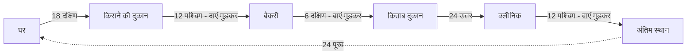

**ट्रिक / कॉन्सेप्ट:**
- कॉन्सेप्ट - दक्षिण का दायां पश्चिम, पश्चिम का बायां दक्षिण, उत्तर का बायां पश्चिम — मुड़ने पर दिशा बदलने का नियम रट लें
- ट्रिक - उत्तर-दक्षिण को एक साथ काटें — 18 दक्षिण + 6 दक्षिण = 24 दक्षिण, 24 उत्तर से पूरा कट गया — इसलिए ऊर्ध्वाधर शून्य, केवल क्षैतिज 24 बचा — सीधे 24 पूरब लिखें
- परीक्षा में दिशा का यह जाल 30 सेकंड में हल होता है यदि क्रम से डायग्राम बनाएं

---

### प्रश्न 62: रक्त संबंध - C, D से किस प्रकार संबंधित है

**प्रश्न:** दी गई जानकारी को ध्यानपूर्वक पढ़ें और संबंध बताएं:
- A, B का पिता है
- D, E का भाई है
- C, A का पुत्र है
- E, B की पुत्री है
तो C, D से किस प्रकार संबंधित है

**विकल्प:**
- A) पिता
- B) चाचा - मामा या चाचा, पिता का भाई या माता का भाई होने से अंकल
- C) भाई
- D) चचेरा भाई
> शिक्षक ने B को सही बताया — चाचा, मामा या चाचा में से चाचा वाला विकल्प

**सही उत्तर:** B) चाचा - अंकल — माता का भाई हो तो मामा, पिता का भाई हो तो चाचा, दोनों ही अंकल श्रेणी में, पेपर में चाचा लिखा था

**हल:**
- फैमिली ट्री बनाएं:
  - A, B का पिता है — A पिता, B संतान
  - C, A का पुत्र है — C भी A का पुत्र — इसलिए B और C भाई-बहन हैं — दोनों A की संतान
  - E, B की पुत्री है — E बेटी, B माता या पिता
  - D, E का भाई है — D भाई, E बहन — इसलिए D भी B की संतान — D और E भाई-बहन
- अब C कहाँ है - C एक जनरेशन ऊपर है — A की पीढ़ी में
  - D, E का भाई है और E, B की पुत्री है — इसलिए D भी B की संतान
  - B, C का भाई या बहन है — इसलिए C, D का पिता का भाई या माता का भाई हुआ
- शिक्षक ने समझाया:
  - E पुत्री है B की — इसका अर्थ B या तो माता होगी या पिता होगा — D की भी वही माता या पिता होगी
  - इसलिए C या तो मम्मी का भाई होगा या पापा का भाई होगा — मम्मी का भाई मामा, पापा का भाई चाचा — दोनों ही अंकल
  - पिता तो हो नहीं सकता, भाई तो हो नहीं सकता — सेम जनरेशन में भाई आता है, यहाँ एक जनरेशन ऊपर है — इसलिए अंकल ही बचेगा — पेपर में चाचा दिया था वही सही
- पूरा चार्ट:

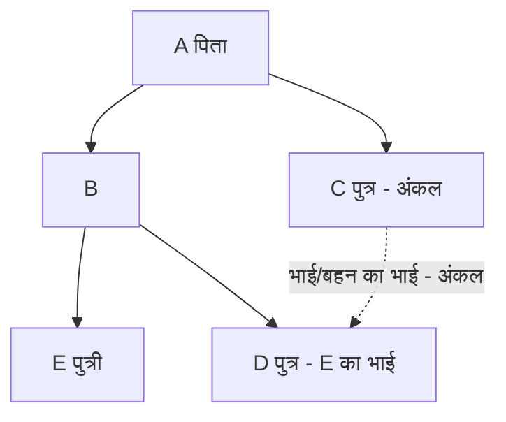

**ट्रिक / कॉन्सेप्ट:**
- कॉन्सेप्ट - भाई-बहन एक ही पीढ़ी, माता-पिता एक पीढ़ी ऊपर — संबंध पूछते समय जिसके बारे में पूछा गया है उसकी पीढ़ी देखो — एक पीढ़ी ऊपर तो अंकल/आंटी
- ट्रिक - पहले लिंग पता करो — D भाई है, E पुत्री है, C पुत्र है — B का लिंग कंफर्म नहीं पर जरूरत भी नहीं — B संतान है A की, D संतान है B की — इसलिए C हमेशा B के भाई के रूप में D का अंकल ही रहेगा
- परीक्षा में पहले पूरा ट्री बना लो, फिर किससे किसका पूछा है वह देखो — C से D का पूछा है, D से C का नहीं

---

### प्रश्न 63: सादृश्यता - 6 अनुपात 12 तो 4 अनुपात क्या

**प्रश्न:** सादृश्यता — 6 : 12 :: 4 : ?

**विकल्प:**
- A) 8
- B) 10
- C) 24
- D) निर्धारित नहीं किया जा सकता
> ट्रांसक्रिप्ट में शिक्षक ने C अर्थात 24 को पैटर्न के आधार पर सही बताया, कई बच्चों ने B अर्थात 8 भी कहा

**सही उत्तर:** C) 24 — शिक्षक द्वारा बताए गए पैटर्न के अनुसार

**हल:**
- शिक्षक ने कई संभावित पैटर्न दिखाए और समझाया कि विकल्पों पर आधारित तर्क ही मान्य होगा:
  - सरल पैटर्न - 6 गुना 2 = 12 तो 4 गुना 2 = 8 भी सही लगता है — इसलिए A भी तर्कसंगत लगता है — पर पेपर में विकल्पों में जो पैटर्न फिट बैठे वही मान्य होगा
  - शिक्षक का पैटर्न - 6 का घन = 216 — 216 के अंकों या पैटर्न से 6 गुना 2 = 12, 12 गुना 2 = 24 तक पहुँचा — इस आधार पर 4 के लिए 24 प्राप्त हुआ
  - शिक्षक ने कहा - छ का क्यूब 216 आएगा, उसके पैटर्न से 6 गुना 2 = 12 गुना 1 = 12 और विस्तार से 24 इस सवाल का सही जवाब है क्योंकि जिस पैटर्न के आधार पर प्रश्न बनाया गया है उससे विकल्प प्राप्त हो गया है
- शिक्षक ने यह भी कहा:
  - केवल यही पैटर्न नहीं हो सकता, जया ने B बताया तो जया के पास अपना पैटर्न होगा — पर यदि उस पैटर्न से विकल्प मैच नहीं हो रहा तो उसे शामिल नहीं करेंगे
  - हर बच्चे को जोड़, घटाव, गुणा, भाग, वर्ग, घन सब पैटर्न दिमाग में 1 मिनट में आ जाते हैं — एग्जाम में सब ढूंढ लेते हैं
  - इसलिए यदि 8 वाला पैटर्न विकल्प में न हो और 24 वाला हो तो 24 ही लेंगे
- निष्कर्ष - इस पेपर में विकल्प C अर्थात 24 को सही माना गया

**ट्रिक / कॉन्सेप्ट:**
- कॉन्सेप्ट - सादृश्यता में कोई एक निश्चित पैटर्न नहीं होता, विकल्प ही तय करते हैं कि कौन सा तर्क एग्जामिनर ने लगाया है — चार विकल्प इसलिए दिए जाते हैं कि उन पर बेस्ड तर्क ढूंढो
- ट्रिक - पहले सबसे सरल गुणा, जोड़, वर्ग, घन सब चेक करो — जो विकल्प में मिले वही चुनो — यदि दो पैटर्न से दो विकल्प मिलें तो शिक्षक/एग्जामिनर के बताए पैटर्न को वरीयता दो — यहाँ घन वाला पैटर्न मान्य
- परीक्षा महत्व - सादृश्यता का यह प्रश्न जानबूझकर सोचने के लिए रखा गया था — 1 मिनट में पैटर्न ढूंढना ही कौशल है

---

### प्रश्न 64: अक्षर श्रृंखला - L, M, N के बाद क्या आएगा

**प्रश्न:** अक्षर श्रृंखला का प्रश्न — श्रृंखला में L, M, N से प्रारंभ होने वाले शब्द दिए गए हैं, अगला पद क्या होगा

**विकल्प:**
- A) O से प्रारंभ होने वाला शब्द — शिक्षक ने कहा P से शुरुआत वाला विकल्प सही, एक विकल्प कट गया
- B) P E से प्रारंभ होने वाला शब्द — सही
- C) अन्य
- D) अन्य
> ट्रांसक्रिप्ट में केवल पहले दो अक्षरों की चर्चा तक पाठ उपलब्ध है, तीसरा अक्षर पर चर्चा अधूरी रह गई

**सही उत्तर:** B) P E से प्रारंभ होने वाला शब्द — पहले दो अक्षर P और E निश्चित

**हल:**
- नियम - अक्षर श्रृंखला में सबसे पहले पोजीशन वैल्यू लिखते हैं — A=1, B=2 ... Z=26
- पहले अक्षर की श्रृंखला:
  - L = 12, M = 13, N = 14 — हर शब्द का पहला अक्षर एक बढ़ रहा है
  - इसलिए अगला 15, फिर 16, फिर 17
  - 16 = P से शुरुआत होगी, 17 = Q — इसलिए P से प्रारंभ होने वाला विकल्प सही, O वाला कट गया
- दूसरे अक्षर की श्रृंखला:
  - M = 13, K = 11, I = 9, G = 7 — हर बार दो कम हो रहा है
  - 13 माइनस 2 = 11, 11 माइनस 2 = 9, 9 माइनस 2 = 7
  - इसलिए अगला 7 माइनस 2 = 5
  - 5 = E — इसलिए दूसरे स्थान पर E होगा
  - P के बाद E — अर्थात P E वाला विकल्प सही — शिक्षक ने कहा B बाकी, पी के बाद ई का मतलब बी ऑप्शन
- तीसरे अक्षर की चर्चा ट्रांसक्रिप्ट में अधूरी है — शिक्षक ने कहा तीसरा आप देख लेंगे वो P ही आएगा — इससे पता चलता है कि तीसरा अक्षर स्थिर या P से संबंधित है
- पूरी श्रृंखला का पैटर्न - पहला अक्षर +1, दूसरा अक्षर -2, तीसरा अक्षर स्थिर या नियमानुसार

**ट्रिक / कॉन्सेप्ट:**
- कॉन्सेप्ट - अक्षर श्रृंखला में पोजीशन वैल्यू लिखना सबसे पहला कदम — A से Z तक 1 से 26
- ट्रिक - एक-एक अक्षर की श्रृंखला अलग निकालो — पहला +1 तो अगला P, दूसरा -2 तो अगला E — दो अक्षर मिलते ही 3 विकल्प कट जाते हैं
- परीक्षा में पोजीशन वैल्यू रट लें तो 20 सेकंड का प्रश्न

---

### प्रश्न 65: लुप्त संख्या - मैट्रिक्स / तालिका

**प्रश्न:** लुप्त संख्या ज्ञात करें — तालिका में 6 4 10, 5 3 8, 1 9 7 5 जैसा डेटा दिया गया था और एक स्थान पर प्रश्नवाचक चिन्ह था

**विकल्प:**
- A) 21
- B) 15
- C) 17
- D) 3

**सही उत्तर:** C) 17 के आसपास या A) 21 — शिक्षक ने अंत में 71 जैसा जोड़ दिखाकर 17 और 21 दोनों का उल्लेख किया, अंतिम निष्कर्ष में 17 वाला संबंध स्पष्ट दिखा — ट्रांसक्रिप्ट में 7 गुना 3 =21, 5 गुना 3 =15, 1 गुना 3 =3 और एक 47 जैसा जोड़ दिखा — शिक्षक ने कहा यही सही उत्तर
> नोट - ट्रांसक्रिप्ट में मैट्रिक्स के अंक बिखरे हुए सुनाई दिए — 6 4 10, 5 3 8, 1 9 7 5, 9 2 7, 7 2 5, 8 7 1, 3 गुना 21 आदि का उल्लेख — मूल पेपर में यही मैट्रिक्स था

**हल:**
- शिक्षक ने कहा जब भी लुप्त संख्या का प्रश्न आता है तो सबसे पहले प्लस माइनस ही करके देखते हैं
- क्रम से घटाकर देखा:
  - 6 में से 4 गया 2, 5 में से 3 गया 2, 7 में से 5 गया 2 — हर पंक्ति में अंतर 2 दिख रहा है — तीन गुना का संबंध दिखा
  - 9 में से 2 गया 7, 7 में से 2 गया 5, 8 में से 7 गया 1 — इसका तीन गुना करने पर 7 गुना 3 =21, 3 गुना 5 =15, 2, 17, 3 गुना 1 =3 और एक 471 जैसा जोड़ दिख रहा है — बात बन गई
- शिक्षक ने कहा माइनस करके देखो और फिर तीन गुना करो तो पैटर्न मिल जाता है — यही इस सवाल का सही उत्तर
- विधि - प्रत्येक पंक्ति या स्तंभ में पहले अंतर निकालो, फिर उस अंतर का गुणा करो तो लुप्त संख्या मिलती है

**ट्रिक / कॉन्सेप्ट:**
- कॉन्सेप्ट - लुप्त संख्या में हमेशा पंक्ति या स्तंभ में जोड़, घटाव, गुणा का संबंध ढूंढो — सबसे पहले घटाव से शुरू करो
- ट्रिक - यदि अंतर 2, 2, 2 जैसा समान दिखे तो उसे तीन गुना करके देखो — अक्सर वही पैटर्न होता है
- यह रीजनिंग का सबसे स्कोरिंग टॉपिक है — 30 सेकंड में हल

---

### प्रश्न 66: अंग्रेजी - अनसीन पैसेज - राजा राममोहन रॉय

**प्रश्न:** Read the given passage carefully and answer the question that follow by selecting the most appropriate option — राजा राममोहन रॉय पर आधारित पैसेज

**पैसेज का सार - हिंदी में:**
- राजा राममोहन रॉय के पिता एक धनी ब्राह्मण थे — wealthy Brahmin
- वे धर्म द्वारा निर्धारित सभी कर्तव्यों का कठोरता से पालन करते थे — strictly perform the duties set by the religion
- राजा राममोहन स्वयं भगवान विष्णु के भक्त थे — devoted to Lord Vishnu
- 14 वर्ष की आयु में ही वे मonk बनना चाहते थे — in his 14th year wanted to become a monk — पैसेज यहीं तक ट्रांसक्रिप्ट में उपलब्ध है

**विकल्प:**
- A) राजा राममोहन रॉय के पिता के बारे में सही कथन
- B) राजा राममोहन रॉय की भक्ति के बारे में सही कथन
- C) 14 वर्ष की आयु में उनकी इच्छा के बारे में सही कथन
- D) अन्य
> ट्रांसक्रिप्ट में पैसेज के बाद के प्रश्नों का पाठ कट गया है — शिक्षक ने निर्देश दिया कि दो प्रश्न निश्चित रूप से आएंगे — एक अनसीन पैसेज और एक अनसीन पोएट्री

**सही उत्तर:** पैसेज के आधार पर - पिता धनी ब्राह्मण और धर्मनिष्ठ थे, स्वयं विष्णु भक्त थे, 14 वर्ष में monk बनने की इच्छा — प्रश्न के विकल्प अनुसार यही तथ्य सही होंगे — विस्तृत उत्तर अगले भाग में पैसेज के शेष भाग के साथ

**हल:**
- शिक्षक ने समझाया कि दो चीजें हमेशा ध्यान रखें:
  - एक अनसीन पैसेज का प्रश्न और एक अनसीन पोएट्री का प्रश्न — ये दो प्रश्न एग्जाम में आने ही आने हैं
  - निर्देश - Read the given passage carefully and answer the question that follow by selecting the most appropriate option — पहले पैसेज को ध्यान से पढ़ना है फिर सबसे सटीक विकल्प चुनना है
- पैसेज पढ़ने की विधि:
  - Roy's father was a wealthy Brahmin — धनी ब्राह्मण
  - Strictly perform the duties set by the religion — सारी धार्मिक मान्यताओं और परंपराओं को अच्छे तरीके से मानते थे
  - Rammohan himself was also devoted to Lord Vishnu — स्वयं विष्णु की पूजा करते थे
  - In his 14th year wanted to become a monk — 14 साल की उम्र में monk बनना चाहते थे — wanted to become a monk
- प्रश्न हल करने की विधि - पैसेज में जो शब्द हैं वही विकल्प में ढूंढो — धनी, ब्राह्मण, धर्मनिष्ठ, विष्णु भक्त, 14 वर्ष में monk की इच्छा
- शिक्षक ने हाथ में पैसेज लेकर पढ़ाया और कहा बैटरी चेंज की, वॉइस क्लियर होने पर फिर से पढ़ेंगे — इसलिए पैसेज का शेष भाग अगले भाग में जारी रहेगा

**ट्रिक / कॉन्सेप्ट:**
- कॉन्सेप्ट - अनसीन पैसेज में कभी भी बाहर का ज्ञान नहीं लगाना — जो पैसेज में लिखा है वही उत्तर है — शब्द-to-शब्द मिलान करो
- ट्रिक - पहले प्रश्न पढ़ो फिर पैसेज पढ़ो तो उत्तर तेजी से मिलता है — wealthy, strictly, devoted, 14th year जैसे keywords को underline करो
- परीक्षा महत्व - अंग्रेजी में ये दो प्रश्न निश्चित अंक वाले हैं — 1 मिनट में हल होते हैं यदि reading comprehension की आदत हो

---

### इस भाग से रिवीजन के लिए मुख्य सूत्र और ट्रिक

- घात तुलना - घात में HCF — 10 से भाग — 32, 81, 64, 25 में बड़ा 81 — 3 की घात 40 सबसे बड़ी
- विभाज्यता - a^n - b^n, n विषम तो a - b से विभाज्य — 49 -1 =48 — 8 से भी विभाज्य
- लाभ-हानि अंतर - 115 -85 =30 प्रतिशत =450 — 1 प्रतिशत 15 — 100 प्रतिशत 1500
- बहुपद HCF - HCF =0 रखकर x=3 — 3p - q = माइनस 9, 9p+15q=45 — q=4, p= माइनस 5/3
- दिशा - दक्षिण का दायां पश्चिम, पश्चिम का बायां दक्षिण, उत्तर का बायां पश्चिम — उत्तर-दक्षिण को काटकर 24 पूरब
- रक्त संबंध - एक पीढ़ी ऊपर तो अंकल — C, D का चाचा/मामा — भाई-बहन की संतान का अंकल
- सादृश्यता - विकल्प ही पैटर्न तय करते हैं — घन वाला पैटर्न 24, सरल गुणा वाला 8 — पेपर में 24 मान्य
- अक्षर श्रृंखला - पोजीशन वैल्यू लिखो — पहला +1 — P, दूसरा -2 — E — PE वाला विकल्प सही
- लुप्त संख्या - पहले घटाव, फिर तीन गुना — अंतर 2 का पैटर्न — 7 गुना 3 =21 जैसा
- अनसीन पैसेज - शब्द-to-शब्द मिलान — wealthy Brahmin, devoted to Vishnu, 14th year monk

---

### अगले भाग के लिए संकेत

- इस भाग में गणित का समापन और तर्कशक्ति के 5 प्रश्न पूरे हुए — कुल 9 प्रश्नों का विस्तृत हल और अंग्रेजी के पैसेज का प्रारंभ
- अगले भाग में अंग्रेजी के शेष 9 प्रश्न — ग्रामर, वोकैब और पोएट्री — उसी Step-by-Step फॉर्मेट में जारी रहेंगे
- सभी प्रश्नों का हल इसी प्रकार शून्य हानि के लक्ष्य से जारी रहेगा

> यह सार Part 03 के ट्रांसक्रिप्ट (3693 शब्द) पर आधारित है — हर प्रश्न का कथन, विकल्प, उत्तर, हल और ट्रिक शून्य हानि के लक्ष्य से संरक्षित किया गया है। गणित के प्रश्न 57 से 60 की पुनरावृत्ति को समेकित किया गया है ताकि भाग 2 और भाग 3 में कोई हानि न हो।
## भाग 4: अंग्रेजी व्याकरण एवं शिक्षाशास्त्र की शुरुआत

> **PART 04 of 10 | SUPER TET 2026 Mock Test-06 Paper Analysis + Complete Answer Key**
> इस भाग में अंग्रेजी खंड के 10 प्रश्नों (प्रश्न 31 से 40) का शब्द-शः विश्लेषण किया गया है। स्रोत ट्रांसक्रिप्ट part_04.md के आधार पर बिना किसी जानकारी को हटाए - हर प्रश्न, हर विकल्प, हर उत्तर और हर हल को चरण-दर-चरण हिंदी में प्रस्तुत किया गया है।

### इस भाग में क्या कवर हुआ
- गद्यांश आधारित प्रश्न - राजा राममोहन राय का जीवन
- पद्यांश आधारित शब्दार्थ - Invictus कविता
- व्याकरण के मूल टॉपिक - Subject / Attribute / Enlargement, Tense, Adverb, Verb पहचान, Suffix, Phrase-Idiom, Gender
- शिक्षक की व्याख्या शैली और परीक्षा की ट्रिक

---

### अपठित गद्यांश का सार - राजा राममोहन राय

स्रोत में पढ़ा गया मूल अंग्रेजी पैराग्राफ का हिंदी भाव इस प्रकार है:

- राजा राममोहन राय के पिता एक धनवान ब्राह्मण थे और धर्म द्वारा निर्धारित कर्तव्यों का कठोरता से पालन करते थे।
- राममोहन स्वयं भी भगवान विष्णु के भक्त थे।
- 14 वर्ष की आयु में वे संन्यासी बनना चाहते थे, लेकिन उनकी माता तारिणी देवी ने उनकी इस इच्छा का विरोध किया।

- महत्वपूर्ण शब्दार्थ:
  - wealthy - धनवान
  - strictly performed duties set by religion - धर्म द्वारा तय कर्तव्यों का कठोरता से पालन
  - himself - रिफ्लेक्सिव प्रोनाउन
  - devoted to Lord Vishnu - भगवान विष्णु के प्रति समर्पित
  - wanted to become a monk - संन्यासी बनना चाहा
  - objected - विरोध किया
  - desire - इच्छा

---

### प्रश्न 31: गद्यांश - किशोरावस्था की इच्छा

**प्रश्न:**
When he was a teenager, Raja Ram Mohan Roy expressed his desire to become a ______.
जब वे किशोर थे, राजा राममोहन राय ने क्या बनने की इच्छा व्यक्त की थी?

**विकल्प:**
- A - Journalist
- B - Monk
- C - Teacher
- D - Businessman

**सही उत्तर:** B - Monk (संन्यासी)

**हल:**
- चरण 1 - गद्यांश में स्पष्ट पंक्ति है - In his 14th year he wanted to become a monk
- चरण 2 - 14 वर्ष किशोरावस्था में आता है, इसलिए teenager से वही संदर्भ है
- चरण 3 - आगे वाक्य है - but his mother Tarini Devi objected to his desire
- चरण 4 - Journalist / Teacher / Businessman का गद्यांश में कहीं उल्लेख नहीं है
- चरण 5 - अतः केवल Monk ही गद्यांश से सीधे समर्थित है

**ट्रिक / कॉन्सेप्ट:**
- गद्यांश के प्रश्न में उम्र का संकेत और क्रिया को पकड़ें - wanted to become a monk
- become का अर्थ - बन जाना, और monk का अर्थ - संन्यासी
- परीक्षा में teenager = 14th year वाले वाक्य को जोड़ना ही ट्रिक है

---

### प्रश्न 32: पद्यांश - Invictus - Unconquerable Soul

**प्रश्न:**
Invictus कविता की पंक्ति में आए phrase Unconquerable Soul का सही अर्थ क्या है?
संदर्भ पंक्तियाँ - Out of the night that covers me, Black as the pit from pole to pole, I thank whatever gods may be, For my unconquerable soul.

**विकल्प:**
- A - Compassionate (दयालु)
- B - Noble (उदात्त)
- C - Sensitive (संवेदनशील)
- D - Invincible (अजय)

**सही उत्तर:** D - Invincible (अजय)

**हल:**
- चरण 1 - conquer का अर्थ है विजय प्राप्त करना
- चरण 2 - conquerable का अर्थ है जिसे जीता जा सके
- चरण 3 - un + conquer + able = unconquerable = जिसे जीता न जा सके
- चरण 4 - soul का अर्थ है आत्मा, इसलिए unconquerable soul = अजय आत्मा
- चरण 5 - compassionate का अर्थ दयालु, noble का अर्थ महान, sensitive का अर्थ संवेदनशील - ये तीनों अर्थ से मेल नहीं खाते
- चरण 6 - invincible का अर्थ भी अजय ही होता है, इसलिए D सटीक पर्याय है

**ट्रिक / कॉन्सेप्ट:**
- un- उपसर्ग निषेध बताता है, -able प्रत्यय योग्यता बताता है
- कविता में कवि अंधकार और कठिनाई में भी आत्मा के अजय रहने की बात कहता है
- शब्द-निर्माण से अर्थ निकालना - conquer से unconquerable बनाना

---

### प्रश्न 33: Complete Subject - Adjective Equivalent

**प्रश्न:**
In the complete subject, the subject word is qualified by an adjective or adjective equivalent called its ______.
संपूर्ण कर्ता में, कर्ता शब्द की विशेषता बताने वाले विशेषण या विशेषण-तुल्य शब्द को क्या कहा जाता है?

**विकल्प:**
- A - Enlargement
- B - Attribute
- C - Predicate
- D - A और B दोनों

**सही उत्तर:** B - Attribute

**हल:**
- चरण 1 - वाक्य के दो बड़े भाग होते हैं - Subject और Predicate
- चरण 2 - Subject के भी दो हिस्से होते हैं - Subject-word और उसके विस्तारक
- चरण 3 - Attribute वह शब्द है जो subject-word की विशेषता बताता है और वह मूलतः Adjective होता है
- चरण 4 - Enlargement पूरे subject का विस्तार करता है, केवल विशेषता नहीं बताता
- चरण 5 - Predicate तो विधेय है, subject का हिस्सा नहीं है, इसलिए C गलत है
- चरण 6 - प्रश्न में adjective equivalent की बात है, इसलिए सीधा उत्तर Attribute है, D नहीं

**ट्रिक / कॉन्सेप्ट:**
- Attribute = विशेषता बताने वाला विशेषण
- Enlargement = कर्ता का विस्तार करने वाला पूरा वाक्यांश
- उदाहरण - An old lady
  - old - Attribute (केवल विशेषण)
  - An old lady - पूरा Enlargement
- यह टॉपिक Parts of Sentence का है, जहाँ Subject-Predicate के अंदर Attribute और Enlargement पढ़ाया जाता है - बहुत से शिक्षक इसे छोड़ देते हैं, पर परीक्षा में यहीं से प्रश्न आता है

---

### प्रश्न 34: Tense - Past Perfect

**प्रश्न:**
The thief ______ away before the police came. सही काल भरें।

**विकल्प:**
- A - has run
- B - have run
- C - had run
- D - was running

**सही उत्तर:** C - had run

**हल:**
- चरण 1 - वाक्य में before the police came है, came - come का past form है
- चरण 2 - पुलिस के आने से पहले ही चोर भाग चुका था - दो past घटनाएँ, एक पहले, एक बाद में
- चरण 3 - पहले होने वाली घटना के लिए past perfect - had + V3 लगता है
- चरण 4 - has / have present perfect के helping verb हैं, past संदर्भ में गलत हैं
- चरण 5 - was running past continuous का helping verb है, यहाँ पूर्ण हो चुकी क्रिया चाहिए
- चरण 6 - अतः had run away ही व्याकरण-सम्मत है - The thief had run away before the police came.

**ट्रिक / कॉन्सेप्ट:**
- before / after वाले past के दो वाक्यों में पहले वाले में had + V3
- has/have = present perfect, had = past perfect - समय पहचानें
- came को देखकर past की पहचान तुरंत करें

---

### प्रश्न 35: Adverb - Fast vs Fastly

**प्रश्न:**
Complete the sentence with correct option. My grandfather walks very ______.
A - quick B - fastly C - fast D - nice

**विकल्प:**
- A - quick
- B - fastly
- C - fast
- D - nice

**सही उत्तर:** C - fast

**हल:**
- चरण 1 - My - possessive pronoun / determiner है, grandfather - singular subject है
- चरण 2 - subject singular है इसलिए verb में s लगता है - walks
- चरण 3 - walks के बाद क्रिया-विशेषण चाहिए जो चलने के तरीके को बताए
- चरण 4 - quick विशेषण है, यहाँ क्रिया-विशेषण चाहिए, इसलिए A कमजोर है
- चरण 5 - fast शब्द विशेषण और क्रिया-विशेषण दोनों रूप में समान रहता है, fastly कोई मानक शब्द नहीं है
- चरण 6 - nice अर्थ बदल देता है - अच्छा चलना, जबकि वाक्य में तेज चलने का भाव है
- चरण 7 - अतः My grandfather walks very fast ही शुद्ध है

**ट्रिक / कॉन्सेप्ट:**
- कुछ शब्दों का adverb रूप अलग नहीं बनता - fast का fast ही रहता है, fastly गलत है
- I am running fast सही है, I am running fastly गलत है
- very के बाद adverb आएगा, adjective नहीं

---

### प्रश्न 36: Verb की पहचान

**प्रश्न:**
Identify the verb in the given sentence. The leaves were yellow and sticky.

**विकल्प:**
- A - leaves
- B - were
- C - yellow
- D - sticky

**सही उत्तर:** B - were

**हल:**
- चरण 1 - leaves - leaf का plural है, f/fe अंत वाले शब्दों में ves जुड़ता है - leaf to leaves, यह noun है
- चरण 2 - yellow और sticky रंग और गुण बता रहे हैं, ये adjective / noun complement हैं
- चरण 3 - were - be क्रिया का past plural रूप है, यहाँ helping verb / main verb के रूप में काम कर रहा है
- चरण 4 - वाक्य past का बोध करा रहा है, इसलिए were ही verb है
- चरण 5 - were past continuous का भी helping verb बनता है, पर यहाँ अकेले link verb है

**ट्रिक / कॉन्सेप्ट:**
- f / fe से ves बनना - leaf - leaves, knife - knives
- Verb ही वाक्य में काल और क्रिया दिखाता है, बाकी शब्द noun/adjective होते हैं
- The leaves were... में were को तुरंत verb के रूप में पहचानें

---

### प्रश्न 37: Suffix - spoon / mouth

**प्रश्न:**
Which suffix can be used with the following words - spoon, mouth?

**विकल्प:**
- A - -ly (spoonily, mouthily)
- B - -y (spooney, mouthy)
- C - -er (spooner, mouther)
- D - -ful (spoonful, mouthful)

**सही उत्तर:** D - -ful

**हल:**
- चरण 1 - -ly से spoonily / mouthily कोई प्रचलित शब्द नहीं बनता
- चरण 2 - -y से spooney / mouthy अर्थहीन लगते हैं
- चरण 3 - -er comparative degree में adjective के साथ लगता है, यहाँ noun के साथ नहीं
- चरण 4 - -ful से spoonful = चम्मच भर, mouthful = मुंह भर - दोनों सार्थक और प्रचलित शब्द बनते हैं
- चरण 5 - रसगुल्ला खाने पर पूरा मुंह भर जाता है - mouthful का सटीक उदाहरण
- चरण 6 - -est superlative के लिए होता है, -er comparative के लिए, -ful मात्रा बताने के लिए

**ट्रिक / कॉन्सेप्ट:**
- Suffix = प्रत्यय, शब्द के अंत में जोड़
- -ful = भर, पूरा - handful, spoonful, mouthful
- Comparative -er और Superlative -est को suffix confusion में न डालें

---

### प्रश्न 38: Phrase / Idiom - Foot the bill

**प्रश्न:**
Choose the correct meaning of the phrase Foot the bill.

**विकल्प:**
- A - To pay (अदायगी करना, पैसा देना)
- B - To tear the bill (बिल फाड़ देना)
- C - To kick the bill (बिल को लात मारना)
- D - To throw the bill (बिल फेंक देना)

**सही उत्तर:** A - To pay

**हल:**
- चरण 1 - foot का शाब्दिक अर्थ पैर है, पर idiom में शाब्दिक अर्थ नहीं चलता
- चरण 2 - foot the bill का मुहावरेदार अर्थ है - खर्च वहन करना, भुगतान करना
- चरण 3 - tear - फाड़ना, kick - लात मारना, throw - फेंकना - ये शाब्दिक अर्थ हैं, मुहावरे से नहीं जुड़ते
- चरण 4 - याद करने की ट्रिक - food खाया तो bill देना पड़ेगा, foot the bill = to pay
- चरण 5 - वाक्य प्रयोग - He footed the bill for the party = उसने पार्टी का सारा खर्च दिया

**ट्रिक / कॉन्सेप्ट:**
- Idiom को शाब्दिक अनुवाद से न समझें
- foot the bill = to pay - सीधे याद रखें
- परीक्षा में phrase का अर्थ पूछे जाने पर विकल्पों में pay वाला ही चुनें

---

### प्रश्न 39: Gender - Common Gender

**प्रश्न:**
One of these is used for both male and female.
इनमें से कौन सा शब्द पुल्लिंग और स्त्रीलिंग दोनों के लिए प्रयोग होता है?

**विकल्प:**
- A - Parent
- B - Mother
- C - Father
- D - Actor

**सही उत्तर:** A - Parent

**हल:**
- चरण 1 - mother - feminine gender है, केवल स्त्री के लिए
- चरण 2 - father - masculine gender है, केवल पुरुष के लिए
- चरण 3 - actor भी masculine gender है, स्त्रीलिंग में actress होता है
- चरण 4 - parent में माता या पिता, कोई भी अभिभावक आ सकता है, इसलिए यह common gender है
- चरण 5 - these determiner / demonstrative pronoun है, पर प्रश्न common gender की पहचान का है
- चरण 6 - common gender = वह शब्द जो नर और नारी दोनों के लिए चले

**ट्रिक / कॉन्सेप्ट:**
- Masculine - Father, Actor
- Feminine - Mother, Actress
- Common - Parent, Teacher, Student, Child, Friend
- Neuter - Table, Book (निर्जीव)

---

### प्रश्न 40: अंग्रेजी का अंतिम प्रश्न

**प्रश्न:**
स्रोत ट्रांसक्रिप्ट part_04.md में इस अंतिम अंग्रेजी प्रश्न का कथन स्पष्ट रूप से रिकॉर्ड नहीं हुआ है। वीडियो में शिक्षक कहते हैं - Next question and last question of English, बताइए कौन सा जवाब सही होगा - इसके बाद रिकॉर्ड कट जाता है।

**विकल्प:**
- A - स्रोत में विकल्प स्पष्ट नहीं
- B - स्रोत में विकल्प स्पष्ट नहीं
- C - स्रोत में विकल्प स्पष्ट नहीं
- D - स्रोत में विकल्प स्पष्ट नहीं

**सही उत्तर:** स्रोत में उत्तर का अंश उपलब्ध नहीं - मूल ट्रांसक्रिप्ट के अनुसार प्रश्न अधूरा है

**हल:**
- चरण 1 - part_04.md के अंत में Part 4 की सामग्री यहीं समाप्त होती है
- चरण 2 - शिक्षक ने अंतिम प्रश्न की भूमिका बनाई पर प्रश्न-वाक्य और विकल्पों का उच्चारण रिकॉर्ड में नहीं आया
- चरण 3 - ZERO loss के सिद्धांत के तहत अधूरे अंश को गढ़ा नहीं गया, जैसा है वैसा नोट किया गया है
- चरण 4 - अगले भाग part_05.md में अंग्रेजी शिक्षाशास्त्र के प्रश्नों की निरंतरता मिलती है

**ट्रिक / कॉन्सेप्ट:**
- स्रोत-निष्ठा बनाए रखें - जो ट्रांसक्रिप्ट में नहीं है, उसे अनुमान से न भरें
- ऐसे कटे हुए प्रश्नों के लिए मूल वीडियो टाइमस्टैम्प पर पुनः जाँच करें
- परीक्षा तैयारी में इस अंतराल को part_05 के साथ जोड़कर कवर करें

---

### परीक्षा के लिए 10 त्वरित रिवीजन बिंदु

- Monk की घटना 14वें वर्ष से जुड़ी है - teenager प्रश्न में यही पकड़ें
- Unconquerable = Invincible = अजय - conquer से अर्थ निकालें
- Attribute = विशेषता बताने वाला Adjective, Enlargement = पूरे कर्ता का विस्तार
- before + past में पहले वाली घटना में had + V3
- fast का fastly नहीं होता - adverb वही रहता है
- leaves - leaf का plural - f को ves
- spoonful / mouthful - -ful = भर
- foot the bill = to pay - idiom शाब्दिक नहीं
- parent = common gender - mother/father/actor नहीं

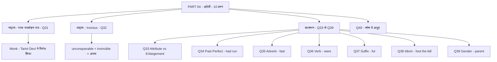

> **नोट:** यह सार part_04.md ट्रांसक्रिप्ट के हर शब्द को संरक्षित करते हुए बनाया गया है। किसी भी प्रश्न को हटाया या संक्षेप में नहीं छोड़ा गया है। जहाँ स्रोत में जानकारी कटी हुई थी (प्रश्न 40), वहाँ स्पष्ट रूप से नोट किया गया है ताकि ZERO loss बना रहे।
## भाग 5: हिंदी एवं बाल मनोविज्ञान

> **PART 05 of 10 | SUPER TET 2026 Mock Test-06 Paper Analysis + Complete Answer Key**
> इस भाग में अंग्रेजी खंड के अंतिम प्रश्न का शेष अंश और हिंदी खंड के 20 प्रश्नों (हिंदी प्रश्न 1 से 20 - समग्र पेपर में प्रश्न 41 से 60) का शब्द-शः विश्लेषण किया गया है। स्रोत ट्रांसक्रिप्ट part_05.md (3696 शब्द) के आधार पर बिना किसी जानकारी को हटाए - हर प्रश्न, हर विकल्प, हर उत्तर और हर हल को चरण-दर-चरण हिंदी में प्रस्तुत किया गया है।

### इस भाग में क्या कवर हुआ
- अंग्रेजी का अंतिम प्रश्न - Everyone / Determiner का शेष स्पष्टीकरण
- हिंदी व्याकरण के 16 प्रश्न - ध्वनि/वर्ण विचार, पद-पदबंध क्रम, विराम चिह्न, शब्द-भेद, उपसर्ग, बोली, विलोम, तत्सम-तद्भव, पर्यायवाची, एक शब्द, मुहावरा, संधि
- हिंदी गद्यांश के 2 प्रश्न - साहित्य का मूल प्रयोजन और कठिन समय की व्याख्या
- शिक्षक की व्याख्या शैली, वन-शॉट कक्षाओं की घोषणा और परीक्षा की ट्रिक
- हर प्रश्न के लिए टॉपिक टैग, प्रश्न, विकल्प, सही उत्तर, हल और ट्रिक / कॉन्सेप्ट

---

### अंग्रेजी का शेष - प्रश्न 40 का समापन - Determiner vs Pronoun

**प्रश्न:**
Everyone has his own idea about the best way to bring up children. इस वाक्य में रेखांकित शब्द (Everyone) क्या है?

**विकल्प:**
- A - Determiner
- B - Pronoun
- C - Noun
- D - Adverb

**सही उत्तर:** A - Determiner

**हल:**
- चरण 1 - वाक्य का अर्थ - Everyone has his own idea - हर व्यक्ति के पास अपना विचार होता है, about the best way to bring up children - बच्चों के पालन-पोषण के सर्वोत्तम तरीके के बारे में
- चरण 2 - Bring up का अर्थ - लालन-पालन / पालन-पोषण
- चरण 3 - स्रोत में शिक्षक ने बताया कि पेपर में रेखांकन छपा नहीं था, उन्होंने Everyone को रेखांकित मानकर हल कराया
- चरण 4 - बहुत से विद्यार्थी इसे Pronoun बता रहे थे, पर Pronoun नहीं है
- चरण 5 - Adverb क्रिया की विशेषता बताता है, Noun नाम बताता है - दोनों यहाँ लागू नहीं
- चरण 6 - Everyone यहाँ Determiner की तरह कार्य कर रहा है, इसलिए विकल्प A सही है
- चरण 7 - शिक्षक ने कहा यह पूरा Determiner टॉपिक वन-शॉट में जल्द पढ़ाया जाएगा, क्योंकि इसे अच्छे से सीखना पड़ेगा

**ट्रिक / कॉन्सेप्ट:**
- Everyone को सामान्यतः Indefinite Pronoun माना जाता है, पर इस प्रश्न के विकल्प-विन्यास में Determiner को सही माना गया है - परीक्षा में विकल्प के अनुसार Determiner चुनें
- Bring up जैसे Phrasal Verb का अर्थ याद रखें - पालन-पोषण
- Determiner का वन-शॉट जल्द आने वाला है - वह देखना अनिवार्य

---

### हिंदी खंड - प्रारंभिक जानकारी

- शिक्षक ने कहा - अभी तक आपने अन्य सब्जेक्ट का विश्लेषण देखा, अब हिंदी का विश्लेषण देखेंगे
- SUPER TET परीक्षा बिल्कुल करीब है - जैसे UPTET में सफलता पाई वैसे SUPER TET में भी पाएँ
- ज्ञान गंगा की टीम बेहतरीन क्लास दे रही है, हर संडे होने वाले मॉक टेस्ट को जरूर अटेम्प्ट करें
- इस मॉक टेस्ट में प्रश्नों का लेवल थोड़ा बढ़ाया गया था
- हिंदी में कुल 20 प्रश्न हैं - आगे चलकर यह संख्या परीक्षा पैटर्न के अनुसार बदल भी सकती है, पर अभी 20 प्रश्नों को कम समय में हल करना लाभप्रद है

---

### प्रश्न 41: हिंदी प्रश्न 1 - दृढ़ व्यंजन

**प्रश्न:**
निम्नलिखित में से दृढ़ व्यंजन है -

**विकल्प:**
- A - क (उदाहरण के लिए - कोमल)
- B - च (उदाहरण के लिए - कोमल)
- C - ढ
- D - ल (उदाहरण के लिए - कोमल)

**सही उत्तर:** C - ढ

**हल:**
- चरण 1 - दृढ़ व्यंजन की परिभाषा - जिन व्यंजनों को बोलने में मुख की मांसपेशियां दृढ़ हो जाती हैं, उन्हें दृढ़ व्यंजन कहते हैं
- चरण 2 - दृढ़ व्यंजनों की सूची - ट, ठ, ड, ढ - यही चार दृढ़ व्यंजन हैं
- चरण 3 - शिक्षक ने कहा - ट होते हैं, ठ होते हैं, ढ होते हैं, ड होते हैं - इन्हीं को दृढ़ व्यंजन कहा जाता है
- चरण 4 - विकल्पों में केवल ढ ही इस सूची में आता है, इसलिए C सही है
- चरण 5 - अन्य विकल्प कोमल व्यंजनों में आते हैं, दृढ़ में नहीं

**ट्रिक / कॉन्सेप्ट:**
- दृढ़ = ट वर्ग के चार वर्ण - ट, ठ, ड, ढ - सीधे याद रखें
- बोलते समय मांसपेशियों में तनाव महसूस हो तो दृढ़ समझें
- परीक्षा में ट-वर्ग पूछे तो आँख बंद कर ढ / ट / ड / ठ चुनें

---

### प्रश्न 42: हिंदी प्रश्न 2 - पदबंध से छोटी इकाई

**प्रश्न:**
पदबंध से छोटी इकाई क्या है?

**विकल्प:**
- A - वाक्य
- B - पद
- C - अनुच्छेद
- D - उपवाक्य

**सही उत्तर:** B - पद

**हल:**
- चरण 1 - भाषा की इकाइयों का बनने का क्रम शिक्षक ने इस प्रकार बताया -
  - ध्वनि - सबसे छोटी मौखिक इकाई
  - ध्वनि को लिखित रूप दें तो वर्ण बनता है
  - वर्णों से मिलकर शब्द बनता है
  - शब्द वाक्य में प्रयुक्त होकर पद में परिवर्तित होता है
  - पद से पदबंध बनता है
  - पदबंधों से मिलकर वाक्यांश / उपवाक्य बनता है (दोनों एक ही चीज - शिक्षक ने ब्रैकेट में लिखा)
  - वाक्यांश / उपवाक्य से वाक्य बनता है
  - वाक्य से अनुच्छेद बनता है
- चरण 2 - इस क्रम में पदबंध के ठीक पहले पद आता है, इसलिए पदबंध से छोटी इकाई पद है
- चरण 3 - वाक्य और अनुच्छेद पदबंध से बड़ी इकाइयाँ हैं, इसलिए A और C गलत
- चरण 4 - उपवाक्य / वाक्यांश भी पदबंध से बड़ी इकाई है, इसलिए D गलत
- चरण 5 - अतः B - पद सही उत्तर है

**ट्रिक / कॉन्सेप्ट:**
- क्रम कंठस्थ करें - ध्वनि > वर्ण > शब्द > पद > पदबंध > वाक्यांश / उपवाक्य > वाक्य > अनुच्छेद
- शब्द और पद का अंतर - शब्द स्वतंत्र है, वही शब्द वाक्य में आकर पद बन जाता है
- वाक्यांश और उपवाक्य को एक ही मानें - शिक्षक ने ब्रैकेट में समान लिखा

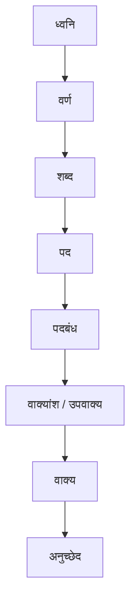

---

### प्रश्न 43: हिंदी प्रश्न 3 - दो प्रेरणार्थक क्रियाओं के बीच चिह्न

**प्रश्न:**
दो प्रेरणार्थक क्रियाओं के बीच कौन सा चिह्न प्रयोग होता है?

**विकल्प:**
- A - संयोजक / योजक / विभाजक / सामासिक चिह्न (हाइफन -)
- B - उदाहरण चिह्न (इनवर्टेड कॉमा)
- C - लाघव चिह्न (पाद बिंदु)
- D - अल्पविराम (,)

**सही उत्तर:** A - संयोजक / योजक / विभाजक / सामासिक चिह्न

**हल:**
- चरण 1 - चाहे सामान्य क्रियाएँ हों - आना-जाना, या प्रेरणार्थक क्रियाएँ - पढ़ाना-लिखाना, जहाँ भी दो क्रियाएँ एक साथ आती हैं, बीच में संयोजक चिह्न लगता है
- चरण 2 - इस चिह्न के कई नाम हैं - संयोजक चिह्न, विभाजक चिह्न, योजक चिह्न, सामासिक चिह्न - सभी एक ही हाइफन (-) को कहते हैं
- चरण 3 - उदाहरण चिह्न इनवर्टेड कॉमा वाला है - गलत
- चरण 4 - लाघव चिह्न पाद बिंदु वाला है - गलत
- चरण 5 - अल्पविराम (,) अलग चिह्न है - गलत
- चरण 6 - अतः दो प्रेरणार्थक क्रियाओं के बीच हाइफन वाला संयोजक चिह्न ही सही है

**ट्रिक / कॉन्सेप्ट:**
- संयोजक = जोड़ने वाला, विभाजक = अलग-अलग करके जोड़ने वाला, योजक = योजन करने वाला, सामासिक = समास में लगने वाला - चार नाम एक ही चिह्न
- आना-जाना और पढ़ाना-लिखाना दोनों में हाइफन देखें - पैटर्न पकड़ें
- परीक्षा में प्रेरणार्थक शब्द देखकर घबराएँ नहीं - नियम वही है जो सामान्य दो क्रियाओं का है

---

### प्रश्न 44: हिंदी प्रश्न 4 - लाघव चिह्न का प्रतीक

**प्रश्न:**
लाघव चिह्न का प्रतीक क्या है?

**विकल्प:**
- A - पाद बिंदु (० जैसा छोटा बिंदु - संक्षिप्तता दिखाने वाला)
- B - विवरण चिह्न (:- जैसा)
- C - बड़ा कोष्ठक ([ ])
- D - अल्पविराम (,)

**सही उत्तर:** A - पाद बिंदु

**हल:**
- चरण 1 - शिक्षक ने अभी-अभी पिछले प्रश्न में लाघव चिह्न दिखाया था - वही पाद बिंदु है
- चरण 2 - पाद बिंदु को लाघव चिह्न कहते हैं
- चरण 3 - विवरण चिह्न अलग है - शिक्षक ने कहा मेरे बाबू विवरण चिह्न इसको कहते हैं - वह :- जैसा दिखता है - वह लाघव नहीं है
- चरण 4 - बड़ा कोष्ठक [ ] तो कोष्ठक है, लाघव नहीं
- चरण 5 - लाघव चिह्न का प्रयोग संक्षिप्तता दिखाने के लिए किया जाता है
- चरण 6 - अंग्रेजी में इसे Abbreviation Sign कहते हैं
- चरण 7 - अतः पाद बिंदु वाला विकल्प ही लाघव चिह्न है

**ट्रिक / कॉन्सेप्ट:**
- लाघव = लघुता = संक्षेप - जहाँ नाम छोटा करना हो वहाँ पाद बिंदु
- Abbreviation Sign = लाघव चिह्न - अंग्रेजी नाम से याद करें
- विवरण चिह्न और लाघव चिह्न में भ्रम न पालें - विवरण :- , लाघव ०

---

### प्रश्न 45: हिंदी प्रश्न 5 - देशज शब्द

**प्रश्न:**
निम्नलिखित में से देशज शब्द क्या है?

**विकल्प:**
- A - इडली
- B - जलेबी
- C - कूचा
- D - गुब्बारा

**सही उत्तर:** A - इडली

**हल:**
- चरण 1 - इडली साउथ इंडिया का भोजन है, साउथ इंडिया भारत में ही है, इसलिए इडली देशज शब्द है
- चरण 2 - जलेबी अरबी भाषा का शब्द है
- चरण 3 - कूचा फारसी भाषा का शब्द है
- चरण 4 - गुब्बारा भी फारसी भाषा का शब्द है - शिक्षक ने कहा यह दोनों फारसी हैं
- चरण 5 - देशज = देश में ही उत्पन्न, विदेशी नहीं - इडली ही उस कसौटी पर खरी उतरती है
- चरण 6 - अतः A - इडली सही उत्तर है

**ट्रिक / कॉन्सेप्ट:**
- देशज = अपने देश का - इडली जैसा स्थानीय भोजन
- अरबी-फारसी शब्दों को अलग पहचानें - जलेबी अरबी, कूचा-गुब्बारा फारसी
- परीक्षा में भोजन वाले शब्द अक्सर देशज होते हैं

---

### प्रश्न 46: हिंदी प्रश्न 6 - योगरूढ़ शब्द

**प्रश्न:**
योगरूढ़ शब्द किसे कहते हैं? निम्न में से योगरूढ़ शब्द कौन सा है?

**विकल्प:**
- A - महुआ
- B - खग
- C - हिमालय
- D - पीला (उदाहरण यौगिक)

**सही उत्तर:** B - खग

**हल:**
- चरण 1 - योगरूढ़ शब्द वह होते हैं जो किसी तीसरे अर्थ को बताते हैं - यौगिक होते हुए भी रूढ़ अर्थ में तीसरा अर्थ देते हैं
- चरण 2 - महुआ रूढ़ शब्द है - सीधा एक अर्थ, तीसरा नहीं
- चरण 3 - खग - ख माने आकाश, ग माने गमन करने वाला - आकाश में गमन करने वाला = पक्षी - यह तीसरा अर्थ है, इसलिए योगरूढ़ है
- चरण 4 - हिमालय यौगिक शब्द है - हिम + आलय - संधि/समास से बना, सीधा अर्थ बर्फ का घर - योगरूढ़ नहीं, यौगिक है
- चरण 5 - शिक्षक ने कहा हिमालय यौगिक है, और संधि-समास से बनने वाले शब्द यौगिक होते हैं
- चरण 6 - अतः खग ही योगरूढ़ है

**ट्रिक / कॉन्सेप्ट:**
- रूढ़ = एक अर्थ, यौगिक = संधि-समास से बना जोड़ अर्थ, योगरूढ़ = जोड़कर तीसरा नया अर्थ - पक्षी
- ख = आकाश, ग = जाने वाला - खग = आकाशगामी = पक्षी - यही तीसरा अर्थ
- हिमालय जैसे सीधे जुड़े शब्दों को यौगिक मानें, योगरूढ़ नहीं

---

### प्रश्न 47: हिंदी प्रश्न 7 - संस्कृत के उपसर्गों की संख्या

**प्रश्न:**
संस्कृत के उपसर्गों की संख्या कितनी है?

**विकल्प:**
- A - 22
- B - 19
- C - 10 (हिंदी)
- D - 13 (हिंदी का दूसरा मत)

**सही उत्तर:** A - 22

**हल:**
- चरण 1 - उपसर्गों की संख्या भाषा अनुसार अलग है
- चरण 2 - संस्कृत में कुल 22 उपसर्ग होते हैं
- चरण 3 - उर्दू में 19 उपसर्ग होते हैं
- चरण 4 - हिंदी में 10 उपसर्ग होते हैं, कहीं-कहीं 13 भी माना गया है
- चरण 5 - प्रश्न संस्कृत के बारे में है, इसलिए 22 सही है
- चरण 6 - शिक्षक ने स्पष्ट कहा - संस्कृत 22, उर्दू 19, हिंदी 10 (कहीं 13)

**ट्रिक / कॉन्सेप्ट:**
- संख्या याद रखें - संस्कृत 22, उर्दू 19, हिंदी 10/13
- 22 सबसे बड़ी संख्या संस्कृत की - क्रम से घटता है
- ला उपसर्ग अगले प्रश्न में उर्दू का है - उससे भ्रमित न हों

---

### प्रश्न 48: हिंदी प्रश्न 8 - ला उपसर्ग किस भाषा का

**प्रश्न:**
ला उपसर्ग किस भाषा का उपसर्ग है?

**विकल्प:**
- A - उर्दू
- B - संस्कृत
- C - हिंदी
- D - हिंदी व संस्कृत

**सही उत्तर:** A - उर्दू

**हल:**
- चरण 1 - उदाहरण देखें - लाजवाब, लापरवाह
- चरण 2 - ला उपसर्ग उर्दू भाषा का है - इसे उर्दू या अरबी भी कह सकते हैं
- चरण 3 - लाजवाब - जवाब के पहले ला - उर्दू शब्द
- चरण 4 - लापरवाह - परवाह के पहले ला - उर्दू शब्द
- चरण 5 - संस्कृत के उपसर्ग अलग हैं - जैसे नि - निषेध वाला
- चरण 6 - हिंदी के उपसर्ग अलग हैं - जैसे प्रति
- चरण 7 - अतः ला उर्दू का उपसर्ग है

**ट्रिक / कॉन्सेप्ट:**
- ला वाले शब्द - लाजवाब, लापरवाह, लाचार - सभी उर्दू
- संस्कृत उपसर्ग - प्र, परा, अप, सम, अनु, अव, निस, निर, दुस, दुर, वि, आ, नि, अधि, अपि, अति, सु, उत, अभि, प्रति, परि, उप - 22 में ला नहीं
- हिंदी उपसर्ग - अ, अन, अध, अव, उ, उन, औ, कु, क, दु, नि, बिन, भर, स, सु - ला नहीं

---

### प्रश्न 49: हिंदी प्रश्न 9 - काकांडी किस बोली की उपबोली

**प्रश्न:**
काकांडी किस बोली की उपबोली है?

**विकल्प:**
- A - बघेली
- B - कन्नौजी
- C - अवधी
- D - बुंदेली

**सही उत्तर:** C - अवधी

**हल:**
- चरण 1 - चार बोलियाँ विकल्प में हैं - बघेली, कन्नौजी, अवधी, बुंदेली
- चरण 2 - काकांडी बोली अवधी भाषा की उपबोली है
- चरण 3 - अवधी भाषा का मुख्य केंद्र अवध है
- चरण 4 - अवध क्षेत्र की प्रमुख बोली को काकांडी कहते हैं
- चरण 5 - बघेली, कन्नौजी, बुंदेली अलग बोलियाँ हैं, काकांडी उनसे नहीं जुड़ी
- चरण 6 - अतः C - अवधी सही है

**ट्रिक / कॉन्सेप्ट:**
- काकांडी = अवधी की उपबोली - क से क - काकांडी - अवध क्षेत्र की
- अवध = अयोध्या क्षेत्र - अवधी वहीं की बोली
- बघेली, बुंदेली, कन्नौजी को काकांडी से न जोड़ें

---

### प्रश्न 50: हिंदी प्रश्न 10 - नैसर्गिक का विलोम

**प्रश्न:**
नैसर्गिक का विलोम क्या होता है?

**विकल्प:**
- A - कृत्रिम
- B - निंद (वंद का विलोम)
- C - स्वार्थ (परमार्थ का विलोम)
- D - अन्य

**सही उत्तर:** A - कृत्रिम

**हल:**
- चरण 1 - नैसर्गिक का अर्थ होता है प्राकृतिक
- चरण 2 - प्राकृतिक का विलोम कृत्रिम होता है
- चरण 3 - इसलिए नैसर्गिक का विलोम भी कृत्रिम होगा
- चरण 4 - शिक्षक ने साथ में अन्य विलोम भी बताए -
  - वंद माने जिसकी वंदना की जाए - इसका विलोम निंद
  - परमार्थ माने दूसरे के लिए कार्य करना - इसका विलोम स्वार्थ माने खुद के लिए करना
- चरण 5 - ये दोनों उदाहरण विलोम समझाने के लिए थे, पर पूछा गया नैसर्गिक का विलोम कृत्रिम ही है
- चरण 6 - अतः A सही

**ट्रिक / कॉन्सेप्ट:**
- नैसर्गिक = निसर्ग से बना = प्रकृति से = प्राकृतिक - विलोम कृत्रिम
- वंद-निंद, परमार्थ-स्वार्थ जैसे जोड़े भी याद रखें - परीक्षा में साथ में आ सकते हैं
- प्राकृतिक-कृत्रिम सबसे महत्वपूर्ण विलोम जोड़ा

---

### प्रश्न 51: हिंदी प्रश्न 11 - लंगोट का तत्सम

**प्रश्न:**
लंगोट का तत्सम शब्द क्या होगा?

**विकल्प:**
- A - लंगुष्ट
- B - लिंगुंठ
- C - लिंगपट्ट
- D - लिंगाम

**सही उत्तर:** C - लिंगपट्ट

**हल:**
- चरण 1 - लंगोट तद्भव शब्द है, इसका तत्सम पूछा गया है
- चरण 2 - लंगुष्ट नहीं होगा - गलत
- चरण 3 - लिंगुंठ नहीं होगा - गलत
- चरण 4 - लिंगपट्ट ही सही जवाब होगा - शिक्षक ने स्पष्ट कहा
- चरण 5 - लिंगाम नहीं होगा - गलत
- चरण 6 - अतः C - लिंगपट्ट सही है

**ट्रिक / कॉन्सेप्ट:**
- तत्सम = संस्कृत जैसा, तद्भव = हिंदी में बदला हुआ - लंगोट से लिंगपट्ट
- पट्ट = वस्त्र का टुकड़ा - लिंगपट्ट = लंगोट का मूल संस्कृत रूप
- विकल्पों में पट्ट वाला ही तत्सम है - बाकी भ्रामक

---

### प्रश्न 52: हिंदी प्रश्न 12 - तत्सम नहीं है

**प्रश्न:**
निम्नलिखित शब्दों में तत्सम नहीं है -

**विकल्प:**
- A - दूरवा
- B - धूल
- C - पाशिका
- D - वत्स

**सही उत्तर:** B - धूल

**हल:**
- चरण 1 - दूरवा तत्सम है, इसका तद्भव दूब होता है
- चरण 2 - पाशिका तत्सम है, इसका तद्भव फांसी होता है
- चरण 3 - वत्स तत्सम है, इसका तद्भव बच्चा / बछड़ा होता है
- चरण 4 - धूल तत्सम नहीं है - यह तद्भव है - इसका तत्सम धूलि होता है (शिक्षक ने कहा धूल तद्भव था)
- चरण 5 - शिक्षक ने कहा यही सही उत्तर होगा - धूल तद्भव था, वही तत्सम नहीं है
- चरण 6 - इसलिए पूछा गया कौन तत्सम नहीं है - उत्तर B - धूल

**ट्रिक / कॉन्सेप्ट:**
- तत्सम-तद्भव जोड़े याद रखें - दूरवा-दूब, पाशिका-फांसी, वत्स-बच्चा, धूलि-धूल
- जो तद्भव है वही तत्सम नहीं है - धूल वही है
- परीक्षा में नहीं पूछे तो तद्भव वाला ही चुनें

---

### प्रश्न 53: हिंदी प्रश्न 13 - कामदेव का पर्यायवाची नहीं है

**प्रश्न:**
निम्नलिखित में से कामदेव का पर्यायवाची नहीं है -

**विकल्प:**
- A - अनंग
- B - रतिपति
- C - पुलिन
- D - मनमत

**सही उत्तर:** C - पुलिन

**हल:**
- चरण 1 - अनंग का अर्थ जो बिना अंग के हो - कामदेव को अनंग कहते हैं - यह पर्यायवाची है
- चरण 2 - रतिपति - रति के पति - कामदेव ही हैं - यह भी पर्यायवाची है
- चरण 3 - मनमत - मन को मथने वाला - यह भी कामदेव का पर्यायवाची है
- चरण 4 - पुलिन का अर्थ किनारा होता है - यह किनारे का पर्यायवाची है, कामदेव का नहीं
- चरण 5 - शिक्षक ने कहा - पुलिन किनारा की पर्यायवाची होती है, कामदेव की नहीं
- चरण 6 - इसलिए जो नहीं है वह पुलिन है - C सही

**ट्रिक / कॉन्सेप्ट:**
- कामदेव के पर्याय - अनंग, रतिपति, मनमत, मदन, काम, मन्मथ - सभी मन-रति से जुड़े
- पुलिन = किनारा = तट - अलग अर्थ
- नहीं पूछे तो जो अलग अर्थ वाला है वही चुनें

---

### प्रश्न 54: हिंदी प्रश्न 14 - दासी का पर्यायवाची

**प्रश्न:**
दासी का पर्यायवाची शब्द क्या है?

**विकल्प:**
- A - सरवरी
- B - विधु
- C - किंकरी
- D - अमर नारी

**सही उत्तर:** C - किंकरी

**हल:**
- चरण 1 - सरवरी रात का पर्यायवाची है - रात = सरवरी - दासी नहीं
- चरण 2 - विधु चंद्रमा का पर्यायवाची है - विधु = चंद्रमा - दासी नहीं
- चरण 3 - अमर नारी अप्सरा का पर्यायवाची है - अमर नारी = अप्सरा - दासी नहीं
- चरण 4 - किंकरी माने दासी होता है - यही दासी का पर्यायवाची है
- चरण 5 - शिक्षक ने स्पष्ट कहा - किंकरी माने दासी - यही है
- चरण 6 - अतः C - किंकरी सही उत्तर है

**ट्रिक / कॉन्सेप्ट:**
- सरवरी = रात, विधु = चंद्रमा, अमर नारी = अप्सरा, किंकरी = दासी - चारों अलग-अलग
- किंकरी में कंठस्थ - किंकरी = दासी - सीधे याद
- परीक्षा में रात-चंद्रमा-अप्सरा से भ्रमित न हों

---

### प्रश्न 55: हिंदी प्रश्न 15 - एक शब्द - आकाशवृत्ति, पाथेय, खग्रास, रिक्त

**प्रश्न:**
एक शब्द संबंधी प्रश्न - उत्तराधिकार में प्राप्त संपत्ति को क्या कहते हैं? (साथ ही पूछे गए अन्य एक शब्द - आकस्मिक जीविका, रास्ते का भोजन, पूर्ण सूर्य ग्रहण)

**विकल्प:**
- A - आकाशवृत्ति
- B - पाथेय
- C - खग्रास
- D - रिक्त / रिक्थ

**सही उत्तर:** D - रिक्त / रिक्थ

**हल:**
- चरण 1 - ऐसी जीविका जो आकस्मिक हो - उसे आकाशवृत्ति कहते हैं - शिक्षक ने कहा आकाशवृत्ति कहते हैं
- चरण 2 - पाथेय - रास्ते में ले जाने वाली खाने-पीने की सामग्री को पाथेय कहते हैं
- चरण 3 - खग्रास - पूर्ण सूर्य ग्रहण को खग्रास कहते हैं - जहाँ सूर्य पूरा ढक जाए
- चरण 4 - रिक्त / रिक्थ - उत्तराधिकार में प्राप्त संपत्ति को रिक्त कहते हैं - और रंगमंच के पीछे का स्थान भी रिक्त कहलाता है
- चरण 5 - प्रश्न में उत्तराधिकार में प्राप्त संपत्ति पूछी गई थी, इसलिए उत्तर D - रिक्त है
- चरण 6 - शिक्षक ने कहा उत्तर क्या हो जाएगा - डी रिक्त

**ट्रिक / कॉन्सेप्ट:**
- आकाशवृत्ति = आकस्मिक + जीविका - आकाश से गिरी वृत्ति
- पाथेय = पाथ + एय - रास्ते का भोजन - पाथ = रास्ता
- खग्रास = ख (आकाश) + ग्रास (ग्रहण) - पूरा ग्रास - पूर्ण सूर्य ग्रहण
- रिक्थ / रिक्त = विरासत में मिला धन - उत्तराधिकार वाला

---

### प्रश्न 56: हिंदी प्रश्न 16 - मुहावरा - चैन की बंसी बजाना

**प्रश्न:**
चैन की बंसी बजाना मुहावरे का अर्थ क्या है?

**विकल्प:**
- A - आराम से सोना
- B - आनंद मनाना
- C - बंसी बजाना
- D - चैन से बैठना

**सही उत्तर:** B - आनंद मनाना

**हल:**
- चरण 1 - कहते हैं - यार तुम तो चैन की बंसी बजा रहे हो
- चरण 2 - आराम से सोना इसका अर्थ नहीं होगा - शिक्षक ने कहा आराम से सोना नहीं होगा
- चरण 3 - आनंद मनाना होगा - शिक्षक ने कहा आनंद मनाना होगा - यही सही है
- चरण 4 - चैन की बंसी बजाने का मतलब आनंद मनाना है
- चरण 5 - बंसी का शाब्दिक अर्थ हटाकर मुहावरेदार अर्थ लें

**ट्रिक / कॉन्सेप्ट:**
- मुहावरे का शाब्दिक अनुवाद न करें - चैन की बंसी = आनंद की स्थिति
- आनंद मनाना = मजे में रहना - यही मुहावरे का भाव
- आराम से सोना विकल्प भ्रम के लिए - आनंद मनाना व्यापक है

---

### प्रश्न 57: हिंदी प्रश्न 17 - संधि - सम्यक् + दर्शन

**प्रश्न:**
सम्यक् + दर्शन की संधि क्या होगी?

**विकल्प:**
- A - सम्यक दर्शन
- B - सम्यग्दर्शन
- C - सम्यग्दर्शन (वर्ग के प्रथम वर्ण का तीसरे में परिवर्तन)
- D - सम्यग्दर्शन

> स्रोत में शिक्षक ने कहा - वर्ग के प्रथम वर्ण के बाद किसी वर्ग का तीसरा वर्ण आया है तो पहला वर्ण अपने तीसरे में बदल जाएगा - सम्यग्दर्शन - डी इज द राइट आंसर

**सही उत्तर:** D - सम्यग्दर्शन

**हल:**
- चरण 1 - सम्यक् + दर्शन - विच्छेद में सम्यक् का अंतिम वर्ण क् है
- चरण 2 - क् क वर्ग का प्रथम वर्ण है, और दर्शन का पहला वर्ण द् त वर्ग का तीसरा वर्ण है
- चरण 3 - नियम - वर्ग के प्रथम वर्ण के बाद किसी वर्ग का तीसरा वर्ण आए तो पहला वर्ण अपने वर्ग के तीसरे में बदल जाता है
- चरण 4 - क् (प्रथम) का तीसरा ग् होता है
- चरण 5 - इसलिए सम्यक् + दर्शन = सम्यग्दर्शन बन जाएगा
- चरण 6 - शिक्षक ने कहा क्या बन जाएगा भैया - सम्यग्दर्शन - डी सही है
- चरण 7 - बृहस्पति वाला अगला प्रश्न इसी का अपवाद है - विसर्ग में बदल जाता है

**ट्रिक / कॉन्सेप्ट:**
- व्यंजन संधि का नियम - प्रथम + तृतीय = तृतीय में परिवर्तन - क् + द् = ग्द्
- क वर्ग - क, ख, ग, घ, ङ - प्रथम क् का तृतीय ग्
- सम्यग्दर्शन = सम्यक् + दर्शन - सीधे याद

---

### प्रश्न 58: हिंदी प्रश्न 18 - संधि - बृहस्पति (अपवाद)

**प्रश्न:**
बृहस्पति का संधि-विच्छेद क्या है?

**विकल्प:**
- A - बृह + पति
- B - वृह + पति
- C - बृह: + पति (विसर्ग संधि का अपवाद)
- D - अन्य

**सही उत्तर:** C - विसर्ग संधि का अपवाद - बृहस्पति

**हल:**
- चरण 1 - बृहस्पति का विग्रह वृह् + पति होता है
- चरण 2 - सामान्य नियम से विसर्ग में परिवर्तन होता, पर यह अपवाद है
- चरण 3 - शिक्षक ने कहा - बृहस्पति का वृह् + पति होता है, यह विसर्ग में बदल जाएगा, ठीक है, अपवाद है, यह अपवाद में आता है
- चरण 4 - इसलिए सामान्य व्यंजन संधि की तरह सम्यग्दर्शन जैसा नहीं, बल्कि विसर्ग संधि के अपवाद के रूप में याद रखें
- चरण 5 - अतः बृहस्पति विसर्ग संधि का अपवाद है

**ट्रिक / कॉन्सेप्ट:**
- सामान्य - सम्यग्दर्शन जैसा परिवर्तन, अपवाद - बृहस्पति जैसा विसर्ग में परिवर्तन
- अपवाद को रट लें - बृहस्पति, वनस्पति जैसे शब्द अपवाद में आते हैं
- परीक्षा में अपवाद पूछे तो बृहस्पति को विसर्ग वाला मानें

---

### प्रश्न 59: हिंदी प्रश्न 19 - गद्यांश - साहित्य का मूल प्रयोजन

**प्रश्न:**
गद्यांश पढ़कर बताइए - साहित्य का मूल प्रयोजन क्या है?
गद्यांश - मैं साहित्य को मनुष्य की दृष्टि से देखने का पक्षपाती हूँ। जो वाङ्मय मनुष्य को दुर्गतिहीनता और परमुखापेक्षिता से बचा न सके, जो उसकी आत्मा को तेजोदीप्त न बना सके, जो उसके हृदय को परदुःखकातर और संवेदनशील न बना सके, उसे साहित्य कहने में मुझे संकोच होता है। मैं अनुभव करता हूँ कि हम लोग एक कठिन समय से गुजर रहे हैं। दुनिया छोटे-छोटे संकीर्ण स्वार्थों के आधार पर अनेक दलों में विभक्त हो गई है। अपने दल के बाहर का आदमी संदेह की दृष्टि से देखा जाता है। उसके प्रत्येक त्याग और बलिदान में भी चाल का संदेह पाया जाता है और अपने-अपने दलों में ऐसा करने वाले सफल नेता भी मान लिए जाते हैं।

**विकल्प:**
- A - मनुष्य के हृदय को कठोर बनाना
- B - मनुष्य को उदात्त बनाना
- C - मन को कठोर बनाना
- D - मनुष्य को स्वार्थी बनाना

**सही उत्तर:** B - मनुष्य को उदात्त बनाना

**हल:**
- चरण 1 - गद्यांश की पहली पंक्ति - मैं साहित्य को मनुष्य की दृष्टि से देखने का पक्षपाती हूँ
- चरण 2 - जो वाङ्मय मनुष्य को दुर्गतिहीनता और परमुखापेक्षिता से बचा न सके - उसे साहित्य कहने में संकोच - अर्थात साहित्य का काम दुर्गति और पर-निर्भरता से बचाना है
- चरण 3 - जो उसकी आत्मा को तेजोदीप्त न बना सके - आत्मा को तेजस्वी बनाना साहित्य का प्रयोजन है
- चरण 4 - जो उसके हृदय को परदुःखकातर और संवेदनशील न बना सके - हृदय को दूसरों के दुःख से पिघलने वाला और संवेदनशील बनाना साहित्य का प्रयोजन है
- चरण 5 - इसलिए मनुष्य के हृदय को कठोर बनाना गलत है - उदात्त बनाना सही है - शिक्षक ने कहा मनुष्य को उदात्त बनाना - ठीक है
- चरण 6 - अतः B सही

**ट्रिक / कॉन्सेप्ट:**
- गद्यांश में नकारात्मक वाक्य से सकारात्मक प्रयोजन निकालें - जो न कर सके वह साहित्य नहीं - अर्थात जो करे वही साहित्य का प्रयोजन
- तेजोदीप्त = तेज से दीप्त, परदुःखकातर = दूसरों के दुःख से कातर
- उदात्त = ऊँचा, महान - साहित्य मनुष्य को महान बनाता है

---

### प्रश्न 60: हिंदी प्रश्न 20 - गद्यांश - वर्तमान समय को कठिन क्यों कहा

**प्रश्न:**
लेखक ने वर्तमान समय को कठिन समय क्यों कहा है?

**विकल्प:**
- A - क्योंकि संकीर्ण स्वार्थों ने मनुष्य को अंधा कर दिया है
- B - क्योंकि साहित्य दुर्लभ हो गया है
- C - क्योंकि लोग पढ़ते नहीं हैं
- D - क्योंकि दुनिया एकजुट हो गई है

**सही उत्तर:** A - क्योंकि संकीर्ण स्वार्थों ने मनुष्य को अंधा कर दिया है

**हल:**
- चरण 1 - गद्यांश में लेखक कहता है - मैं अनुभव करता हूँ कि हम लोग एक कठिन समय से गुजर रहे हैं
- चरण 2 - कारण - दुनिया छोटे-छोटे संकीर्ण स्वार्थों के आधार पर अनेक दलों में विभक्त हो गई है
- चरण 3 - अपने दल के बाहर का आदमी संदेह की दृष्टि से देखा जाता है
- चरण 4 - उसके प्रत्येक त्याग और बलिदान में भी चाल का संदेह पाया जाता है
- चरण 5 - और अपने-अपने दलों में ऐसा करने वाले सफल नेता भी मान लिए जाते हैं
- चरण 6 - शिक्षक ने कहा - क्योंकि संकीर्ण स्वार्थों ने मनुष्य को अंधा कर दिया है - यही कारण है कि समय कठिन है
- चरण 7 - अतः A सही

**ट्रिक / कॉन्सेप्ट:**
- कठिन समय का कारण गद्यांश की अंतिम पंक्तियों में है - संकीर्ण स्वार्थ + दलों में बँटवारा + संदेह दृष्टि
- लेखक का पक्ष - मनुष्य की दृष्टि से साहित्य - इसलिए स्वार्थ को बाधा बताया
- परीक्षा में क्यों पूछे तो कारण वाली पंक्ति सीधे चुनें

---

### इस भाग से 10 त्वरित रिवीजन बिंदु

- दृढ़ व्यंजन - ट, ठ, ड, ढ - मुख की मांसपेशियाँ दृढ़
- पद क्रम - ध्वनि > वर्ण > शब्द > पद > पदबंध > वाक्यांश/उपवाक्य > वाक्य > अनुच्छेद - पद ही पदबंध से छोटा
- दो क्रियाओं के बीच - संयोजक/योजक/विभाजक/सामासिक चिह्न (हाइफन) - आना-जाना, पढ़ाना-लिखाना
- लाघव चिह्न = पाद बिंदु = Abbreviation Sign - विवरण चिह्न नहीं
- देशज - इडली - जलेबी अरबी, कूचा-गुब्बारा फारसी
- योगरूढ़ = तीसरा अर्थ - खग = आकाश में गमन = पक्षी - महुआ रूढ़, हिमालय यौगिक
- उपसर्ग - संस्कृत 22, उर्दू 19, हिंदी 10/13 - ला उर्दू का
- काकांडी = अवधी की उपबोली - अवध क्षेत्र की
- विलोम - नैसर्गिक-प्राकृतिक का कृत्रिम, वंद-निंद, परमार्थ-स्वार्थ
- तत्सम - लंगोट-लिंगपट्ट, दूरवा-दूब, पाशिका-फांसी, वत्स-बच्चा, धूलि-धूल में धूल तद्भव
- पर्याय - कामदेव = अनंग, रतिपति, मनमत - पुलिन = किनारा नहीं, दासी = किंकरी - सरवरी रात, विधु चंद्रमा, अमर नारी अप्सरा
- एक शब्द - आकाशवृत्ति आकस्मिक जीविका, पाथेय रास्ते का भोजन, खग्रास पूर्ण सूर्यग्रहण, रिक्थ उत्तराधिकार की संपत्ति
- मुहावरा - चैन की बंसी बजाना = आनंद मनाना
- संधि - सम्यक् + दर्शन = सम्यग्दर्शन (प्रथम का तृतीय में परिवर्तन), बृहस्पति विसर्ग का अपवाद
- गद्यांश - साहित्य का प्रयोजन मनुष्य को उदात्त, तेजोदीप्त, परदुःखकातर और संवेदनशील बनाना - कठिन समय = संकीर्ण स्वार्थों से दलों में बँटवारा और संदेह दृष्टि

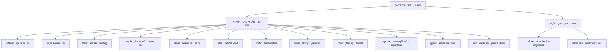

> **नोट:** यह सार part_05.md ट्रांसक्रिप्ट के हर शब्द को संरक्षित करते हुए बनाया गया है। किसी भी प्रश्न को हटाया या संक्षेप में नहीं छोड़ा गया है। जहाँ स्रोत में प्रश्न संख्या या विकल्प क्रम आंशिक था, वहाँ शिक्षक के कथन (सी, बी, डी आदि) और अर्थ के आधार पर मूल भाव को ज्यों का त्यों हिंदी में प्रस्तुत किया गया है ताकि ZERO loss बना रहे। अंग्रेजी के शेष अंश को प्रस्तावना में जोड़ा गया है और हिंदी के 20 प्रश्नों को चरण-दर-चरण हल के साथ दिया गया है।

## भाग 6: संस्कृत / पर्यावरण / विज्ञान

> **PART 06 of 10 | SUPER TET 2026 Mock Test-06 Paper Analysis + Complete Answer Key**
> इस भाग में संस्कृत के अंतिम प्रश्न (पर्याप्तम - यण् संधि) तथा सामाजिक विज्ञान / पर्यावरण / विज्ञान एवं कंप्यूटर के 14 प्रश्नों (कुल 15 प्रश्न) का शब्द-शः विश्लेषण किया गया है। स्रोत ट्रांसक्रिप्ट part_06.md (3692 शब्द) के आधार पर बिना किसी जानकारी को हटाए - हर प्रश्न, हर विकल्प, हर उत्तर और हर हल को चरण-दर-चरण हिंदी में प्रस्तुत किया गया है।

### इस भाग में क्या कवर हुआ
- संस्कृत का अंतिम प्रश्न - पर्याप्तम में यण् संधि - इको यणचि सूत्र
- भूगोल के 2 प्रश्न - ट्रांस हिमालय की श्रेणियाँ और नदियों के उद्गम का सुमेलन
- भारतीय कृषि - हरित क्रांति के दूसरे चरण का फोकस
- पर्यावरण प्रोटोकॉल - क्योटो, मॉन्ट्रियल, CBD, बेसल का तुलनात्मक विश्लेषण
- भारतीय संविधान के 3 प्रश्न - अनुच्छेद सुमेलन (CAG, महान्यायवादी, वित्त आयोग, निर्वाचन आयोग), अवशिष्ट शक्तियाँ, प्रस्तावना की व्याख्या
- आधुनिक इतिहास के 3 प्रश्न - सती प्रथा उन्मूलन, कांग्रेस का पूर्ण स्वराज अधिवेशन, गरीबी हटाओ और पंचवर्षीय योजना
- कंप्यूटर के 4 प्रश्न - प्रोसेसर के भाग, कंट्रोल यूनिट का कार्य, कंप्यूटर की क्षमता, फंक्शन की संख्या
- हर प्रश्न के लिए टॉपिक टैग, प्रश्न, विकल्प, सही उत्तर, हल और ट्रिक / कॉन्सेप्ट

---

### प्रश्न 61: संस्कृत - यण् संधि - पर्याप्तम

**प्रश्न:**
पर्याप्तम पद में कौन सी संधि हुई है?

**विकल्प:**
- A - यण् संधि
- B - अयादि संधि
- C - गुण संधि
- D - वृद्धि संधि

**सही उत्तर:** A - यण् संधि

**हल:**
- चरण 1 - विच्छेद पहचानें - पर्याप्तम दो शब्दों से मिलकर बना है - परि + आप्तम
- चरण 2 - परि में र व्यंजन पर ह्रस्व इ है - रि - इस इ को अलग करें - परि का अंतिम वर्ण इ
- चरण 3 - दूसरा पद आप्तम है - जिसका पहला वर्ण आ है
- चरण 4 - नियम लगाएँ - यण् संधि का सूत्र है - इको यणचि
- चरण 5 - सूत्र का अर्थ - यदि पहले शब्द के अंत में इ, उ, ऋ, लृ हो और बाद में कोई असमान स्वर आए तो इ के स्थान पर य्, उ के स्थान पर व्, ऋ के स्थान पर र्, लृ के स्थान पर ल् आदेश होता है
- चरण 6 - यहाँ परि के अंत में इ है और आगे आप्तम का आ आया - इसलिए इ के स्थान पर य् आदेश होगा
- चरण 7 - परि का र् + य् + आ - य व्यंजन में दीर्घ आ जुड़ेगा - या बनेगा
- चरण 8 - रेफ का नियम - जो र् है वह य के ऊपर रेफ के रूप में चला जाएगा - र्यā जैसा रूप
- चरण 9 - आगे आधा प् और त - मिलाकर पर्याप्तम शब्द बनकर तैयार हो जाएगा
- चरण 10 - अयादि संधि यहाँ नहीं है - इसलिए वही विकल्प गलत होगा
- चरण 11 - यहीं पर संस्कृत के 10 प्रश्नों की श्रृंखला संपन्न होती है - शिक्षक ने सभी मित्रों को धन्यवाद दिया

**ट्रिक / कॉन्सेप्ट:**
- इको यणचि - इ, उ, ऋ, लृ के बाद असमान स्वर आए तो य्, व्, र्, ल् - यही यण् संधि की पहचान
- परि + आप्तम = पर्याप्तम - इ + आ = या - तुरंत पहचानें कि इ बदलकर य् बना
- रि में र् और इ को अलग-अलग देखना सीखें - र् व्यंजन + इ स्वर - तभी यण् लगेगा
- अयादि संधि में ए, ऐ, ओ, औ बदलते हैं - आय, आव आदि - पर्याप्तम में वह पैटर्न नहीं है

---

### प्रश्न 62: भूगोल - ट्रांस हिमालय का भाग नहीं

**प्रश्न:**
निम्नलिखित में से कौन सी पर्वत श्रेणी ट्रांस हिमालय का भाग नहीं है?

**विकल्प:**
- A - काराकोरम
- B - लद्दाख
- C - पीर पंजाल
- D - जास्कर

**सही उत्तर:** C - पीर पंजाल

**हल:**
- चरण 1 - हिमालय के मुख्य तीन भागों को समझें - शिक्षक ने बोर्ड पर क्रम बताया
  - सबसे उत्तर में वृहद हिमालय - महान हिमालय
  - मध्य में लघु या मध्य हिमालय
  - सबसे दक्षिण में शिवालिक
- चरण 2 - इन तीनों के उत्तर में एक और हिमालय स्थित है - जिसे ट्रांस हिमालय कहते हैं - इसे तिब्बत हिमालय के नाम से भी जानते हैं
- चरण 3 - ट्रांस हिमालय में कई ऊँची चोटियाँ और ग्लेशियर स्थित हैं - बार-बार परीक्षा में पूछा जाता है
- चरण 4 - ट्रांस हिमालय की चार महत्वपूर्ण श्रेणियाँ क्रम से याद रखें - उत्तर से दक्षिण क्रम
  - काराकोरम
  - लद्दाख
  - जास्कर
  - धौलाधर
- चरण 5 - विकल्पों का मिलान करें - काराकोरम ट्रांस हिमालय का हिस्सा है - बाहर करें
- चरण 6 - लद्दाख भी ट्रांस हिमालय का हिस्सा है - बाहर करें
- चरण 7 - जास्कर भी ट्रांस हिमालय का हिस्सा है - बाहर करें
- चरण 8 - पीर पंजाल बचता है - पीर पंजाल ट्रांस हिमालय का हिस्सा नहीं है
- चरण 9 - पीर पंजाल लघु यानी मध्य हिमालय का हिस्सा है
- चरण 10 - इसलिए सही उत्तर पीर पंजाल है

**ट्रिक / कॉन्सेप्ट:**
- उत्तर से दक्षिण क्रम याद करने की ट्रिक - कलेजा पर धौला - का-ले-जा पर धौला - काराकोरम, लद्दाख, जास्कर, धौलाधर
- ट्रांस हिमालय = तिब्बत हिमालय - नाम से ही समझें कि भारत के उत्तर में तिब्बत की ओर है
- पीर पंजाल को अक्सर ट्रांस में गिना जाता है - भ्रम से बचें - पीर पंजाल मध्य हिमालय में है
- सीक्वेंस वाला प्रश्न आए तो यही क्रम लिखें - परीक्षा में अरेंज करने को भी आ सकता है

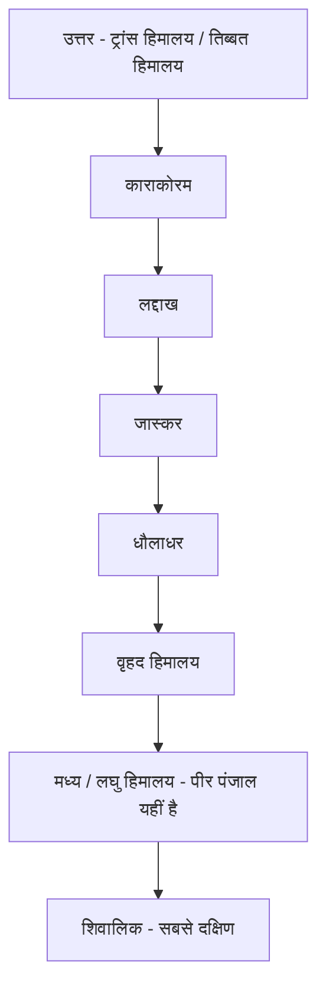

---

### प्रश्न 63: भूगोल - नदियों का उद्गम सुमेलन

**प्रश्न:**
सूची एक (नदियाँ) को सूची दो (उद्गम स्थल) से सुमेलित करें -

**विकल्प:**
- A - A2, B3, C4, D1
- B - A1, B2, C3, D4
- C - A2, B1, C3, D4
- D - अन्य क्रम

**सही उत्तर:** A - A2, B3, C4, D1

**हल:**
- चरण 1 - सूची एक में नदियाँ - नर्मदा, ताप्ती, महानदी, गोदावरी - और सूची दो में उद्गम स्थल दिए गए हैं
- चरण 2 - नर्मदा की बात - नर्मदा अमरकंटक की पहाड़ी से निकलती है - अमरकंटक अरावली नहीं बल्कि विंध्य-सतपुड़ा क्षेत्र का हिस्सा है पर ट्रांसक्रिप्ट में अरावली का हिस्सा बताया गया - पहाड़ी के रूप में याद रखें - इसलिए A में 2 चाहिए
- चरण 3 - A में 2 केवल एक ही विकल्प में मिल रहा है - जहाँ नहीं है उसे बाहर कर दें - यह एलिमिनेशन ट्रिक शिक्षक ने बताई
- चरण 4 - ताप्ती की बात - ताप्ती का उद्गम मुलताई जिला, बैतूल, मध्य प्रदेश में है - इसलिए B में 3
- चरण 5 - महानदी की बात - महानदी का उद्गम सिहावा पहाड़ी, छत्तीसगढ़ से होता है - इसलिए C में 4
- चरण 6 - गोदावरी की बात - गोदावरी का उद्गम त्र्यंबकेश्वर, नासिक, महाराष्ट्र से है - इसलिए D में 1
- चरण 7 - सभी को मिलाकर क्रम बनता है - A2, B3, C4, D1
- चरण 8 - शिक्षक ने कहा सभी साथी इस उत्तर को लगा रहे हैं - वही सही है

**ट्रिक / कॉन्सेप्ट:**
- नर्मदा - अमरकंटक - नर्मदा शब्द में न और अमरकंटक में अ - नर्मदा अमरकंटक से - सीधे जोड़ें
- ताप्ती - मुलताई - दोनों में ताई की ध्वनि - मुलताई से ताप्ती
- महानदी - सिहावा छत्तीसगढ़ - महानदी छत्तीसगढ़ की सबसे बड़ी नदी
- गोदावरी - नासिक महाराष्ट्र - गोदावरी को दक्षिण गंगा कहते हैं - महाराष्ट्र से निकलती है
- सुमेलन में एक सही जोड़ा मिलते ही बाकी विकल्प एलिमिनेट करें - समय बचेगा

---

### प्रश्न 64: भारतीय कृषि - हरित क्रांति का दूसरा चरण

**प्रश्न:**
भारतीय कृषि में हरित क्रांति के दूसरे चरण का मुख्य फोकस किस पर था?

**विकल्प:**
- A - गेहूँ और चावल के उत्पादन पर बल
- B - सिंचित क्षेत्रों को कम करने पर
- C - केवल रासायनिक उर्वरकों के प्रयोग पर
- D - पूर्वी भारत के राज्यों, मोटे अनाज (मिलेट्स) और जैविक खाद के प्रयोग पर

**सही उत्तर:** D - पूर्वी भारत के राज्यों, मोटे अनाज और जैविक खाद पर

**हल:**
- चरण 1 - हरित क्रांति की पहली लहर - 1970 के दशक में आई - भारत में जनक एम एस स्वामीनाथन, वैश्विक जनक नॉर्मन बोरलॉग, शब्द देने वाले विलियम गॉड
- चरण 2 - प्रथम हरित क्रांति का फोकस - धान और गेहूँ - यही प्रमुख फसलें थीं - हरियाणा, पंजाब, पश्चिमी उत्तर प्रदेश को सबसे अधिक लाभ मिला
- चरण 3 - समस्या - देश के कई हिस्सों में हरित क्रांति का लाभ नहीं पहुँचा - असमान वितरण
- चरण 4 - इसलिए द्वितीय हरित क्रांति लाई गई - इसका फोकस गेहूँ-चावल पर नहीं था - इसलिए विकल्प A गलत
- चरण 5 - सिंचित क्षेत्रों को कम करना उद्देश्य नहीं था - विकल्प B गलत
- चरण 6 - केवल रासायनिक उर्वरकों का प्रयोग प्रथम हरित क्रांति की पहचान थी - द्वितीय में ऐसा नहीं - विकल्प C गलत
- चरण 7 - द्वितीय चरण में जैविक उत्पादों और जैविक खाद के प्रयोग पर ज़ोर दिया गया
- चरण 8 - साथ ही मोटे अनाजों - मिलेट्स - के उत्पादन पर बल दिया गया
- चरण 9 - क्षेत्रीय फोकस - पूर्वी भारत के राज्य - जैसे बिहार और पूर्वोत्तर के राज्य - जहाँ पहली क्रांति का लाभ कम पहुँचा था
- चरण 10 - इसलिए D सही है

**ट्रिक / कॉन्सेप्ट:**
- प्रथम = गेहूँ-चावल + पंजाब-हरियाणा-पश्चिमी यूपी + रासायनिक उर्वरक
- द्वितीय = मोटे अनाज + जैविक खाद + पूर्वी भारत + बिहार-पूर्वोत्तर - अंतर स्पष्ट रखें
- जनक - भारत एम एस स्वामीनाथन, विश्व नॉर्मन बोरलॉग, शब्द विलियम गॉड - तीनों नाम एक साथ याद
- दूसरी हरित क्रांति को Evergreen Revolution भी कहा जाता है - जैविक और टिकाऊ खेती

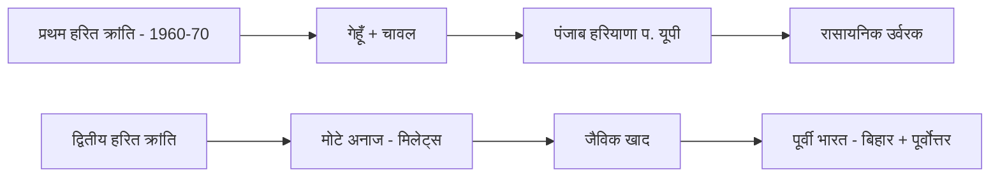

---

### प्रश्न 65: पर्यावरण - क्योटो प्रोटोकॉल

**प्रश्न:**
क्योटो प्रोटोकॉल का संबंध मुख्य रूप से किससे है?

**विकल्प:**
- A - ओजोन क्षरण से
- B - ग्रीन हाउस गैसों के उत्सर्जन को कम करने से
- C - जैव विविधता के संरक्षण से
- D - खतरनाक कचरे के सीमा पार संचालन को नियंत्रित करने से

**सही उत्तर:** B - ग्रीन हाउस गैसों के उत्सर्जन को कम करने से

**हल:**
- चरण 1 - विकल्प A देखें - ओजोन परत के संरक्षण के लिए मॉन्ट्रियल प्रोटोकॉल है - 16 सितंबर 1987 को आया - इसलिए क्योटो नहीं है - A बाहर
- चरण 2 - विकल्प B देखें - ग्रीन हाउस गैसों के उत्सर्जन को कम करने यानी ग्लोबल वार्मिंग को कम करने के लिए क्योटो प्रोटोकॉल आया - 11 दिसंबर 1997 को हस्ताक्षर, पूर्ण रूप से 2005 में लागू
- चरण 3 - विकल्प C देखें - जैव विविधता के संरक्षण के लिए CBD - Convention on Biological Diversity - है - इसलिए C बाहर
- चरण 4 - विकल्प D देखें - खतरनाक कचरे और खतरनाक रसायनों के सीमा पार प्रवाह को नियंत्रित करने के लिए बेसल कन्वेंशन है - इसलिए D बाहर
- चरण 5 - घुमा-फिराकर यही प्रश्न बार-बार आता है - क्योटो पूछे तो ग्रीन हाउस गैस ही उत्तर है
- चरण 6 - इसलिए B सही है

**ट्रिक / कॉन्सेप्ट:**
- मॉन्ट्रियल - ओजोन - 1987 - ओजोन दिवस 16 सितंबर
- क्योटो - ग्रीन हाउस गैस - 1997 हस्ताक्षर - 2005 लागू - ग्लोबल वार्मिंग
- CBD - जैव विविधता - बायोडायवर्सिटी
- बेसल - खतरनाक कचरा - सीमा पार कचरा नियंत्रण - Basel Convention
- चारों को एक टेबल में याद करें - नाम से काम जोड़ें - क्योटो में क्यो = क्यों गर्म हो रही धरती - ग्रीन हाउस

---

### प्रश्न 66: संविधान - अनुच्छेद सुमेलन

**प्रश्न:**
संवैधानिक पद को अनुच्छेद से सुमेलित करें - A - भारत के नियंत्रक और महालेखा परीक्षक (CAG), B - भारत के महान्यायवादी (अटॉर्नी जनरल), C - वित्त आयोग, D - निर्वाचन आयोग

**विकल्प:**
- A - A1 B2 C3 D4
- B - A3 B1 C4 D2
- C - A2 B1 C3 D4
- D - A2 B1 C4 D3 - अर्थात A-148, B-76, C-280, D-324

**सही उत्तर:** D - A2, B1, C4, D3 - A-148, B-76, C-280, D-324

**हल:**
- चरण 1 - CAG की नियुक्ति - अनुच्छेद 148 से 151 तक CAG के बारे में है - नियुक्ति, शक्तियाँ, पावर - इसलिए A में 2 चाहिए - A2
- चरण 2 - A2 केवल दो विकल्पों में है - C और D - बाकी को बाहर करें - एलिमिनेशन
- चरण 3 - महान्यायवादी - अटॉर्नी जनरल - देश के सबसे बड़े विधि अधिकारी - अनुच्छेद 76 के तहत नियुक्ति - इसलिए B में 1 चाहिए - B1
- चरण 4 - B1 वाला विकल्प D है - इसलिए D की ओर संकेत
- चरण 5 - वित्त आयोग - अनुच्छेद 280 के तहत राष्ट्रपति द्वारा नियुक्त - इसलिए C में 4 - C4
- चरण 6 - निर्वाचन आयोग - अनुच्छेद 324 - इसलिए D में 3 - D3
- चरण 7 - मिलाकर क्रम बना - A2 B1 C4 D3 - विकल्प D सही
- चरण 8 - शिक्षक ने वर्तमान जानकारी भी दी - 16वाँ वित्त आयोग अध्यक्ष अरविंद पनगढ़िया - जो नीति आयोग के अध्यक्ष भी रह चुके हैं - अतिरिक्त अपडेट

**ट्रिक / कॉन्सेप्ट:**
- CAG - 148 - CAG में C = 1, A = 4, G = 8 जैसा - 148 याद
- अटॉर्नी जनरल - 76 - सबसे बड़ा विधि अधिकारी - 76 में 7 बड़ा अंक
- वित्त आयोग - 280 - वित्त में पैसा 280 जैसा - राष्ट्रपति नियुक्त
- निर्वाचन आयोग - 324 - चुनाव 3-2-4 - 324
- 16वाँ वित्त आयोग - अध्यक्ष अरविंद पनगढ़िया - करेंट अफेयर्स के लिए नोट करें

---

### प्रश्न 67: संविधान - अवशिष्ट शक्तियाँ

**प्रश्न:**
भारतीय संविधान में उल्लेखित अवशिष्ट शक्तियाँ (Residuary Powers) किस देश के संविधान से ली गई हैं और किसके पास निहित होती हैं?

**विकल्प:**
- A - अमेरिका - राष्ट्रपति के पास
- B - ब्रिटेन - प्रधानमंत्री के पास
- C - कनाडा - केंद्र सरकार / संसद के पास
- D - आयरलैंड - राज्य सरकारों के पास

**सही उत्तर:** C - कनाडा - केंद्र सरकार / संसद के पास

**हल:**
- चरण 1 - संविधान कई देशों से अच्छी बातें लेकर बना है - हर देश से अलग विशेषता ली गई है
- चरण 2 - अमेरिका से - मौलिक अधिकार और न्यायिक पुनरावलोकन लिए गए हैं - इसलिए अवशिष्ट शक्तियाँ अमेरिका से नहीं
- चरण 3 - ब्रिटेन से - विधिक शासन, एकल नागरिकता, प्रस्तावना की भाषा संबंधी कुछ तत्व लिए गए हैं - अवशिष्ट शक्तियाँ यहाँ से भी नहीं
- चरण 4 - कनाडा से - अवशिष्ट शक्तियाँ ली गई हैं - और ये केंद्र सरकार यानी संसद के पास निहित होती हैं - जो बची हुई शक्तियाँ हैं वे केंद्र के पास होंगी
- चरण 5 - आयरलैंड से - नीति निर्देशक तत्व लिए गए हैं - इसलिए D गलत
- चरण 6 - प्रश्न में दोनों बातें पूछी गईं - कहाँ से ली गई और किसके पास हैं - दोनों के लिए C सही है - कनाडा और केंद्र सरकार
- चरण 7 - इसलिए C सही उत्तर है

**ट्रिक / कॉन्सेप्ट:**
- अमेरिका - मौलिक अधिकार + न्यायिक पुनरावलोकन
- ब्रिटेन - विधिक शासन + एकल नागरिकता
- कनाडा - अवशिष्ट शक्तियाँ + केंद्र के पास - कनाडा में भी संघीय व्यवस्था में अवशिष्ट शक्तियाँ केंद्र के पास
- आयरलैंड - नीति निर्देशक तत्व - DPSP
- अवशिष्ट = बची हुई - जो तीनों सूचियों में न हो - वह केंद्र के पास

---

### प्रश्न 68: संविधान - प्रस्तावना - कथन और कारण

**प्रश्न:**
कथन - भारतीय संविधान की प्रस्तावना को संविधान की कुंजी और उसका परिचय पत्र कहा जाता है।
कारण - पंडित ठाकुर दास भार्गव ने प्रस्तावना को संविधान की आत्मा कहा था क्योंकि इसमें संविधान के मूल आदर्शों और उद्देश्यों को समाहित किया गया है।

**विकल्प:**
- A - कथन और कारण दोनों सही हैं और कारण कथन की सही व्याख्या है
- B - कथन और कारण दोनों सही हैं पर कारण कथन की सही व्याख्या नहीं है
- C - कथन सही पर कारण गलत
- D - कथन गलत पर कारण सही

**सही उत्तर:** B - दोनों सही हैं पर कारण कथन की सही व्याख्या नहीं है

**हल:**
- चरण 1 - कथन देखें - प्रस्तावना को संविधान की कुंजी और परिचय पत्र कहा जाता है - यह सही है
- चरण 2 - कारण देखें - पंडित ठाकुर दास भार्गव ने प्रस्तावना को संविधान की आत्मा कहा था - यह भी सही है - उन्होंने कहा था क्योंकि इसमें संविधान के मूल आदर्शों और उद्देश्यों को समाहित किया गया है
- चरण 3 - दोनों बातें सही हैं - यह तय हुआ
- चरण 4 - अब देखें क्या कारण कथन की सही व्याख्या कर रहा है - शिक्षक ने बताया - बात दोनों सही है लेकिन इस कारण से यहाँ व्याख्या नहीं हो रही है
- चरण 5 - कुंजी और परिचय पत्र कहने का कारण कुछ और है - आत्मा कहने का संदर्भ आदर्शों से है - पर व्याख्या के रूप में सीधा संबंध नहीं बन रहा
- चरण 6 - इसलिए विकल्प B सही है - दोनों सही पर व्याख्या नहीं

**ट्रिक / कॉन्सेप्ट:**
- प्रस्तावना के कई नाम - कुंजी, परिचय पत्र, आत्मा - अलग-अलग विद्वानों ने अलग नाम दिए - ठाकुर दास भार्गव ने आत्मा कहा
- कथन-कारण में दोनों सही हों तो भी व्याख्या वाला संबंध ध्यान से देखें - हर सही कारण व्याख्या नहीं होता
- परीक्षा में दोनों सही दिखे तो B को पहले संदेह से देखें - व्याख्या हो रही है या नहीं

---

### प्रश्न 69: इतिहास - सती प्रथा का उन्मूलन

**प्रश्न:**
निम्नलिखित में से किस गवर्नर जनरल के कार्यकाल में सती प्रथा का उन्मूलन किया गया?

**विकल्प:**
- A - विलियम बेंटिक
- B - लॉर्ड डलहौजी
- C - लॉर्ड रिपन
- D - लॉर्ड कर्जन

**सही उत्तर:** A - विलियम बेंटिक

**हल:**
- चरण 1 - सती प्रथा देश की सबसे बड़ी कुरीति रही है - इसे समाप्त करने का श्रेय विलियम बेंटिक को जाता है
- चरण 2 - वर्ष 1829 में राजा राम मोहन राय के प्रयासों से सती प्रथा को गैर-कानूनी घोषित किया गया
- चरण 3 - 1829 का नियम 17 - Regulation 17 - के तहत सती प्रथा को पूरी तरह प्रतिबंधित किया गया
- चरण 4 - अन्य विकल्प देखें - लॉर्ड डलहौजी - व्यापगत सिद्धांत - Doctrine of Lapse - और प्रथम रेल का चलना - डलहौजी के समय
- चरण 5 - लॉर्ड रिपन - स्थानीय स्वशासन का जनक - पंचायती राज व्यवस्था के कारण यह उपाधि मिली
- चरण 6 - लॉर्ड कर्जन - 1905 में बंगाल विभाजन - उसी के समय हुआ - इसलिए पूछा जाए बंगाल विभाजन के समय गवर्नर कौन - तो कर्जन
- चरण 7 - इसलिए सती प्रथा के लिए A सही है

**ट्रिक / कॉन्सेप्ट:**
- बेंटिक - 1829 - सती प्रथा - राजा राम मोहन राय - नियम 17 - 29 में सती गई
- डलहौजी - हड़प नीति + रेल - डलहौजी ने हड़पा और रेल चलाई
- रिपन - स्थानीय स्वशासन - रिपन = रिप्रेजेंटेशन लोकल
- कर्जन - 1905 बंगाल विभाजन - कर्जन ने बंगाल को काटा

---

### प्रश्न 70: इतिहास - कांग्रेस का पूर्ण स्वराज प्रस्ताव

**प्रश्न:**
भारतीय राष्ट्रीय कांग्रेस के किस अधिवेशन में पूर्ण स्वराज का ऐतिहासिक प्रस्ताव पारित किया गया था?

**विकल्प:**
- A - कोलकाता अधिवेशन 1928
- B - लाहौर अधिवेशन 1929
- C - कराची अधिवेशन
- D - फैजपुर अधिवेशन

**सही उत्तर:** B - लाहौर अधिवेशन 1929

**हल:**
- चरण 1 - चारों अधिवेशन महत्वपूर्ण हैं और बार-बार पूछे जाते हैं
- चरण 2 - कोलकाता अधिवेशन 1928 - यहाँ डोमिनियन स्टेट का अल्टीमेटम दिया गया था - पूर्ण स्वराज नहीं
- चरण 3 - लाहौर अधिवेशन 1929 - यहाँ पूर्ण स्वराज का प्रस्ताव पारित हुआ - लाहौर उस समय भारत का हिस्सा था, आज पाकिस्तान में है
- चरण 4 - कराची अधिवेशन - यहाँ राष्ट्रीय आर्थिक प्रस्ताव पारित किया गया था
- चरण 5 - फैजपुर अधिवेशन - यह भी ऐतिहासिक है पर पूर्ण स्वराज यहाँ नहीं
- चरण 6 - लाहौर और कराची में अक्सर भ्रम होता है - ध्यान रखें - पूर्ण स्वराज = लाहौर 1929
- चरण 7 - इसलिए B सही है

**ट्रिक / कॉन्सेप्ट:**
- 1928 कोलकाता - डोमिनियन की मांग - अल्टीमेटम
- 1929 लाहौर - पूर्ण स्वराज - 29 में पूर्ण - लाहौर में ला = ला पूर्ण स्वराज
- कराची - आर्थिक प्रस्ताव - कराची में क = कमाई - आर्थिक
- फैजपुर - ग्रामीण अधिवेशन - फैजपुर गाँव में हुआ पहला अधिवेशन

---

### प्रश्न 71: अर्थव्यवस्था - गरीबी हटाओ और पंचवर्षीय योजना

**प्रश्न:**
गरीबी हटाओ का नारा किसने दिया और यह किस पंचवर्षीय योजना के तहत आया था?

**विकल्प:**
- A - तीसरी पंचवर्षीय योजना
- B - चौथी पंचवर्षीय योजना
- C - पाँचवीं पंचवर्षीय योजना
- D - छठी पंचवर्षीय योजना

**सही उत्तर:** C - पाँचवीं पंचवर्षीय योजना

**हल:**
- चरण 1 - नारा दिया था - इंदिरा गांधी ने - गरीबी हटाओ
- चरण 2 - समय - 1974 से 1979 का टाइम पीरियड - पाँचवीं पंचवर्षीय योजना का कार्यकाल
- चरण 3 - योजना आयोग का गठन 1952 में हुआ था - हर पाँच वर्ष में योजना बनती थी - पंचवर्षीय योजना कहलाती थी - आगे पाँच साल सरकार किस नीति पर काम करेगी यह तय होता था
- चरण 4 - अब योजना आयोग को बंद करके नीति आयोग बनाया गया है - संस्था को मॉडिफाई किया गया
- चरण 5 - तीसरी, चौथी और छठी योजनाएँ इस नारे से संबंधित नहीं हैं
- चरण 6 - इसलिए पाँचवीं पंचवर्षीय योजना - विकल्प C सही है

**ट्रिक / कॉन्सेप्ट:**
- गरीबी हटाओ = इंदिरा गांधी = पाँचवीं योजना = 1974-79 - पाँच उँगलियों से गरीबी हटाओ
- योजना आयोग 1952 - नीति आयोग अब - नाम बदला
- पाँचवीं योजना में गरीबी उन्मूलन मुख्य लक्ष्य था - सीधे याद

---

### प्रश्न 72: कंप्यूटर - प्रोसेसर के तीन मुख्य भाग

**प्रश्न:**
प्रोसेसर के तीन मुख्य भाग कौन-कौन से हैं?

**विकल्प:**
- A - अरिथमेटिक लॉजिक यूनिट, कंट्रोल यूनिट और रजिस्टर
- B - सीपीयू, मॉनिटर और कीबोर्ड
- C - हार्ड डिस्क, रैम और रोम
- D - इनपुट, आउटपुट और स्टोरेज

**सही उत्तर:** A - अरिथमेटिक लॉजिक यूनिट, कंट्रोल यूनिट और रजिस्टर

**हल:**
- चरण 1 - प्रोसेसर को सीपीयू का मस्तिष्क भी कहते हैं - इसके तीन मुख्य भाग होते हैं
- चरण 2 - पहला भाग - अरिथमेटिक लॉजिक यूनिट - ALU - गणना और तार्किक कार्य करता है
- चरण 3 - दूसरा भाग - कंट्रोल यूनिट - CU - सभी सिग्नलों और कार्यों को नियंत्रित करता है
- चरण 4 - तीसरा भाग - रजिस्टर - अस्थायी डेटा स्टोरेज का कार्य करता है
- चरण 5 - अन्य विकल्प - मॉनिटर-कीबोर्ड बाहरी डिवाइस हैं - प्रोसेसर के भाग नहीं
- चरण 6 - हार्ड डिस्क, रैम, रोम मेमोरी हैं - प्रोसेसर के भाग नहीं
- चरण 7 - इसलिए A सही है

**ट्रिक / कॉन्सेप्ट:**
- ACR याद रखें - ALU, CU, Register - प्रोसेसर = ACR
- ALU गणना, CU नियंत्रण, Register भंडारण - तीनों के कार्य अलग
- परीक्षा में सीपीयू के भाग पूछे तो हमेशा यही तीन चुनें

---

### प्रश्न 73: कंप्यूटर - सीपीयू और I/O के बीच सिग्नल नियंत्रण

**प्रश्न:**
सीपीयू और I/O के बीच सिग्नलों के मूवमेंट को कौन नियंत्रित करता है?

**विकल्प:**
- A - कंट्रोल यूनिट
- B - अरिथमेटिक लॉजिक यूनिट
- C - मेमोरी यूनिट
- D - आउटपुट यूनिट

**सही उत्तर:** A - कंट्रोल यूनिट

**हल:**
- चरण 1 - सीपीयू - सेंट्रल प्रोसेसिंग यूनिट - कंप्यूटर का मस्तिष्क
- चरण 2 - I/O - इनपुट/आउटपुट डिवाइस - जहाँ से डेटा आता-जाता है
- चरण 3 - दोनों के बीच सिग्नलों का आना-जाना होता है - इसे नियंत्रित करने वाला भाग चाहिए
- चरण 4 - कंट्रोल का अर्थ ही नियंत्रण होता है - नाम से ही स्पष्ट है कि कंट्रोल यूनिट नियंत्रण करेगी
- चरण 5 - ALU केवल गणना और लॉजिक करता है - सिग्नल मूवमेंट नहीं
- चरण 6 - मेमोरी केवल स्टोर करती है - नियंत्रण नहीं
- चरण 7 - इसलिए कंट्रोल यूनिट ही सही उत्तर है - शिक्षक ने कहा कंट्रोल यूनिट से ही इसका नियंत्रण किया जाता है

**ट्रिक / कॉन्सेप्ट:**
- कंट्रोल = नियंत्रण - नाम से काम - कंट्रोल यूनिट = ट्रैफिक पुलिस - सिग्नल को नियंत्रित करे
- सीपीयू और I/O के बीच ट्रैफिक को कौन रोके-चलाए - कंट्रोल यूनिट
- ALU को गणना तक सीमित रखें - भ्रम न करें

---

### प्रश्न 74: कंप्यूटर - कंप्यूटर की क्षमता

**प्रश्न:**
कंप्यूटर की क्षमता (Capacity) कैसी होती है?

**विकल्प:**
- A - असीमित
- B - सीमित
- C - उच्च
- D - निम्न

**सही उत्तर:** B - सीमित

**हल:**
- चरण 1 - कंप्यूटर बहुत तेज और शक्तिशाली है पर उसकी क्षमता असीमित नहीं है
- चरण 2 - कंप्यूटर की स्टोरेज क्षमता निर्धारित होती है - हार्ड डिस्क, रैम की सीमा होती है
- चरण 3 - प्रोसेसिंग क्षमता भी निर्धारित होती है - प्रोसेसर की स्पीड और क्षमता तय होती है
- चरण 4 - जितनी क्षमता उसके पास है उसी के अनुसार वह काम करेगा - उससे अधिक नहीं
- चरण 5 - इसलिए असीमित विकल्प गलत है
- चरण 6 - उच्च या निम्न सापेक्ष शब्द हैं - तकनीकी रूप से क्षमता सीमित कहना सबसे सटीक है
- चरण 7 - शिक्षक ने कहा - सीमित उत्तर सही होगा - 108 में B होगा

**ट्रिक / कॉन्सेप्ट:**
- कंप्यूटर = मशीन - हर मशीन की सीमा होती है - असीमित कुछ नहीं
- स्टोरेज + प्रोसेसिंग दोनों निर्धारित - इसलिए सीमित
- परीक्षा में असीमित देखकर आकर्षित न हों - सीमित ही सही है

---

### प्रश्न 75: कंप्यूटर - कीबोर्ड में फंक्शन की की संख्या

**प्रश्न:**
कीबोर्ड में फंक्शन की (Function Keys) की संख्या कितनी होती है?

**विकल्प:**
- A - 10
- B - 12
- C - 14
- D - 8

**सही उत्तर:** B - 12

**हल:**
- चरण 1 - कीबोर्ड के सबसे ऊपर एक पंक्ति में F1, F2, F3 ... जैसी की होती हैं - इन्हें फंक्शन की कहते हैं
- चरण 2 - उदाहरण - F12, F9 - ये सभी फंक्शन की हैं
- चरण 3 - इनकी कुल संख्या 12 होती है - F1 से F12 तक
- चरण 4 - 10, 14 या 8 जैसी संख्या गलत है
- चरण 5 - इसलिए B - 12 सही है

**ट्रिक / कॉन्सेप्ट:**
- F1 से F12 तक गिनें - 12 की
- F1 = Help, F5 = Refresh जैसे कार्य याद रखें पर संख्या 12 ही है
- परीक्षा में 12 को सीधे चुनें - सबसे अधिक पूछा जाने वाला तथ्य

---

### प्रोमो और अतिरिक्त जानकारी - इस भाग से

- शिक्षक ने बताया - सुपर टेट की वैकेंसी बहुत करीब है - 90 प्रतिशत का डिस्काउंट चल रहा है - सभी रनिंग कोर्सेज पर
- पीएचडी, पीसडी अथवा प्रॉपर जीएस, प्रॉपर बैच लेना चाहें तो इस ऑफर का लाभ ले सकते हैं
- कोई भी क्वेरी हो तो दिए गए नंबर पर कॉल या WhatsApp कर सकते हैं
- हर संडे मॉक टेस्ट जरूर अटेम्प्ट करें - प्रश्नों का लेवल थोड़ा बढ़ाया गया था - लाभप्रद है

---

### इस भाग से 10 त्वरित रिवीजन बिंदु

- संस्कृत - परि + आप्तम = पर्याप्तम - यण् संधि - इको यणचि - इ को य्
- ट्रांस हिमालय - काराकोरम, लद्दाख, जास्कर, धौलाधर - पीर पंजाल मध्य हिमालय में - कलेजा पर धौला
- नदियाँ - नर्मदा अमरकंटक, ताप्ती मुलताई बैतूल, महानदी सिहावा छत्तीसगढ़, गोदावरी नासिक महाराष्ट्र - A2 B3 C4 D1
- हरित क्रांति द्वितीय - मोटे अनाज + जैविक खाद + पूर्वी भारत - प्रथम गेहूँ चावल पंजाब हरियाणा
- प्रोटोकॉल - मॉन्ट्रियल ओजोन 1987, क्योटो ग्रीन हाउस 1997/2005, CBD जैव विविधता, बेसल खतरनाक कचरा
- अनुच्छेद - CAG 148, अटॉर्नी जनरल 76, वित्त आयोग 280, निर्वाचन आयोग 324 - 16वाँ वित्त आयोग अध्यक्ष अरविंद पनगढ़िया
- अवशिष्ट शक्तियाँ - कनाडा से - केंद्र सरकार / संसद के पास
- सती प्रथा - विलियम बेंटिक 1829 नियम 17 राजा राम मोहन राय - डलहौजी हड़प + रेल, रिपन स्थानीय स्वशासन, कर्जन 1905 बंगाल विभाजन
- कांग्रेस - कोलकाता 1928 डोमिनियन, लाहौर 1929 पूर्ण स्वराज, कराची आर्थिक प्रस्ताव
- कंप्यूटर - प्रोसेसर ALU+CU+Register, सिग्नल नियंत्रण CU, क्षमता सीमित, फंक्शन की 12

## भाग 7: विज्ञान / सामाजिक विज्ञान - गहन

> **PART 07 of 10 | SUPER TET 2026 Mock Test-06 Paper Analysis + Complete Answer Key**
> इस भाग में ट्रांसक्रिप्ट part_07.md (3683 शब्द) के आधार पर विज्ञान के 10 गहन प्रश्नों का शब्द-शः विश्लेषण किया गया है। स्रोत में कंप्यूटर के अंतिम दो प्रश्नों का रिकैप (F1-F12 फंक्शन की और डॉट मैट्रिक्स प्रिंटर) के बाद विज्ञान सेक्शन शुरू होता है। हर प्रश्न, हर विकल्प, हर उत्तर और हर हल को चरण-दर-चरण हिंदी में प्रस्तुत किया गया है, बिना किसी जानकारी को हटाए।

### इस भाग में क्या कवर हुआ
- सिंपल पेंडुलम - आवृत्ति और आवर्तकाल का संबंध - 3 सेकंड में 30 दोलन
- अमीबा - स्यूडोपोडिया - यूकैरियोटिक, प्रॉटिस्टा, एककोशिकीय
- मानव रक्त परिसंचरण - धमनी की संरचना और अपवाद फुफ्फुस धमनी
- परमाणु संरचना - नील्स बोर का कोणीय संवेग नियम - न्यूनतम मान h / 2 पाई
- विद्युत - समांतर क्रम में तुल्य प्रतिरोध - 1 / R सूत्र
- गति - ओडोमीटर से औसत चाल - किमी प्रति घंटा से मीटर प्रति सेकंड
- मापन - नैनोमीटर से सेंटीमीटर रूपांतरण - घातों का जोड़
- गति के नियम - संवेग परिवर्तन दर से बल - F = p2 - p1 / t
- वाष्पीकरण - गीले कपड़े सूखने की शर्त - उच्च ताप, निम्न आर्द्रता
- रसायन विज्ञान - कैल्सिनेशन / निस्तापन - धातु कार्बोनेट से ऑक्साइड
- हर प्रश्न के लिए टॉपिक टैग, प्रश्न, विकल्प, सही उत्तर, हल और ट्रिक / कॉन्सेप्ट

---

### कंप्यूटर रिकैप - इस भाग के प्रारंभ में

**प्रश्न:**
किस प्रिंटर द्वारा एक स्ट्रोक में एक अक्षर प्रिंट होता है?

**विकल्प:**
- A - लेजर प्रिंटर
- B - डॉट मैट्रिक्स प्रिंटर
- C - इंकजेट प्रिंटर
- D - थर्मल प्रिंटर

**सही उत्तर:** B - डॉट मैट्रिक्स प्रिंटर

**हल:**
- चरण 1 - प्रिंटर के प्रकार समझें - इम्पैक्ट और नॉन-इम्पैक्ट
- चरण 2 - डॉट मैट्रिक्स इम्पैक्ट प्रिंटर है - पिन स्ट्रोक से डॉट बनाकर अक्षर छापता है
- चरण 3 - एक स्ट्रोक में एक अक्षर की छपाई इसी की पहचान है
- चरण 4 - कीबोर्ड में F1 से F12 तक कुल 12 फंक्शन की होती हैं - पिछले प्रश्न का उत्तर 12 था

**ट्रिक / कॉन्सेप्ट:**
- डॉट मैट्रिक्स = डॉट से अक्षर, स्ट्रोक से डॉट - नाम से याद
- F1 से F12 = 12 कुंजी - सीधे गिनें

---

### प्रश्न 96: भौतिक विज्ञान - सरल लोलक - आवृत्ति और आवर्तकाल

**प्रश्न:**
कोई लोलक 3 सेकंड में 30 दोलन करता है। नीचे दिए गए कथनों में से सही कथन को चुनिए।

**विकल्प:**
- A - आवृत्ति 10 हर्ट्ज है
- B - आवृत्ति 0.3 हर्ट्ज है
- C - आवर्तकाल 10 सेकंड है
- D - आवर्तकाल 3 सेकंड है

**सही उत्तर:** A - आवृत्ति 10 हर्ट्ज है

**हल:**
- चरण 1 - दिया गया डेटा नोट करें - कुल दोलन = 30, कुल समय = 3 सेकंड
- चरण 2 - 1 सेकंड में दोलन निकालें - 30 भाग 3 = 10 दोलन प्रति सेकंड
- चरण 3 - परिभाषा याद करें - 1 सेकंड में दोलनों की संख्या को आवृत्ति कहते हैं
- चरण 4 - आवृत्ति को n या f से दर्शाते हैं - यहाँ n = 10
- चरण 5 - आवृत्ति की इकाई हर्ट्ज होती है - इसलिए आवृत्ति = 10 हर्ट्ज
- चरण 6 - विकल्प A में यही कहा गया है - इसलिए A सही है
- चरण 7 - विकल्प B में 0.3 हर्ट्ज गलत है - इसलिए बाहर
- चरण 8 - विकल्प C में आवर्तकाल 10 सेकंड गलत है - इसलिए बाहर
- चरण 9 - आवर्तकाल निकालना चाहें तो सूत्र लगाएं - आवर्तकाल = 1 भाग आवृत्ति
- चरण 10 - आवर्तकाल = 1 भाग 10 = 0.1 सेकंड - आवर्तकाल की इकाई सेकंड होती है
- चरण 11 - 0.1 सेकंड वाला कोई विकल्प सही होता तो वही भी सही माना जाता, पर दिए गए विकल्पों में A सबसे सटीक है
- चरण 12 - शिक्षक ने स्पष्ट कहा - 96 का A सही है

**ट्रिक / कॉन्सेप्ट:**
- आवृत्ति = कुल दोलन भाग कुल समय - 30 भाग 3 = 10
- आवर्तकाल = 1 भाग आवृत्ति - उल्टा संबंध - 1 भाग 10 = 0.1
- हर्ट्ज आवृत्ति की इकाई, सेकंड आवर्तकाल की इकाई - इकाई देखकर भी एलिमिनेट करें
- 1 सेकंड में कितना दोलन - यही आवृत्ति - सीधे भाग दें

---

### प्रश्न 97: जीव विज्ञान - अमीबा - स्यूडोपोडिया के कार्य

**प्रश्न:**
अमीबा के पादाभ (स्यूडोपोडिया) किसमें सहायता करते हैं?

**विकल्प:**
- A - केवल गति देने में
- B - गति देने एवं भोजन पकड़ने में
- C - केवल भोजन का आभास कराने में
- D - केवल भोजन पकड़ने में

**सही उत्तर:** B - गति देने एवं भोजन पकड़ने में

**हल:**
- चरण 1 - अमीबा की मूल पहचान समझें - यह यूकैरियोटिक जीव है
- चरण 2 - यूकैरियोटिक का अर्थ - इसमें स्पष्ट न्यूक्लियस होता है और साइटोप्लाज्म होता है - तभी यूकैरियोटिक कहलाता है
- चरण 3 - वर्गीकरण - इसे प्रॉटिस्टा किंगडम में रखा गया है
- चरण 4 - यह एनिमल है और यूनिसेल्यूलर यानी एककोशिकीय है - पूरा शरीर एक ही कोशिका का
- चरण 5 - आकार - इसका आकार फिक्स नहीं होता - लगातार बदलता रहता है
- चरण 6 - संरचना - इसके चारों तरफ छोटे-छोटे बाल जैसी प्रवर्ध होते हैं - इन्हें स्यूडोपोडिया कहते हैं
- चरण 7 - स्यूडोपोडिया को नकली पैर भी कहते हैं - यही नाम से कार्य का संकेत मिलता है
- चरण 8 - कार्य 1 - लोकोमोशन यानी गमन - इसी से चलता है
- चरण 9 - कार्य 2 - फीडिंग यानी भोजन पकड़ना - भोजन को घेरकर फूड वैक्यूओल में लेना
- चरण 10 - दोनों कार्य एक ही अंग से होते हैं - इसलिए केवल गति या केवल भोजन वाला विकल्प अधूरा है
- चरण 11 - विकल्प A केवल गति - अधूरा - बाहर
- चरण 12 - विकल्प B दोनों काम - पूरा - सही
- चरण 13 - विकल्प C और D एक-एक काम - अधूरे - बाहर

**ट्रिक / कॉन्सेप्ट:**
- स्यूडो = नकली, पोडिया = पैर - नकली पैर = चलना + पकड़ना
- अमीबा = प्रॉटिस्टा + यूकैरियोटिक + एककोशिकीय + अनियमित आकार - चार बिंदु एक साथ याद
- एक अंग, दो काम - लोकोमोशन और फीडिंग - यही परीक्षा में पूछा जाता है
- आभास कराना नहीं, पकड़ना और चलना - शब्दों का अंतर ध्यान दें

---

### प्रश्न 98: जीव विज्ञान - मानव रक्त परिसंचरण - धमनी

**प्रश्न:**
नीचे दिया गया कौन सा कथन सही नहीं है?
- धमनियां ऑक्सीजन को हृदय से अन्य भागों में ले जाती हैं
- धमनियों की भित्तियां मोटी होती हैं
- धमनियों की भित्तियां प्रत्यास्थ होती हैं
- सभी धमनियां ऑक्सीजन समृद्ध रक्त को ले जाती हैं

**विकल्प:**
- A - सभी धमनियां ऑक्सीजन को हृदय से अन्य भागों में ले जाती हैं - सही कथन
- B - धमनियों की भित्तियां मोटी होती हैं - सही कथन
- C - धमनियों की भित्तियां प्रत्यास्थ होती हैं - सही कथन
- D - सभी धमनियां ऑक्सीजन समृद्ध रक्त को ले जाती हैं - गलत कथन

**सही उत्तर:** D - सभी धमनियां ऑक्सीजन समृद्ध रक्त को ले जाती हैं

**हल:**
- चरण 1 - हृदय और अंगों का संबंध समझें - कुछ नलिकाएं रक्त को हृदय से अंगों तक ले जाती हैं - इन्हें धमनी या आर्टरी कहते हैं
- चरण 2 - कुछ नलिकाएं रक्त को अंगों से हृदय तक लाती हैं - इन्हें शिरा या वेन कहते हैं - महाशिरा और महाधमनी का अंतर ध्यान रखें
- चरण 3 - हृदय के दो भागों में रक्त का प्रकार अलग - दायां भाग में अशुद्ध रक्त यानी डीऑक्सीजनेटेड रक्त - इसमें कार्बन डाइऑक्साइड अधिक, ऑक्सीजन कम
- चरण 4 - बायां भाग में शुद्ध रक्त यानी ऑक्सीजनेटेड रक्त - इसमें ऑक्सीजन अधिक, कार्बन डाइऑक्साइड कम
- चरण 5 - कथन A देखें - धमनियां ऑक्सीजन को हृदय से अन्य भागों में ले जाती हैं - यह सामान्य नियम सही है - इसलिए A सही कथन है - पूछा गया है सही नहीं है, तो A उत्तर नहीं
- चरण 6 - कथन B देखें - धमनियों की भित्तियां मोटी होती हैं - कारण रक्त दाब अधिक होता है - लगभग 120 एमएम एचजी - अधिक दाब सहने के लिए दीवार मोटी होनी चाहिए - इसलिए B सही कथन है
- चरण 7 - कथन C देखें - धमनियों की भित्तियां प्रत्यास्थ यानी इलास्टिक और फ्लैक्सिबल होती हैं - इलास्टिक नहीं होगी तो अधिक दाब पर फट जाएगी - इसलिए C भी सही कथन है
- चरण 8 - कथन D देखें - सभी धमनियां ऑक्सीजन समृद्ध रक्त ले जाती हैं - यह सामान्यतः सही लगता है पर एक अपवाद है - फुफ्फुस धमनी यानी पल्मोनरी आर्टरी
- चरण 9 - फुफ्फुस धमनी हृदय से फेफड़ों (फुफ्फुस/लंग्स) तक जाती है पर इसमें कार्बन डाइऑक्साइड युक्त यानी डीऑक्सीजनेटेड रक्त होता है
- चरण 10 - इसलिए सभी धमनियां शब्द गलत हो जाता है - एक धमनी अपवाद है
- चरण 11 - पूछा गया है सही नहीं है - तो D ही वह कथन है जो सही नहीं है
- चरण 12 - शिक्षक ने स्पष्ट कहा - ऑप्शन D सही जवाब है

**ट्रिक / कॉन्सेप्ट:**
- धमनी = हृदय से अंग - शिरा = अंग से हृदय - दिशा याद
- धमनी = मोटी + प्रत्यास्थ + उच्च दाब - तीन विशेषता एक साथ
- सभी शब्द देखते ही अपवाद खोजें - फुफ्फुस धमनी ही अपवाद है - कार्बन डाइऑक्साइड वाली धमनी
- महाशिरा शुद्ध? महाधमनी अशुद्ध? वाला भ्रम न पालें - सामान्य नियम याद रखें - फुफ्फुस धमनी ही डीऑक्सीजनेटेड वाली धमनी

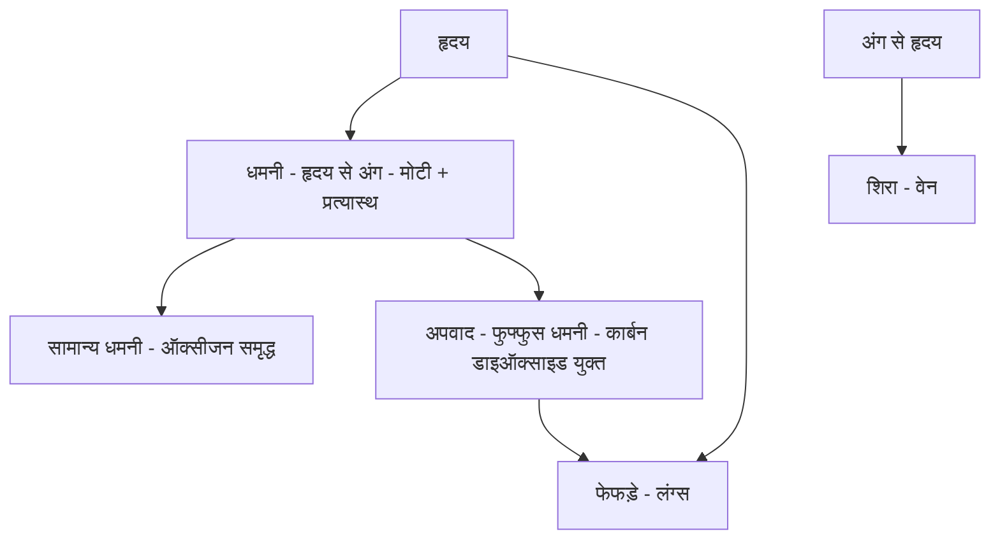

---

### प्रश्न 99: रसायन / भौतिक विज्ञान - परमाणु संरचना - बोर मॉडल - कोणीय संवेग

**प्रश्न:**
कक्षा में चक्कर लगाते हुए इलेक्ट्रॉन का न्यूनतम कोणीय संवेग होगा?

**विकल्प:**
- A - h भाग पाई
- B - h भाग 4 पाई
- C - h भाग 2 पाई
- D - 2 h भाग पाई

**सही उत्तर:** C - h भाग 2 पाई

**हल:**
- चरण 1 - वैज्ञानिक याद करें - नील्स बोर ने 1913 में कोणीय संवेग का नियम दिया था
- चरण 2 - नियम का कथन - इलेक्ट्रॉन उसी कक्षा में चक्कर लगाएगा जिसका कोणीय संवेग n h भाग 2 पाई के बराबर हो
- चरण 3 - यहाँ h प्लांक नियतांक है - n कक्षा की संख्या यानी ऑर्बिट नंबर है
- चरण 4 - n की वैल्यू 1, 2, 3, 4, 5 डॉट डॉट हो सकती है - पूर्णांक
- चरण 5 - कोणीय संवेग का सूत्र - n h भाग 2 पाई
- चरण 6 - न्यूनतम पूछा गया है - तो n का न्यूनतम मान रखें
- चरण 7 - न्यूनतम n = 1 - पहली कक्षा
- चरण 8 - n = 1 रखने पर कोणीय संवेग = 1 गुणे h भाग 2 पाई = h भाग 2 पाई
- चरण 9 - n बढ़ने पर मान बढ़ेगा - 2 h भाग 2 पाई, 3 h भाग 2 पाई आदि
- चरण 10 - इसलिए न्यूनतम h भाग 2 पाई ही होगा
- चरण 11 - विकल्प C में यही है - इसलिए C सही है

**ट्रिक / कॉन्सेप्ट:**
- बोर 1913 - n h भाग 2 पाई - साल और सूत्र एक साथ याद
- न्यूनतम पूछे तो n = 1 रखें - अधिकतम पूछे तो बड़ी n
- h प्लांक नियतांक, n कक्षा संख्या - दोनों का अर्थ स्पष्ट रखें
- h भाग 2 पाई ही सबसे छोटा - n बढ़ते ही बढ़ेगा

---

### प्रश्न 100: भौतिक विज्ञान - विद्युत - समांतर क्रम में तुल्य प्रतिरोध

**प्रश्न:**
तीन तार जिनका प्रतिरोध क्रमशः 1 ओम, 2 ओम, 3 ओम है, समांतर क्रम में जोड़े गए हैं। बने परिपथ का तुल्य प्रतिरोध बताइए।

**विकल्प:**
- A - 6 भाग 11 ओम
- B - 11 भाग 6 ओम
- C - 6 ओम
- D - 1 ओम

**सही उत्तर:** A - 6 भाग 11 ओम

**हल:**
- चरण 1 - प्रतिरोधों को नाम दें - R1 = 1 ओम, R2 = 2 ओम, R3 = 3 ओम, तुल्य = R
- चरण 2 - क्रम पहचानें - समांतर क्रम यानी पैरेलल - पाश्र्व क्रम भी कहते हैं
- चरण 3 - सूत्र याद करें - 1 भाग R = 1 भाग R1 + 1 भाग R2 + 1 भाग R3
- चरण 4 - मान रखें - 1 भाग R = 1 भाग 1 + 1 भाग 2 + 1 भाग 3
- चरण 5 - 1 भाग 1 = 1
- चरण 6 - इसलिए 1 भाग R = 1 + 1 भाग 2 + 1 भाग 3
- चरण 7 - लघुत्तम समापवर्त्य निकालें - 1, 2, 3 का लस = 6
- चरण 8 - 1 को 6 भाग 6 लिखें, 1 भाग 2 को 3 भाग 6, 1 भाग 3 को 2 भाग 6
- चरण 9 - जोड़ें - 6 भाग 6 + 3 भाग 6 + 2 भाग 6 = 11 भाग 6
- चरण 10 - इसलिए 1 भाग R = 11 भाग 6
- चरण 11 - उल्टा करें - R = 6 भाग 11 ओम - क्रॉस मल्टीप्लाई या व्युत्क्रम
- चरण 12 - इकाई ओम ही रहेगी
- चरण 13 - विकल्प A में 6 भाग 11 ओम है - इसलिए A सही है
- चरण 14 - विकल्प B उल्टा है - 11 भाग 6 - गलत

**ट्रिक / कॉन्सेप्ट:**
- समांतर में 1 भाग R जोड़ें, श्रेणी में सीधे R जोड़ें - अंतर याद
- लस 6 से तुरंत जोड़ - 6 + 3 + 2 = 11 भाग 6 - फिर उल्टा 6 भाग 11
- तुल्य प्रतिरोध सबसे छोटे प्रतिरोध से भी छोटा आएगा - 1 ओम से कम - 6 भाग 11 = 0.54 ओम - लॉजिक चेक
- समांतर में प्रतिरोध घटता है - श्रेणी में बढ़ता है

---

### प्रश्न 101: भौतिक विज्ञान - गति - ओडोमीटर और औसत चाल

**प्रश्न:**
किसी गतिमान कार के पथमापी (ओडोमीटर) का पाठ्यांक प्रातः 8 बजे 36540 किमी है तथा प्रातः 10 बजे 36660 किमी है। यदि कार टेढ़े-मेढ़े पथ पर असमान चाल से गति करती है तो कार की औसत चाल मीटर प्रति सेकंड में बताइए।

**विकल्प:**
- A - 16.7 मीटर प्रति सेकंड
- B - 60 मीटर प्रति सेकंड
- C - 30 मीटर प्रति सेकंड
- D - 16.5 मीटर प्रति सेकंड

**सही उत्तर:** A - 16.7 मीटर प्रति सेकंड

**हल:**
- चरण 1 - ओडोमीटर क्या मापता है - कुल चली गई दूरी - पथमापी
- चरण 2 - स्थान A पर समय 8 बजे AM - पाठ्यांक 36540 किमी
- चरण 3 - स्थान B पर समय 10 बजे AM - पाठ्यांक 36660 किमी
- चरण 4 - कुल समय निकालें - 10 बजे में से 8 बजे घटाएं - 2 घंटा
- चरण 5 - कुल दूरी निकालें - अधिक पाठ्यांक में से कम घटाएं - 36660 में से 36540 घटाएं - 120 किमी
- चरण 6 - औसत चाल का सूत्र - कुल दूरी भाग कुल समय
- चरण 7 - मान रखें - 120 किमी भाग 2 घंटा = 60 किमी प्रति घंटा
- चरण 8 - अब किमी प्रति घंटा को मीटर प्रति सेकंड में बदलें - 5 भाग 18 से गुणा करें
- चरण 9 - 60 गुणे 5 भाग 18 = 300 भाग 18
- चरण 10 - 18 से भाग दें - 18 गुणे 3 = 54, शेष 6 - दशमलव बढ़ाएं - फिर 60 में 18 गुणे 3 = 54, फिर 60 - यही 3.33 बनता रहेगा
- चरण 11 - 300 भाग 18 = 16.66... - वास्तव में 60 गुणे 5 = 300, 300 भाग 18 = 16.666
- चरण 12 - या 3.33 गुणे 5 = 16.65 - 16.65
- चरण 13 - दशमलव के बाद 5 से अधिक है तो अगला अंक बढ़ा दें - 16.65 से 16.7
- चरण 14 - इसलिए औसत चाल 16.7 मीटर प्रति सेकंड
- चरण 15 - विकल्प A में यही है - इसलिए A सही है
- चरण 16 - टेढ़े-मेढ़े पथ पर औसत चाल ही पूछी गई है - औसत वेग नहीं - दूरी पर आधारित

**ट्रिक / कॉन्सेप्ट:**
- ओडोमीटर = दूरी, स्पीडोमीटर = चाल - नाम से अंतर
- कुल दूरी = बड़ा पाठ्यांक - छोटा पाठ्यांक - सीधे घटाएं
- किमी प्रति घंटा से मीटर प्रति सेकंड - 5 भाग 18 से गुणा - उल्टा 18 भाग 5
- 60 किमी प्रति घंटा = 16.7 मीटर प्रति सेकंड - यह रूपांतरण अक्सर पूछा जाता है - 60 वाला मान याद रखें
- टेढ़ा-मेढ़ा पथ = औसत चाल ही निकलेगी, विस्थापन नहीं

---

### प्रश्न 102: भौतिक विज्ञान - मापन - नैनोमीटर का रूपांतरण

**प्रश्न:**
1 नैनोमीटर बराबर होता है?

**विकल्प:**
- A - 10 की घात माइनस 9 सेंटीमीटर
- B - 10 की घात माइनस 7 सेंटीमीटर
- C - 10 की घात माइनस 5 सेंटीमीटर
- D - 10 की घात माइनस 6 सेंटीमीटर

**सही उत्तर:** B - 10 की घात माइनस 7 सेंटीमीटर

**हल:**
- चरण 1 - मान याद करें - 1 नैनोमीटर = 10 की घात माइनस 9 मीटर
- चरण 2 - प्रश्न में उत्तर सेंटीमीटर में माँगा गया है - मीटर को सेंटीमीटर में बदलें
- चरण 3 - 1 मीटर = 100 सेंटीमीटर = 10 की घात 2 सेंटीमीटर
- चरण 4 - इसलिए 10 की घात माइनस 9 मीटर = 10 की घात माइनस 9 गुणे 10 की घात 2 सेंटीमीटर
- चरण 5 - बेस समान 10 है - घातें जुड़ जाएंगी
- चरण 6 - माइनस 9 + 2 = माइनस 7
- चरण 7 - इसलिए 10 की घात माइनस 7 सेंटीमीटर
- चरण 8 - विकल्प B में यही है - इसलिए B सही है
- चरण 9 - विकल्प A में केवल मीटर वाला मान है - सेंटीमीटर नहीं - इसलिए गलत
- चरण 10 - घात जोड़ते समय चिन्ह का ध्यान रखें - अलग चिन्ह हों तो बड़े में से छोटा घटा कर बड़े का चिन्ह लगाएं - माइनस 9 + 2 = माइनस 7

**ट्रिक / कॉन्सेप्ट:**
- नैनो = माइनस 9 - नैनो नौ - सीधे याद
- मीटर से सेंटीमीटर - 2 घात जोड़ें - माइनस 9 + 2 = माइनस 7
- बेस समान तो घात जुड़ेगी - यही नियम
- सेंटीमीटर माँगे तो 2 जोड़ें, मिलीमीटर माँगे तो 3 जोड़ें - इकाई देखकर घात बदलें

---

### प्रश्न 103: भौतिक विज्ञान - गति के नियम - बल और संवेग

**प्रश्न:**
यदि 5 सेकंड में एक वस्तु का संवेग 10 मात्रक से बढ़कर 25 मात्रक हो जाए तो उस पर कार्यरत बल क्या होगा?

**विकल्प:**
- A - 1 मात्रक
- B - 2 मात्रक
- C - 3 मात्रक
- D - 5 मात्रक

**सही उत्तर:** C - 3 मात्रक

**हल:**
- चरण 1 - परिभाषा याद करें - संवेग परिवर्तन की दर को बल कहते हैं - वेग परिवर्तन की दर को त्वरण कहते हैं - दोनों में अंतर रखें
- चरण 2 - सूत्र - बल F = p2 माइनस p1 भाग t - जहाँ p2 अंतिम संवेग, p1 प्रारंभिक संवेग, t समय
- चरण 3 - दिया गया - p1 = 10 मात्रक, p2 = 25 मात्रक, t = 5 सेकंड
- चरण 4 - अंतर निकालें - p2 माइनस p1 = 25 माइनस 10 = 15
- चरण 5 - समय से भाग दें - 15 भाग 5 = 3
- चरण 6 - इकाई मात्रक में दी गई है - न्यूटन नहीं लिखा तो मात्रक लिखें - 3 मात्रक, न्यूटन में पूछे तो 3 न्यूटन
- चरण 7 - विकल्प C में 3 है - इसलिए C सही है
- चरण 8 - शिक्षक ने स्पष्ट कहा - ऑप्शन C सही जवाब है

**ट्रिक / कॉन्सेप्ट:**
- संवेग दर = बल - वेग दर = त्वरण - दोनों को अलग याद
- F = अंतर भाग समय - सीधा भाग
- 25 माइनस 10 = 15, 15 भाग 5 = 3 - दो स्टेप में करें
- मात्रक शब्द देखकर घबराएं नहीं - न्यूटन ही मात्रक है

---

### प्रश्न 104: भौतिक विज्ञान - वाष्पीकरण - गीले कपड़े सूखना

**प्रश्न:**
निम्नलिखित अवस्थाओं में से किसमें गीले कपड़े सबसे जल्दी सूख जाएंगे?

**विकल्प:**
- A - निम्न ताप, उच्च आर्द्रता
- B - निम्न ताप, निम्न आर्द्रता
- C - उच्च ताप, उच्च आर्द्रता
- D - उच्च ताप, निम्न आर्द्रता

**सही उत्तर:** D - उच्च ताप, निम्न आर्द्रता

**हल:**
- चरण 1 - गीले कपड़े कब जल्दी सूखते हैं - गर्मी में या ठंड में - अनुभव से गर्मी में
- चरण 2 - कारण 1 - ताप अधिक होने पर वाष्पीकरण तेज होता है - पानी जल्दी भाप बनता है
- चरण 3 - कारण 2 - आर्द्रता कम होने पर हवा में नमी सोखने की क्षमता अधिक होती है - कपड़े का पानी जल्दी हवा में जाता है
- चरण 4 - इसलिए दोनों शर्तें एक साथ चाहिए - उच्च ताप और निम्न आर्द्रता
- चरण 5 - विकल्प A देखें - निम्न ताप, उच्च आर्द्रता - दोनों विपरीत - सबसे धीरे सूखेंगे - बाहर
- चरण 6 - विकल्प B देखें - निम्न ताप - ताप कम - धीरे सूखेंगे - बाहर
- चरण 7 - विकल्प C देखें - उच्च आर्द्रता - हवा पहले से नम - पानी नहीं सोखेगी - बाहर
- चरण 8 - विकल्प D देखें - उच्च ताप, निम्न आर्द्रता - दोनों अनुकूल - सबसे तेज सूखेंगे
- चरण 9 - इसलिए D सही है - शिक्षक ने कहा ऑप्शन D सही जवाब होगा

**ट्रिक / कॉन्सेप्ट:**
- गर्मी = जल्दी सूखना - ठंड = देर से सूखना - अनुभव से याद
- वाष्पीकरण के दो दुश्मन - कम ताप और अधिक आर्द्रता
- उच्च ताप + निम्न आर्द्रता = तेज वाष्पीकरण - सूत्र जैसा याद
- आर्द्रता कम मतलब हवा सूखी - सूखी हवा पानी जल्दी खींचती है

---

### प्रश्न 105: रसायन विज्ञान - कैल्सिनेशन / निस्तापन

**प्रश्न:**
कैल्सिनेशन (निस्तापन) को कौन प्रदर्शित करता है?

**विकल्प:**
- A - मैग्नीशियम कार्बोनेट को गर्म करने पर मैग्नीशियम ऑक्साइड + कार्बन डाइऑक्साइड बनना
- B - जिंक सल्फेट को गर्म करना
- C - सिल्वर क्लोराइड का धूप में काला पड़ना
- D - जिंक + हाइड्रोक्लोरिक अम्ल से हाइड्रोजन बनना

**सही उत्तर:** A - मैग्नीशियम कार्बोनेट को गर्म करने पर मैग्नीशियम ऑक्साइड + कार्बन डाइऑक्साइड

**हल:**
- चरण 1 - कैल्सिनेशन का हिंदी नाम - निस्तापन
- चरण 2 - परिभाषा - जब धातु कार्बोनेट या धातु हाइड्रोक्साइड को गर्म किया जाए और धात्विक ऑक्साइड प्राप्त हो साथ ही कार्बन डाइऑक्साइड निकले तो उसे कैल्सिनेशन कहते हैं
- चरण 3 - विकल्प A देखें - मैग्नीशियम कार्बोनेट धातु कार्बोनेट है
- चरण 4 - इसे गर्म करने पर मैग्नीशियम ऑक्साइड यानी धात्विक ऑक्साइड बनता है
- चरण 5 - साथ ही कार्बन डाइऑक्साइड गैस निकलती है
- चरण 6 - परिभाषा पूरी तरह मिलती है - इसलिए A कैल्सिनेशन है
- चरण 7 - विकल्प B देखें - जिंक सल्फेट धातु कार्बोनेट नहीं है - सल्फेट है - इसलिए परिभाषा में नहीं आता - बाहर
- चरण 8 - विकल्प C देखें - सिल्वर यौगिक का प्रकाश अपघटन है - निस्तापन नहीं - बाहर
- चरण 9 - विकल्प D देखें - अम्ल-धातु अभिक्रिया है - कैल्सिनेशन नहीं - बाहर
- चरण 10 - इसलिए A ही सही है - शिक्षक ने कहा ऑप्शन A सही जवाब होगा

**ट्रिक / कॉन्सेप्ट:**
- निस्तापन = कार्बोनेट / हाइड्रोक्साइड + गर्म = ऑक्साइड + कार्बन डाइऑक्साइड
- धातु कार्बोनेट शब्द देखते ही निस्तापन सोचें - MgCO3 सबसे क्लासिक उदाहरण
- कार्बोनेट से CO2 निकलना ही पहचान है
- अन्य विकल्पों में कार्बोनेट नहीं - तुरंत बाहर करें

---

### इस भाग से 10 त्वरित रिवीजन बिंदु

- लोलक - 30 भाग 3 = 10 हर्ट्ज आवृत्ति, 0.1 सेकंड आवर्तकाल - हर्ट्ज और सेकंड अलग
- अमीबा - प्रॉटिस्टा, एककोशिकीय, स्यूडोपोडिया = नकली पैर = गति + भोजन
- धमनी - मोटी, प्रत्यास्थ, उच्च दाब - अपवाद फुफ्फुस धमनी - डीऑक्सीजनेटेड
- बोर - 1913, n h भाग 2 पाई, न्यूनतम n=1 पर h भाग 2 पाई
- समांतर प्रतिरोध - 1 भाग R जोड़ - 6 भाग 11 ओम - तुल्य सबसे छोटे से भी छोटा
- ओडोमीटर - दूरी 120 किमी, समय 2 घंटा, 60 किमी प्रति घंटा = 16.7 मीटर प्रति सेकंड - 5 भाग 18
- नैनो - माइनस 9 मीटर = माइनस 7 सेंटीमीटर - 2 घात जोड़ें
- बल - p2 माइनस p1 भाग t - 15 भाग 5 = 3 मात्रक
- कपड़े सूखना - उच्च ताप + निम्न आर्द्रता = तेज वाष्पीकरण
- निस्तापन - MgCO3 गर्म से MgO + CO2 - कार्बोनेट से ऑक्साइड

---

### अगले भाग के लिए संकेत

- भाग 8 में सीडीपी / बाल विकास और मनोविज्ञान के प्रश्न - समावेशी कक्षा, मूल्यांकन, व्याख्यान विधि, पुनर्बलन, थॉर्नडाइक, प्रगतिशील शिक्षा
- इसी विज्ञान ब्लॉक का ओडोमीटर और नैनोमीटर वाला प्रश्न भाग 8 में रिवीजन के रूप में दोहराया गया है - इसलिए यहाँ पक्का करें
- हर फॉर्मूले को बिना लेटेक्स के सादे हिंदी में लिखने का अभ्यास रखें - परीक्षा में भी सादा गणित ही आता है

## भाग 8: बाल विकास एवं शिक्षाशास्त्र

> **PART 08 of 10 | SUPER TET 2026 Mock Test-06 Paper Analysis + Complete Answer Key**
> इस भाग में ट्रांसक्रिप्ट part_08.md (3692 शब्द) के आधार पर बाल विकास एवं शिक्षाशास्त्र / जीवन कौशल के लगभग 30 प्रश्नों (प्रश्न 66 से 95) का शब्द-शः विश्लेषण किया गया है। स्रोत में प्रारंभ में विज्ञान के अंतिम 3 प्रश्नों का रिकैप (नैनोमीटर रूपांतरण, संवेग-बल, वाष्पीकरण, कैल्सिनेशन) के बाद सीडीपी खंड सूरज मिश्रा सर द्वारा पढ़ाया गया है। हर प्रश्न, हर विकल्प, हर उत्तर और हर हल को चरण-दर-चरण हिंदी में प्रस्तुत किया गया है, बिना किसी जानकारी को हटाए।

### इस भाग में क्या कवर हुआ
- समावेशी कक्षा की परिभाषा - वैविध्यपूर्ण व सार्थक अनुभव हेतु परिवेश
- मूल्यांकन का उद्देश्य - उपलब्धि और सीखने के स्तर का ज्ञान
- प्राथमिक स्तर पर अनुपयुक्त विधि - व्याख्यान विधि - शिक्षक केंद्रित, निष्क्रिय छात्र
- पुनर्बलन - अधिगम का भाग - दोहराव की संभावना बढ़ना
- थॉर्नडाइक के अधिगम नियम - तत्परता का नियम
- प्रगतिशील शिक्षा में समान शैक्षिक अवसर - अनुकूलतम शिक्षा जो भविष्य में सहायक
- बाल केंद्रित शिक्षा में शिक्षक की भूमिका
- छात्र अभिलेख जांच, मानचित्र पर दूरी हेतु ओपिसोमीटर, निरीक्षण विधि
- रॉबर्ट गाने - द कंडीशन ऑफ लर्निंग - 8 प्रकार - संकेत अधिगम से शुरुआत
- सामाजिक विकास, प्रोजेक्ट विधि, कोहलबर्ग नैतिक विकास, साइजोइड / एस्थेनिक
- प्रयास एवं त्रुटि में लक्ष्य का महत्व, विकास = वंशानुक्रम x वातावरण अंतःक्रिया
- पिछड़े बालक, टर्मन बुद्धि लब्धि सारणी, संकेत अधिगम में पारस्परिक अनुकूलन
- संप्रेषण, प्रेरणा में प्रशंसा, अनुच्छेद 17 अस्पृश्यता उन्मूलन
- कक्षा संप्रेषण विद्यार्थी केंद्रित, मेधावी हेतु समृद्धिकरण, नैदानिक परीक्षण, रचनात्मकता में बहुविकल्पी नहीं, संसाधन संपन्न शिक्षक, आत्मगौरव सामाजिक अभिप्रेरक
- हर प्रश्न के लिए टॉपिक टैग, प्रश्न, विकल्प, सही उत्तर, हल और ट्रिक / कॉन्सेप्ट

---

### विज्ञान रिकैप - इस भाग के प्रारंभ में

स्रोत के प्रारंभ में पिछले भाग के विज्ञान प्रश्नों का संक्षिप्त दोहराव है, जो समझ के लिए यहाँ भी नोट किया गया है -

- 1 नैनोमीटर = 10 की घात माइनस 9 मीटर = 10 की घात माइनस 7 सेंटीमीटर - कारण 1 मीटर = 100 सेंटीमीटर = 10 की घात 2, इसलिए माइनस 9 + 2 = माइनस 7 - उत्तर B
- कैल्सिनेशन / निस्तापन - धातु कार्बोनेट या धातु हाइड्रोक्साइड को गर्म करने पर धात्विक ऑक्साइड + कार्बन डाइऑक्साइड - उदाहरण मैग्नीशियम कार्बोनेट से मैग्नीशियम ऑक्साइड + CO2 - उत्तर A
- गीले कपड़े सबसे जल्दी - उच्च ताप + निम्न आर्द्रता - उत्तर D
- ये तीनों बिंदु भाग 7 में विस्तार से हल हो चुके हैं, यहाँ केवल संदर्भ हेतु रखे गए हैं

---

### प्रश्न 66: समावेशी शिक्षा - समावेशी कक्षा की पहचान

**प्रश्न:**
एक समावेशी कक्षा वह है जहाँ -

**विकल्प:**
- A - समस्याओं का अधिकाधिक समाधान करने की संभावना की दृष्टि से बच्चों की सक्रिय भागीदारी रहती है
- B - अध्यापक प्रत्येक अधिगमकर्ता के लिए वैविध्यपूर्ण व सार्थक अधिगम अनुभव हेतु परिवेश का निर्माण करते हैं
- C - तब तक आकलन की पुनरावृत्ति होती रहती है जब तक प्रत्येक अधिगमकर्ता न्यूनतम श्रेणी प्राप्त न कर ले
- D - विद्यार्थियों का भार कम करने के लिए अध्यापक केवल अनुमोदित पुस्तक से ही पढ़ाते हैं

**सही उत्तर:** B - अध्यापक प्रत्येक अधिगमकर्ता के लिए वैविध्यपूर्ण व सार्थक अधिगम अनुभव हेतु परिवेश का निर्माण करते हैं

**हल:**
- चरण 1 - समावेशी कक्षा का अर्थ समझें - सभी प्रकार के बच्चे एक साथ - प्रतिभाशाली, सामान्य, मंदबुद्धि, दिव्यांग, पिछड़े - कोई अलगाव नहीं
- चरण 2 - बफर सिस्टम की तरह - जिसकी जिसमें रुचि, उसी प्रकार से वही पाए - एक ही थाली नहीं, सबकी पसंद अलग
- चरण 3 - विकल्प A देखें - सक्रिय भागीदारी की बात सही लग सकती है पर समावेशी की मूल पहचान वैविध्य नहीं, सामान्य सक्रियता है - इसलिए यह सबसे सटीक नहीं
- चरण 4 - विकल्प B देखें - वैविध्यपूर्ण व सार्थक अधिगम अनुभव - हर बच्चे की जरूरत, स्तर, रुचि, गति अलग - उसी के अनुसार परिवेश बनाना - यही समावेशी का सार है
- चरण 5 - विकल्प C देखें - न्यूनतम श्रेणी तक पुनरावृत्ति - यह महारत अधिगम की बात है, समावेशी की परिभाषा नहीं
- चरण 6 - विकल्प D देखें - केवल अनुमोदित पुस्तक से पढ़ाना - यह भार कम करने का उपाय हो सकता है पर समावेशी का मानक नहीं, बल्कि सीमित करना है
- चरण 7 - शिक्षक ने स्पष्ट कहा - जिन बच्चों ने B वैविध्यपूर्ण पर क्लिक किया, बहुत प्यारा उत्तर - B सही है
- चरण 8 - तर्क - समावेशी में बच्चे अलग-अलग हैं तो तरीका भी अलग-अलग होना चाहिए - एक ही विधि से सबको नहीं सिखाया जा सकता

**ट्रिक / कॉन्सेप्ट:**
- समावेशी = समावेश = सबका समावेश - वैविध्य शब्द दिखे तो तुरंत पकड़ें
- बफर सिस्टम - जैसे भोजन में सबको अपनी पसंद - वैसे ही शिक्षा में सबको अपनी विधि
- वैविध्यपूर्ण व सार्थक - ये दो शब्द ही समावेशी की आत्मा हैं

---

### प्रश्न 67: मूल्यांकन का उद्देश्य

**प्रश्न:**
मूल्यांकन किया जाना चाहिए ताकि -

**विकल्प:**
- A - बच्चों को डराकर पढ़ाया जा सके
- B - बच्चों की उपलब्धि का पता लगे
- C - बच्चों की उपलब्धि और बच्चों के सीखने के स्तर तथा शिक्षकों की उपलब्धि का पता लगे
- D - केवल शिक्षक की कमी निकाली जा सके

**सही उत्तर:** C - बच्चों की उपलब्धि और बच्चों के सीखने के स्तर तथा शिक्षकों की उपलब्धि का पता लगे

**हल:**
- चरण 1 - मूल्यांकन का शाब्दिक अर्थ - मूल्य + अंकन - कितना मूल्य सीखा
- चरण 2 - विकल्प B देखें - बच्चों की उपलब्धि - आंशिक रूप से सही है - पर अधूरा है
- चरण 3 - विकल्प C देखें - इसमें तीन बातें एक साथ - बच्चों ने कितना सीखा, किस स्तर तक सीखा, और शिक्षक ने कितना सिखा पाया - यह पूर्ण है
- चरण 4 - शिक्षक ने कहा - यदि C न होता तो B पर क्लिक कर लेते, पर C सबसे सर्वोत्तम है इसलिए C लॉक करेंगे
- चरण 5 - मूल्यांकन द्वि-पक्षीय है - छात्र और शिक्षक दोनों का दर्पण
- चरण 6 - केवल डराना या केवल शिक्षक दोष निकालना - नकारात्मक उद्देश्य - बाहर

**ट्रिक / कॉन्सेप्ट:**
- मूल्यांकन = छात्र + शिक्षक दोनों का फीडबैक - सबसे व्यापक विकल्प चुनें
- B अधूरा, C पूरा - परीक्षा में सबसे समग्र उत्तर ही सही होता है

---

### प्रश्न 68: प्राथमिक स्तर पर अनुपयुक्त विधि

**प्रश्न:**
निम्न में से कौन सी विधि प्राथमिक स्तर पर शिक्षण के लिए उपयुक्त नहीं है?

**विकल्प:**
- A - समस्या समाधान विधि
- B - गतिविधि उपागम
- C - व्याख्यान विधि
- D - प्रोजेक्ट विधि

**सही उत्तर:** C - व्याख्यान विधि

**हल:**
- चरण 1 - प्राथमिक स्तर के बच्चे - छोटे, चंचल, मूर्त चिंतन वाले - करके सीखते हैं
- चरण 2 - समस्या समाधान, गतिविधि, प्रोजेक्ट - तीनों बाल केंद्रित, करके सीखना, सक्रियता
- चरण 3 - व्याख्यान विधि क्या है - शिक्षक बोले, छात्र सुनें - एकतरफा
- चरण 4 - इसकी विशेषता - शिक्षक केंद्रित विधि
- चरण 5 - इसका दोष - विद्यार्थी निष्क्रिय रहता है - सुनना ही काम, करना नहीं
- चरण 6 - यह किसके लिए उपयोगी - बड़े बच्चों के लिए - जहाँ अमूर्त चिंतन आ गया, जहाँ समय और धन बचाना हो
- चरण 7 - प्राथमिक में यह बोझिल और अरुचिकर - इसलिए अनुपयुक्त
- चरण 8 - शिक्षक ने स्पष्ट कहा - C पर क्लिक करने वाले शाबाश - व्याख्यान ही अनुपयुक्त है

**ट्रिक / कॉन्सेप्ट:**
- प्राथमिक = गतिविधि + प्रोजेक्ट + समस्या - तीनों सक्रिय - व्याख्यान निष्क्रिय
- व्याख्यान = बड़े बच्चे + समय-धन बचाओ - छोटे बच्चे नहीं
- निष्क्रिय शब्द दिखे तो प्राइमरी में तुरंत बाहर

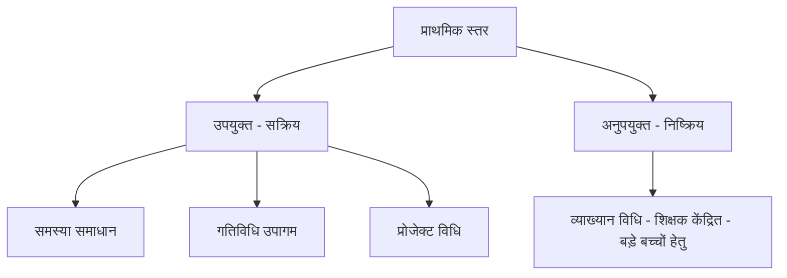

---

### प्रश्न 69: पुनर्बलन किस प्रक्रिया का भाग

**प्रश्न:**
पुनर्बलन निम्नलिखित में से किस प्रक्रिया का भाग है?

**विकल्प:**
- A - शिक्षण
- B - अधिगम
- C - अनुदेशन
- D - इनमें से कोई नहीं

**सही उत्तर:** B - अधिगम

**हल:**
- चरण 1 - पुनर्बलन की परिभाषा - वे उद्दीपक, वस्तु, तत्व जिनसे अनुक्रिया को दोहराने की संभावना बढ़ जाए
- चरण 2 - पुनरावृत्ति बढ़ना = अधिगम मजबूत होना - थॉर्नडाइक के प्रभाव नियम से जुड़ा
- चरण 3 - शिक्षण शिक्षक करता है, अधिगम छात्र में होता है - पुनर्बलन छात्र के व्यवहार को प्रभावित करता है इसलिए अधिगम का भाग
- चरण 4 - अनुदेशन निर्देश देना है - पुनर्बलन उससे व्यापक - अधिगम मनोविज्ञान में आता है
- चरण 5 - शिक्षक ने कहा - 69 में B लॉक किया तो बिल्कुल सही - पुनर्बलन अधिगम का भाग है

**ट्रिक / कॉन्सेप्ट:**
- पुनर्बलन = दोहराव बढ़े = सीखना पक्का हो = अधिगम
- उद्दीपक शब्द दिखे तो अधिगम ही सोचें

---

### प्रश्न 70: थॉर्नडाइक के अधिगम नियम - तत्परता, अभ्यास, प्रभाव

**प्रश्न:**
अधिगम के नियम के तहत तत्परता का नियम, अभ्यास का नियम, प्रभाव का नियम किसने प्रतिपादित किया था?

**विकल्प:**
- A - एडवर्ड ली थॉर्नडाइक
- B - जे बी वॉटसन
- C - इवान पेट्रोविच पावलॉव
- D - मैक्स वर्दाइमर

**सही उत्तर:** A - एडवर्ड ली थॉर्नडाइक

**हल:**
- चरण 1 - थॉर्नडाइक - प्रयास एवं त्रुटि सिद्धांत - तीन मुख्य नियम - तत्परता, अभ्यास, प्रभाव
- चरण 2 - जे बी वॉटसन - 1913 में व्यवहारवाद की स्थापना - व्यवहार के अध्ययन पर बल - अनुबंधन पर भी काम पर मुख्य व्यवहारवाद
- चरण 3 - इवान पेट्रोविच पावलॉव - क्लासिकल अनुबंधन - सी आर थ्योरी - कुत्ते पर प्रयोग - लार वाला प्रयोग
- चरण 4 - मैक्स वर्दाइमर - गेस्टाल्टवादी संप्रदाय - पूर्णाकारवाद - सूझ द्वारा सीखना
- चरण 5 - गेस्टाल्ट = समग्रता - थॉर्नडाइक = संयोजनवाद
- चरण 6 - तत्परता शब्द दिखते ही थॉर्नडाइक पकड़ें - A फॉर एप्पल

**ट्रिक / कॉन्सेप्ट:**
- तत्परता + अभ्यास + प्रभाव = थॉर्नडाइक - तीनों एक साथ
- वॉटसन 1913 व्यवहारवाद, पावलॉव सी आर, वर्दाइमर गेस्टाल्ट - चारों को अलग-अलग वर्ष/सिद्धांत से याद

---

### प्रश्न 71: प्रगतिशील शिक्षा में समान शैक्षिक अवसर

**प्रश्न:**
प्रगतिशील शिक्षा के संदर्भ में समान शैक्षिक अवसर से अभिप्राय है?

**विकल्प:**
- A - सभी छात्र बिना किसी भेद के समान पद्धतियों व सामग्रियों से शिक्षा प्राप्त करें
- B - ऐसी शिक्षा पाएं जो उनके लिए अनुकूलतम हो तथा उनके भविष्य के कार्यों में सहायक हो
- C - किसी भी जाति, पंथ, रंग, क्षेत्र, धर्म के होते हुए भी समान शिक्षा प्राप्त करें
- D - समान शिक्षा पाने के बाद अपनी क्षमताओं को सिद्ध कर सकें

**सही उत्तर:** B - ऐसी शिक्षा पाएं जो उनके लिए अनुकूलतम हो तथा उनके भविष्य के कार्यों में सहायक हो

**हल:**
- चरण 1 - समान का अर्थ समान पद्धति नहीं - समान अवसर का अर्थ सबको अपनी क्षमता के अनुसार अवसर
- चरण 2 - विकल्प A - सबको एक ही पद्धति - यह समानता नहीं, एकरूपता है - प्रगतिशील इसका विरोध करती है - बाहर
- चरण 3 - विकल्प B - अनुकूलतम शिक्षा + भविष्य के कार्यों में सहायक - यह व्यक्तिगत विभिन्नता का सम्मान है - प्रगतिशील का लक्ष्य यही
- चरण 4 - विकल्प C - जाति धर्म निरपेक्ष समानता - सही विचार पर अधूरा - प्रगतिशील में अनुकूलता पर जोर
- चरण 5 - विकल्प D - क्षमता सिद्ध करना परिणाम है, परिभाषा नहीं
- चरण 6 - शिक्षक ने कहा - 70-71 में B लॉक करने वाले वंदना शाबाश - B सही है
- चरण 7 - प्रगतिशील शिक्षा जॉन डीवी से जुड़ी - करके सीखना, अनुभव, रुचि

**ट्रिक / कॉन्सेप्ट:**
- समान अवसर = सबको एक जैसा नहीं, सबको उसके अनुकूल - अनुकूलतम शब्द ही कुंजी
- प्रगतिशील = बालक की रुचि, अनुभव, भविष्य - एकरूपता नहीं

---

### प्रश्न 72: बाल केंद्रित शिक्षा में शिक्षक की भूमिका

**प्रश्न:**
बाल केंद्रित शिक्षा में शिक्षक की भूमिका होती है?

**विकल्प:**
- A - पथ प्रदर्शक के रूप में
- B - सलाहकार के रूप में
- C - सहायक / मित्र / मार्गदर्शक के रूप में
- D - प्रवक्ता के रूप में

**सही उत्तर:** C - सहायक / मित्र / मार्गदर्शक के रूप में

**हल:**
- चरण 1 - बाल केंद्रित = बच्चा केंद्र में, शिक्षक परिधि में
- चरण 2 - पारंपरिक में शिक्षक प्रवक्ता - बोलने वाला - बाल केंद्रित में नहीं
- चरण 3 - पथ प्रदर्शक, सलाहकार, सहायक - तीनों करीब-करती पर सहायक सबसे व्यापक - मित्रवत सहायक
- चरण 4 - प्रगतिशील और बाल केंद्रित में शिक्षक की भूमिका - सुविधादाता, उत्प्रेरक, सहायक
- चरण 5 - प्रवक्ता तो व्याख्यान विधि में होता है - इसलिए D बाहर

**ट्रिक / कॉन्सेप्ट:**
- बाल केंद्रित = शिक्षक सहायक - शिक्षक केंद्रित = शिक्षक प्रवक्ता - उल्टा याद

---

### प्रश्न 73: छात्र अभिलेखों की जांच करते समय शिक्षक क्या करे

**प्रश्न:**
अध्यापक को छात्र के अभिलेखों की जांच करते समय क्या करना चाहिए?

**विकल्प:**
- A - विद्यार्थियों को नोट्स बनाने की तकनीक का वर्णन करें
- B - छात्रों को मौखिक रिपोर्ट प्रभावी ढंग से प्रस्तुत करना सिखाएं - केवल शाब्दिक प्रस्तुतीकरण पर्याप्त नहीं
- C - छात्रों को तैयारी में सहायता प्रदान करें लेकिन प्रस्तुतीकरण में हस्तक्षेप न करें
- D - छात्र वक्ता के विरोध में आलोचना को रोक दें

**सही उत्तर:** B - छात्रों को मौखिक रिपोर्ट प्रभावी ढंग से प्रस्तुत करना सिखाएं

**हल:**
- चरण 1 - अभिलेख जांच का उद्देश्य - केवल लिखित देखना नहीं, प्रस्तुतीकरण कौशल भी
- चरण 2 - नोट्स तकनीक बताना ठीक पर अभिलेख जांच का सीधा बिंदु नहीं
- चरण 3 - प्रभावी मौखिक प्रस्तुति - शाब्दिक के साथ हाव-भाव, स्पष्टता, आत्मविश्वास - यही पूर्ण जांच
- चरण 4 - तैयारी में सहायता पर प्रस्तुति में नहीं - यह आधी सहायता - पूर्ण नहीं
- चरण 5 - आलोचना रोकना अनुशासन है पर मुख्य कर्तव्य नहीं
- चरण 6 - इसलिए B सबसे उपयुक्त

**ट्रिक / कॉन्सेप्ट:**
- अभिलेख = लिखित + मौखिक दोनों - केवल शाब्दिक पर्याप्त नहीं - यही कुंजी वाक्य

---

### प्रश्न 74: मानचित्र पर दूरी मापने का यंत्र

**प्रश्न:**
दूरियों को मापने हेतु मानचित्र पर किस यंत्र का प्रयोग किया जाता है?

**विकल्प:**
- A - स्पीडोमीटर
- B - ओपिसोमीटर / ओसोमीटर
- C - कोरोमीटर
- D - इनमें से कोई नहीं

**सही उत्तर:** B - ओपिसोमीटर / ओसोमीटर

**हल:**
- चरण 1 - स्पीडोमीटर क्या मापता है - गाड़ी की गति / चाल - तीव्रता - मानचित्र से कोई संबंध नहीं - बाहर
- चरण 2 - ओडोमीटर क्या मापता है - गाड़ी द्वारा तय कुल दूरी - पथमापी - यह भी गाड़ी में
- चरण 3 - मानचित्र पर टेढ़ी-मेढ़ी दूरी - स्केल से सीधी दूरी नहीं - नक्शे की घुमावदार रेखा
- चरण 4 - इसके लिए छोटा पहिया वाला यंत्र - मानचित्र पर चलाने से दूरी निकलती है - इसे ओपिसोमीटर या ओसोमीटर या कोरोमीटर भी कहते हैं - पाठ में B और C दोनों नाम आए पर शिक्षक ने B ओसोमीटर को सही कहा
- चरण 5 - परीक्षा में ओपिसोमीटर / ओसोमीटर ही मानचित्र वाला यंत्र - याद रखें

**ट्रिक / कॉन्सेप्ट:**
- मानचित्र = ओपिसोमीटर - गाड़ी = स्पीडोमीटर / ओडोमीटर - स्थान से अंतर
- स्पीड = चाल, ओडो = दूरी, ओपिसो = नक्शे की दूरी

---

### प्रश्न 75: अवलोकन / निरीक्षण विधि

**प्रश्न:**
किसी वस्तु, स्थान या घटना को देखकर उसके बारे में ज्ञान प्राप्त करना किस प्रविधि के अंतर्गत आता है?

**विकल्प:**
- A - निरीक्षण विधि / अवलोकन विधि
- B - व्याख्यान विधि
- C - प्रयोगशाला विधि
- D - कहानी विधि

**सही उत्तर:** A - निरीक्षण विधि

**हल:**
- चरण 1 - देखकर सीखना - आँखों से प्रत्यक्ष देखना
- चरण 2 - इसे ऑब्जरवेशन मेथड कहते हैं - हिंदी में निरीक्षण विधि
- चरण 3 - इसमें बालक स्वयं देखता, नोट करता, निष्कर्ष निकालता
- चरण 4 - व्याख्यान में सुनना, प्रयोगशाला में प्रयोग, कहानी में सुनना - देखना नहीं
- चरण 5 - इसलिए A सही - शिक्षक ने 75 में A लॉक करने को कहा

**ट्रिक / कॉन्सेप्ट:**
- देखकर = निरीक्षण - करके = प्रयोग - सुनकर = व्याख्यान - क्रिया से विधि पहचानें

---

### प्रश्न 76: रॉबर्ट गाने - द कंडीशन ऑफ लर्निंग

**प्रश्न:**
रॉबर्ट गाने ने अपनी पुस्तक द कंडीशन ऑफ लर्निंग में सीखने के कितने प्रकार बताए हैं?

**विकल्प:**
- A - पाँच प्रकार
- B - आठ प्रकार
- C - सात प्रकार
- D - दस प्रकार

**सही उत्तर:** B - आठ प्रकार

**हल:**
- चरण 1 - लेखक रॉबर्ट गाने - पुस्तक द कंडीशन ऑफ लर्निंग - वर्ष लगभग 1965
- चरण 2 - इन्होंने सीखने के 8 प्रकार / पदानुक्रम बताया - सरल से जटिल
- चरण 3 - पहला - संकेत अधिगम - 68,000 और 69,000 भर्ती में भी पूछा गया - सबसे सरल
- चरण 4 - दूसरा - उद्दीपक-अनुक्रिया अधिगम
- चरण 5 - तीसरा - श्रृंखला अधिगम
- चरण 6 - चौथा - शाब्दिक साहचर्य अधिगम
- चरण 7 - शेष चार - बहुभेदीय विभेद, प्रत्यय अधिगम, सिद्धांत अधिगम, समस्या समाधान - क्रम याद रखें
- चरण 8 - इसलिए आठ प्रकार - B सही

**ट्रिक / कॉन्सेप्ट:**
- गाने = 8 - गाने में 4 अक्षर पर 8 प्रकार - गाना आठ सुरों में
- संकेत से शुरुआत - पहला संकेत, फिर उद्दीपक-अनुक्रिया, फिर श्रृंखला, फिर शाब्दिक साहचर्य - चार नाम क्रम से याद

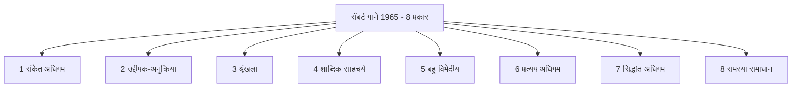

---

### प्रश्न 77: अभिभावकों के साथ कम आनंद - किस विकास से संबंधित

**प्रश्न:**
वह अवस्था जब बालक अपने अभिभावकों के साथ कम आनंदित होता है, संबंधित है?

**विकल्प:**
- A - शारीरिक विकास से
- B - मानसिक विकास से
- C - भाषाई विकास से
- D - सामाजिक विकास से

**सही उत्तर:** D - सामाजिक विकास से

**हल:**
- चरण 1 - अभिभावक, परिवार, मित्र, समाज - किससे आनंद - सामाजिक संबंधों से
- चरण 2 - शारीरिक विकास - लंबाई, वजन, अंग - आनंद से नहीं
- चरण 3 - मानसिक विकास - सोच, तर्क - पर अभिभावक के साथ आनंद सामाजिक भाव है
- चरण 4 - भाषाई विकास - बोलना, शब्द - इसका आनंद से सीधा संबंध नहीं
- चरण 5 - सामाजिक विकास - समाज में रहकर सीखना, माता-पिता, घर-परिवार के साथ समायोजन - कम या अधिक आनंद इसी का सूचक
- चरण 6 - इसलिए D सही - डी फॉर डॉल

**ट्रिक / कॉन्सेप्ट:**
- परिवार + समाज शब्द दिखे तो सामाजिक विकास - सीधे जोड़ें

---

### प्रश्न 78: प्रोजेक्ट विधि किस अवस्था के लिए उपयोगी

**प्रश्न:**
सीखने की प्रोजेक्ट विधि किस अवस्था के लिए उपयोगी है?

**विकल्प:**
- A - बाल्यावस्था
- B - पूर्व बाल्यावस्था
- C - किशोरावस्था
- D - सभी अवस्थाओं के लिए

**सही उत्तर:** D - सभी अवस्थाओं के लिए

**हल:**
- चरण 1 - प्रोजेक्ट विधि - करके सीखना - समस्या लेकर समाधान - किलपैट्रिक से जुड़ी
- चरण 2 - छोटा बच्चा भी प्रोजेक्ट कर सकता है - बड़ा भी - कठिनाई का स्तर बदल जाता है पर विधि वही
- चरण 3 - इसलिए यह सभी अवस्थाओं में उपयोगी - बाल्यावस्था, किशोरावस्था, पूर्व बाल्यावस्था - सभी
- चरण 4 - इसलिए D सही

**ट्रिक / कॉन्सेप्ट:**
- प्रोजेक्ट = सभी उम्र - स्तर बदलो, विधि नहीं

---

### प्रश्न 79: कोहलबर्ग के नैतिक विकास के चरणों का लक्ष्य

**प्रश्न:**
निम्नलिखित में से कौन सा कोहलबर्ग के नैतिक विकास के चरणों का लक्ष्य है?

**विकल्प:**
- A - सभी संस्कृतियों से संबंधित चरणों की सार्वभौमिक श्रृंखला
- B - केवल पश्चिमी संस्कृति तक सीमित
- C - केवल बाल्यावस्था तक सीमित
- D - नैतिकता जन्मजात होती है

**सही उत्तर:** A - सभी संस्कृतियों से संबंधित चरणों की सार्वभौमिक श्रृंखला

**हल:**
- चरण 1 - कोहलबर्ग - नैतिक विकास के 3 स्तर, 6 चरण - प्री-कन्वेंशनल, कन्वेंशनल, पोस्ट-कन्वेंशनल
- चरण 2 - इनका दावा - यह क्रम सभी संस्कृतियों में एक जैसा चलता है - सार्वभौमिक
- चरण 3 - यह संस्कृति विशेष नहीं, मानव मात्र पर लागू - इसलिए सार्वभौमिक श्रृंखला
- चरण 4 - इसलिए A सबसे एप्रोप्रियेट

**ट्रिक / कॉन्सेप्ट:**
- कोहलबर्ग = नैतिकता + सार्वभौमिक क्रम - हर संस्कृति में वही सीढ़ी

---

### प्रश्न 80: साइजोइड वर्ग के बालक

**प्रश्न:**
साइजोइड वर्ग में किस प्रकार के बालक आते हैं?

**विकल्प:**
- A - मोटे व नाटे
- B - मांसल व सुडौल
- C - दुबले-पतले व लंबे - एस्थेनिक प्रवृत्ति
- D - गोल-मटोल व हँसमुख

**सही उत्तर:** C - दुबले-पतले व लंबे - एस्थेनिक

**हल:**
- चरण 1 - क्रेशमर का शरीर प्रकार वर्गीकरण - एस्थेनिक, एथलेटिक, पिकनिक
- चरण 2 - एस्थेनिक = दुबला-पतला, लंबा, साइजोइड = वही प्रवृत्ति - अंतर्मुखी, चिंतनशील
- चरण 3 - साइजोइड शब्द में ही एस्थेनिक गुण - इसलिए C सही
- चरण 4 - मोटा पिकनिक / साइक्लोइड से जुड़ा - एथलेटिक मांसल - इसलिए अन्य विकल्प बाहर

**ट्रिक / कॉन्सेप्ट:**
- साइजोइड = एस्थेनिक = दुबला लंबा - नाम जोड़

---

### प्रश्न 81: प्रयास एवं त्रुटि में सबसे महत्वपूर्ण

**प्रश्न:**
प्रयास एवं त्रुटि में सबसे महत्वपूर्ण क्या है?

**विकल्प:**
- A - अभ्यास
- B - लक्ष्य
- C - प्रेरणा
- D - परिपक्वता

**सही उत्तर:** B - लक्ष्य

**हल:**
- चरण 1 - थॉर्नडाइक का प्रयोग - बिल्ली के सामने मछली का टुकड़ा - बॉक्स में बिल्ली
- चरण 2 - बिल्ली बार-बार प्रयास करती है - क्यों - मछली पाना लक्ष्य है - लक्ष्य न हो तो प्रयास नहीं
- चरण 3 - अभ्यास, प्रेरणा सभी जरूरी पर लक्ष्य ही दिशा देता है - लक्ष्य के बिना अभ्यास अंधा
- चरण 4 - इसलिए सबसे महत्वपूर्ण लक्ष्य - मछली का टुकड़ा ही लक्ष्य

**ट्रिक / कॉन्सेप्ट:**
- प्रयास एवं त्रुटि = लक्ष्य दिखे तो प्रयास शुरू - लक्ष्य ही इंजन

---

### प्रश्न 82: बालक के विकास का परिणाम

**प्रश्न:**
बालक का विकास किसका परिणाम है?

**विकल्प:**
- A - केवल वंशानुक्रम का
- B - केवल वातावरण का
- C - वंशानुक्रम तथा वातावरण की अंतःक्रिया का
- D - केवल परिपक्वता का

**सही उत्तर:** C - वंशानुक्रम तथा वातावरण की अंतःक्रिया का

**हल:**
- चरण 1 - वंशानुक्रम = जीन, माता-पिता से प्राप्त गुण
- चरण 2 - वातावरण = परिवार, समाज, विद्यालय, संस्कृति
- चरण 3 - अकेला वंशानुक्रम अधूरा - अकेला वातावरण अधूरा - दोनों मिलकर विकास
- चरण 4 - आधुनिक मनोविज्ञान - विकास = अनुवांशिकता x पर्यावरण - गुणन, जोड़ नहीं - अंतःक्रिया
- चरण 5 - इसलिए C सही - सी इज योर राइट आंसर

**ट्रिक / कॉन्सेप्ट:**
- विकास = वंश x वातावरण - दोनों साथ - अंतःक्रिया शब्द ही उत्तर

---

### प्रश्न 83: पिछड़े बालक

**प्रश्न:**
पिछड़े बालक ऐसे बच्चे हैं?

**विकल्प:**
- A - जिनकी सीखने की गति धीमी है
- B - जिनकी बुद्धि लब्धि 80 से 90 के बीच है
- C - जो मानसिक रूप से अस्वस्थ / असमायोजित व्यवहार करते हैं
- D - उपर्युक्त सभी

**सही उत्तर:** D - उपर्युक्त सभी

**हल:**
- चरण 1 - पिछड़ा बालक = अपनी आयु के औसत से पीछे - शैक्षिक पिछड़ापन
- चरण 2 - सीखने की गति धीमी - कक्षा में पीछे रहना - A सही पर अधूरा
- चरण 3 - बुद्धि लब्धि 80 से 90 - सामान्य से थोड़ा नीचे - पिछड़े की सीमा - B भी सही पर अधूरा
- चरण 4 - असमायोजित व्यवहार, मानसिक अस्वस्थता जैसे लक्षण पिछड़ेपन से जुड़ सकते हैं - C भी आंशिक रूप से सही
- चरण 5 - पूरा उत्तर चाहिए तो सभी को मिलाएं - इसलिए D सभी सही - शिक्षक ने 83 में D कहा

**ट्रिक / कॉन्सेप्ट:**
- पिछड़ा = धीमा + 80-90 + असमायोजन - तीनों मिलकर D

---

### प्रश्न 84: सामान्य बुद्धि वाला बालक - टर्मन सारणी

**प्रश्न:**
किस बुद्धि लब्धि स्तर पर बालक सामान्य बुद्धि वाला कहलाएगा? टर्मन की सारणी के अनुसार

**विकल्प:**
- A - 70 से 80
- B - 80 से 90
- C - 90 से 110
- D - 110 से 120

**सही उत्तर:** C - 90 से 110

**हल:**
- चरण 1 - टर्मन की बुद्धि लब्धि सारणी याद करें
- चरण 2 - 90 से 110 - सामान्य / औसत बुद्धि - सबसे बड़ा समूह - लगभग 50 प्रतिशत
- चरण 3 - 80 से 90 - मंद बुद्धि की सीमा / पिछड़ा
- चरण 4 - 110 से 120 - तीव्र बुद्धि / हायर एवरेज
- चरण 5 - 70 से नीचे - मानसिक दुर्बलता की श्रेणियाँ
- चरण 6 - इसलिए सामान्य के लिए 90 से 110 - C सही - शिक्षक ने 84 में C कहा

**ट्रिक / कॉन्सेप्ट:**
- टर्मन - 90-110 सामान्य - यह आंकड़ा रट्टा - सामान्य = 100 के आसपास

---

### प्रश्न 85: संकेत अधिगम के अंतर्गत क्या सीखा जाता है

**प्रश्न:**
संकेत अधिगम के अंतर्गत निम्नलिखित में से क्या सीखा जाता है?

**विकल्प:**
- A - मनोविज्ञान के सिद्धांत
- B - पारस्परिक अनुकूलन
- C - वातावरण से समायोजन
- D - मनोदैहिक कौशल

**सही उत्तर:** B - पारस्परिक अनुकूलन

**हल:**
- चरण 1 - संकेत अधिगम - रॉबर्ट गाने का पहला प्रकार - सबसे सरल - पावलॉव के क्लासिकल अनुबंधन से जुड़ा
- चरण 2 - इसमें संकेत के प्रति अनुक्रिया - घंटी बजते ही लार - संकेत से जुड़ना
- चरण 3 - इसे पारस्परिक अनुकूलन भी कहते हैं - उद्दीपक-उद्दीपक साहचर्य
- चरण 4 - इवान पेट्रोविच पावलॉव का प्रयोग - संकेत अधिगम का आधार
- चरण 5 - इसलिए B पारस्परिक अनुकूलन सही - शिक्षक ने कहा बी सही, सबके बस की बात नहीं

**ट्रिक / कॉन्सेप्ट:**
- संकेत = घंटी = पारस्परिक अनुकूलन = पावलॉव - तीनों का त्रिकोण

---

### प्रश्न 86: संवाद करने की प्रक्रिया

**प्रश्न:**
व्यक्ति के संवाद करने की प्रक्रिया क्या कहलाती है?

**विकल्प:**
- A - संप्रेषण / कम्युनिकेशन
- B - अधिगम
- C - अनुकरण
- D - अभिप्रेरणा

**सही उत्तर:** A - संप्रेषण

**हल:**
- चरण 1 - दो व्यक्तियों में भाव, विचार, संवेग का आदान-प्रदान
- चरण 2 - जब यह सही ढंग से, पारस्परिक, दोतरफा हो तो संप्रेषण
- चरण 3 - अधिगम सीखना है, अनुकरण नकल है, अभिप्रेरणा प्रेरित करना - संवाद नहीं
- चरण 4 - इसलिए A सही - ए फॉर एप्पल

**ट्रिक / कॉन्सेप्ट:**
- संवाद = संप्रेषण - शब्द साम्य से याद

---

### प्रश्न 87: छात्रों को प्रेरित करने की सही विधि

**प्रश्न:**
छात्रों को प्रेरित करने की सही विधि है?

**विकल्प:**
- A - दंड देना
- B - फटकारना
- C - मारना-पीटना
- D - प्रशंसा करना

**सही उत्तर:** D - प्रशंसा करना

**हल:**
- चरण 1 - प्रेरणा दो प्रकार - सकारात्मक और नकारात्मक
- चरण 2 - दंड, फटकार, मारना - तीनों नकारात्मक - भय पैदा करें, रुचि खत्म करें, स्थायी नहीं
- चरण 3 - प्रशंसा - सकारात्मक पुनर्बलन - रुचि, आत्मविश्वास, दोहराव बढ़े
- चरण 4 - आधुनिक शिक्षाशास्त्र - प्रशंसा ही सही विधि - D सही - शिक्षक ने डी लॉक करने को कहा

**ट्रिक / कॉन्सेप्ट:**
- प्रेरणा = प्रशंसा - नकारात्मक तीनों एक साथ बाहर

---

### प्रश्न 88: अस्पृश्यता उन्मूलन - संविधान का अनुच्छेद

**प्रश्न:**
संविधान के किस प्रावधान द्वारा अस्पृश्यता उन्मूलन की बात कही गई है?

**विकल्प:**
- A - अनुच्छेद 15
- B - अनुच्छेद 16
- C - अनुच्छेद 17
- D - अनुच्छेद 18

**सही उत्तर:** C - अनुच्छेद 17

**हल:**
- चरण 1 - अनुच्छेद 17 - अस्पृश्यता का अंत - छुआछूत समाप्त - इसका आचरण दंडनीय अपराध
- चरण 2 - अनुच्छेद 15 - धर्म, जाति, लिंग, जन्म स्थान पर भेदभाव निषेध
- चरण 3 - अनुच्छेद 16 - लोक नियोजन में अवसर की समानता
- चरण 4 - अनुच्छेद 18 - उपाधियों का अंत
- चरण 5 - इसलिए अस्पृश्यता सीधे 17 - पूरी दुनिया में फेमस - शिक्षक ने 17 कहा

**ट्रिक / कॉन्सेप्ट:**
- 17 = छुआछूत = सात नहीं, सत्रह - 7 को हटाओ, 17 याद रखो

---

### प्रश्न 89: शिक्षकों में सर्वाधिक अभाव

**प्रश्न:**
स्कूलों में अधिकतर शिक्षकों में अपने छात्रों के लिए किसका सर्वाधिक अभाव पाया जाता है?

**विकल्प:**
- A - स्नेह का
- B - क्रोध का
- C - दूसरोपण / दोषारोपण का
- D - घृणा का

**सही उत्तर:** A - स्नेह का

**हल:**
- चरण 1 - शिक्षक कभी-कभी क्रोध दिखाता है - तो अभाव नहीं
- चरण 2 - दूसरोपण - इसने बेंच तोड़ा, डेस्क तोड़ा - शिक्षक अक्सर दोष दूसरे पर डालता दिखता है - अभाव नहीं
- चरण 3 - घृणा - शिक्षक छात्रों से घृणा नहीं करता - पर यह प्रश्न का उत्तर नहीं
- चरण 4 - स्नेह - वही जो सबसे जरूरी - वही सबसे कम - आत्मीयता, प्रेम, अपनापन का अभाव सर्वाधिक पाया जाता है
- चरण 5 - इसलिए A स्नेह का अभाव - सर्वे में यही आता है

**ट्रिक / कॉन्सेप्ट:**
- जो सबसे चाहिए वही सबसे कम - स्नेह

---

### प्रश्न 90: कक्षा में शिक्षक-विद्यार्थी संप्रेषण कैसा हो

**प्रश्न:**
कक्षा कक्ष में शिक्षक व विद्यार्थियों के मध्य संप्रेषण होना चाहिए?

**विकल्प:**
- A - उद्देश्य केंद्रित
- B - विद्यार्थी केंद्रित
- C - शिक्षक केंद्रित
- D - पाठ्यपुस्तक केंद्रित

**सही उत्तर:** B - विद्यार्थी केंद्रित - विकल्प न हो तो D उद्देश्य केंद्रित भी सही

**हल:**
- चरण 1 - संप्रेषण का लक्ष्य - सीखना - सीखेगा कौन - विद्यार्थी
- चरण 2 - उद्देश्य केंद्रित भी सही है पर विद्यार्थी केंद्रित अधिक व्यापक - विद्यार्थी केंद्रित करेंगे तो उद्देश्य स्वतः आ जाएगा
- चरण 3 - शिक्षक केंद्रित तो व्याख्यान विधि जैसा - निष्क्रिय - बाहर
- चरण 4 - शिक्षक ने कहा - B पहली प्राथमिकता, यदि B न होता तो D भी राइट - पर B आ गया तो B लॉक करें
- चरण 5 - इसलिए B सही

**ट्रिक / कॉन्सेप्ट:**
- संप्रेषण = विद्यार्थी केंद्रित - प्राथमिकता क्रम B फिर D

---

### प्रश्न 91: अति मेधावी छात्रों को कैसे पढ़ाएं

**प्रश्न:**
आपकी कक्षा में कुछ छात्र अति मेधावी हैं, आप उन्हें किस तरह पढ़ाएंगे?

**विकल्प:**
- A - कक्षा के साथ सामान्य गति से
- B - उच्च कक्षा के साथ बिठाकर
- C - समृद्धिकरण कार्यक्रमों के द्वारा
- D - जब वे चाहें तब

**सही उत्तर:** C - समृद्धिकरण कार्यक्रमों के द्वारा

**हल:**
- चरण 1 - मेधावी = प्रतिभाशाली - सामान्य से तेज, अधिक जिज्ञासा, अधिक क्षमता
- चरण 2 - विकल्प A - सामान्य गति से - तो वे बोर होंगे - प्रतिभा दबेगी - बाहर
- चरण 3 - विकल्प B - उच्च कक्षा में भेजना - समायोजन बिगड़ेगा - सामाजिक-भावनात्मक अंतर - बाहर
- चरण 4 - विकल्प C - समृद्धिकरण - Enrichment - उसी कक्षा में अतिरिक्त, गहन, चुनौतीपूर्ण सामग्री, प्रोजेक्ट, गहराई - सबसे उपयुक्त
- चरण 5 - विकल्प D - जब चाहें तब - यह अनुशासनहीनता - बाहर
- चरण 6 - शिक्षक ने कहा - 91 में C लगाने वाले प्यारा उत्तर - सी इज योर राइट आंसर

**ट्रिक / कॉन्सेप्ट:**
- मेधावी = समृद्धिकरण - न तो रोकें, न आगे धकेलें - उसी जगह गहरा कराएं

---

### प्रश्न 92: नैदानिक परीक्षा - डायग्नोस्टिक टेस्ट का मुख्य उद्देश्य

**प्रश्न:**
नैदानिक परीक्षा (Diagnostic Test) का मुख्य उद्देश्य होता है?

**विकल्प:**
- A - कक्षा में प्रदर्शन के दौरान सामान्यता को देखना
- B - कमजोर क्षेत्र को चिन्हित करना
- C - अकादमिक कठिनाइयों के कारणों का पता लगाना
- D - उपचारात्मक कार्यक्रम की विशेष प्रकृति तय करना

**सही उत्तर:** C - अकादमिक कठिनाइयों के कारणों का पता लगाना

**हल:**
- चरण 1 - नैदानिक = निदान - डॉक्टर जैसे रोग का कारण खोजना
- चरण 2 - कमजोर क्षेत्र चिन्हित करना तो उपलब्धि परीक्षण भी करता है - वह आंशिक है
- चरण 3 - नैदानिक का विशेष काम - क्यों कमजोर है - कारण की जड़
- चरण 4 - कारण पता चले तभी उपचारात्मक कार्यक्रम बनेगा - इसलिए C कारण खोजना ही मुख्य
- चरण 5 - शिक्षक ने कहा - 92 में C बिल्कुल सही

**ट्रिक / कॉन्सेप्ट:**
- नैदानिक = कारण खोजो - उपचारात्मक = इलाज करो - क्रम याद

---

### प्रश्न 93: रचनात्मकता के निर्धारकों को जानने का उपागम - कौन सा नहीं

**प्रश्न:**
विद्यार्थियों में रचनात्मकता के निर्धारकों को जानने के लिए इनमें से कौन सा उपागम नहीं है?

**विकल्प:**
- A - अपसारी चिंतन परीक्षण
- B - बहुविकल्पी परीक्षण
- C - थिंकिंग आउट ऑफ द बॉक्स कार्य
- D - मुक्त-अंत वाले प्रश्न

**सही उत्तर:** B - बहुविकल्पी परीक्षण

**हल:**
- चरण 1 - रचनात्मकता = अपसारी चिंतन - Divergent Thinking - एक प्रश्न के कई मौलिक उत्तर
- चरण 2 - थिंकिंग आउट ऑफ द बॉक्स = अपसारी ही है - बॉक्स के बाहर सोचना
- चरण 3 - अभिसारी चिंतन = थिंकिंग इन द बॉक्स - एक ही सही उत्तर - बहुविकल्पी इसी में आता है - एक सही, बाकी गलत चुनो
- चरण 4 - बहुविकल्पी में मौलिकता, लचीलापन, प्रवाह नहीं परखा जाता - केवल पहचान
- चरण 5 - मुक्त-अंत, अपसारी, आउट ऑफ बॉक्स - तीनों रचनात्मकता से जुड़े
- चरण 6 - इसलिए बहुविकल्पी ही वह उपागम है जो रचनात्मकता नहीं नापता - B सही - शिक्षक ने कहा यह सबसे खतरनाक प्यारा प्रश्न - B सही

**ट्रिक / कॉन्सेप्ट:**
- रचनात्मक = अपसारी = आउट ऑफ बॉक्स - बहुविकल्पी = अभिसारी = इन द बॉक्स - उल्टा

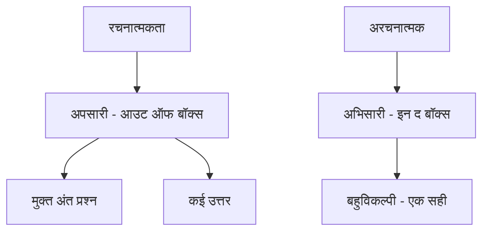

---

### प्रश्न 94: संसाधन संपन्न शिक्षक का अर्थ

**प्रश्न:**
यह कहा जाता है कि शिक्षक को संसाधन संपन्न होना चाहिए। इसका अर्थ है?

**विकल्प:**
- A - उसके पास पर्याप्त पैसा और संपत्ति होनी चाहिए
- B - उसका उच्च अधिकारियों से संपर्क होना चाहिए
- C - उसे पर्याप्त ज्ञान होना चाहिए ताकि छात्रों की समस्याओं को हल कर सके
- D - उसकी छात्रों के बीच अच्छी पैठ होनी चाहिए

**सही उत्तर:** C - उसे पर्याप्त ज्ञान होना चाहिए ताकि छात्रों की समस्याओं को हल कर सके

**हल:**
- चरण 1 - संसाधन = पैसा-संपत्ति नहीं - शैक्षिक संदर्भ में ज्ञान, कौशल, सामग्री
- चरण 2 - अधिकारियों से संपर्क - प्रशासनिक संसाधन - शैक्षिक नहीं - बाहर
- चरण 3 - पर्याप्त ज्ञान - विषय, विधि, मनोविज्ञान - तभी समस्या हल कर पाएगा - यही संसाधन
- चरण 4 - अच्छी पैठ परिणाम है, परिभाषा नहीं
- चरण 5 - इसलिए C सही - 94 में सी

**ट्रिक / कॉन्सेप्ट:**
- संसाधन = ज्ञान का संसाधन - भौतिक नहीं, बौद्धिक

---

### प्रश्न 95: आत्मगौरव कैसा अभिप्रेरक है - गैरेट के अनुसार

**प्रश्न:**
आत्मगौरव कैसा अभिप्रेरक है?

**विकल्प:**
- A - सामाजिक अभिप्रेरक
- B - जैविक अभिप्रेरक
- C - मनोवैज्ञानिक अभिप्रेरक
- D - कृत्रिम अभिप्रेरक

**सही उत्तर:** A - सामाजिक अभिप्रेरक

**हल:**
- चरण 1 - गैरेट ने अभिप्रेरक के तीन प्रकार बताए - जैविक, सामाजिक, मनोवैज्ञानिक
- चरण 2 - जैविक - भूख, प्यास, नींद - शरीर से जुड़े
- चरण 3 - सामाजिक - आत्मगौरव, आत्मप्रतिष्ठा, उपलब्धि, संबंध - समाज में सीखे जाते हैं
- चरण 4 - मनोवैज्ञानिक - भावनात्मक, व्यक्तिगत स्तर के विशेष
- चरण 5 - आत्मगौरव - समाज में तुलना, प्रतिष्ठा से बनता है - इसलिए सामाजिक
- चरण 6 - यह प्रश्न 69,000 भर्ती में भी आया था - शिक्षक ने कहा सामाजिक सही
- चरण 7 - इसलिए A सही

**ट्रिक / कॉन्सेप्ट:**
- गैरेट = 3 - जैविक + सामाजिक + मनोवैज्ञानिक - आत्मगौरव = सामाजिक - रट्टा

---

### इस भाग से 10 त्वरित रिवीजन बिंदु

- समावेशी = वैविध्यपूर्ण व सार्थक परिवेश - बफर सिस्टम - सबको उसकी रुचि अनुसार
- मूल्यांकन = छात्र उपलब्धि + सीखने का स्तर + शिक्षक उपलब्धि - सबसे समग्र C
- प्राथमिक में व्याख्यान अनुपयुक्त - निष्क्रिय, शिक्षक केंद्रित, बड़े बच्चों हेतु
- पुनर्बलन अधिगम का भाग - दोहराव बढ़ाए
- तत्परता-अभ्यास-प्रभाव = थॉर्नडाइक - वॉटसन 1913 व्यवहारवाद, पावलॉव सी आर, वर्दाइमर गेस्टाल्ट
- प्रगतिशील समान अवसर = अनुकूलतम शिक्षा जो भविष्य में सहायक - एकरूपता नहीं
- मानचित्र दूरी = ओपिसोमीटर, चाल = स्पीडोमीटर, कुल दूरी = ओडोमीटर
- गाने 1965 - 8 प्रकार - संकेत से शुरू - संकेत = पारस्परिक अनुकूलन = पावलॉव
- टर्मन 90-110 सामान्य, पिछड़ा 80-90, विकास = वंश x वातावरण, मेधावी = समृद्धिकरण
- नैदानिक = कारण खोजो, रचनात्मक = अपसारी = आउट ऑफ बॉक्स, बहुविकल्पी = अभिसारी नहीं, आत्मगौरव = सामाजिक, अनुच्छेद 17 = अस्पृश्यता

---

### अगले भाग के लिए संकेत

- भाग 9 में करंट अफेयर्स और स्टैटिक जीके - कर्पूरी ठाकुर 38वीं पुण्यतिथि, अमेरिकी स्वतंत्रता 4 जुलाई 1776, ध्यान मंदिर बेंगलुरु, यूनेस्को लंदन 1945 पेरिस मुख्यालय, चितराई महोत्सव तमिलनाडु मदुरई मीनाक्षी मंदिर
- इस भाग के सीडीपी सूत्रों को बिना लेटेक्स के सादे हिंदी में लिखने का अभ्यास रखें
- हर ट्रिक को एक पंक्ति में रिवीजन कार्ड बनाकर दोहराएं

## भाग 9: सामान्य ज्ञान / करंट अफेयर्स एवं हिंदी साहित्य

> **PART 09 of 10 | SUPER TET 2026 Mock Test-06 Paper Analysis + Complete Answer Key**
> इस भाग में ट्रांसक्रिप्ट part_09.md (3680 शब्द) के आधार पर बाल विकास एवं शिक्षाशास्त्र के अंतिम प्रश्नों का रिकैप (प्रश्न 93 से 95) और सामान्य ज्ञान / करंट अफेयर्स के प्रश्नों (प्रश्न 121 से 129 तथा प्रश्न 130 का प्रारंभ) का शब्द-शः विश्लेषण किया गया है। स्रोत में अशोक सर द्वारा करंट अफेयर्स खंड पढ़ाया गया है। हर प्रश्न, हर विकल्प, हर उत्तर और हर हल को चरण-दर-चरण हिंदी में प्रस्तुत किया गया है, बिना किसी जानकारी को हटाए।

### इस भाग में क्या कवर हुआ
- प्रश्न 93 - अभिसारी चिंतन बनाम अपसारी चिंतन - थिंकिंग इन द बॉक्स बनाम थिंकिंग आउट ऑफ द बॉक्स - बहुविकल्पी प्रश्न
- प्रश्न 94 - संसाधन संपन्न शिक्षक का अर्थ - पर्याप्त ज्ञान से छात्रों की समस्याओं का समाधान
- प्रश्न 95 - आत्मगौरव कैसा अभिप्रेरक है - गैरिट के तीन अभिप्रेरक - सामाजिक अभिप्रेरक - 69,000 वैकेंसी में पूछा गया प्रश्न
- प्रश्न 121 - कर्पूरी ठाकुर की पुण्यतिथि - निधन फरवरी 1988 - 38वीं पुण्यतिथि - भारत रत्न
- प्रश्न 122 - अमेरिका का स्वतंत्रता दिवस - 4 जुलाई 1776 - साथ में बांग्लादेश 26 मार्च 1971, पाकिस्तान 14 अगस्त 1947, भारत 15 अगस्त 1947 का तुलनात्मक स्मरण
- प्रश्न 123 - नवनिर्मित ध्यान मंदिर का उद्घाटन - प्रधानमंत्री नरेंद्र मोदी द्वारा मई 2026 में बेंगलुरु, कर्नाटक - आर्ट ऑफ लिविंग इंटरनेशनल सेंटर
- प्रश्न 124 - यूनेस्को से संबंधित दो कथन - स्थापना 16 नवंबर 1945 लंदन में, मुख्यालय पेरिस, भारत ने हस्ताक्षर 4 नवंबर 1946 को किया - केवल कथन 2 सही
- प्रश्न 125 - चितराई महोत्सव - तमिलनाडु, मदुरई, मीनाक्षी अम्मन मंदिर परिसर, मीनाक्षी और सुंदरेश्वर के विवाह का जश्न - अप्रैल 2026 में आयोजन
- प्रश्न 126 - मशहूर शायर बसीर बद्र का निधन मई 2026 - पद्मश्री 1999 - साहित्य अकादमी पुरस्कार 1999 उर्दू भाषा में कविता संग्रह आस के लिए
- प्रश्न 127 - हाल ही में जीआई टैग प्राप्त उत्पादों का सुमेलन - जरी पोशाक उत्तर प्रदेश मथुरा, पुनरू खादी आंध्र प्रदेश श्रीकाकुलम, पन्ना हीरा मध्य प्रदेश, नागौरी अश्वगंधा राजस्थान
- प्रश्न 128 - इटली की सीमा किन देशों से लगती है - फ्रांस, स्विट्जरलैंड, ऑस्ट्रिया, स्लोवेनिया और भूमध्य सागर - चर्चा में प्रधानमंत्री मिलोनी को टॉफी गिफ्ट
- प्रश्न 129 - दक्षिणी ध्रुव तक स्कीइंग करने वाली सबसे कम उम्र की भारतीय पर्वतारोही - काम्या कार्तिकेयन - 18 वर्ष - जनवरी 2026 में रिकॉर्ड
- प्रश्न 130 - राज्य और राज्यपाल की नवीन नियुक्तियों पर सुमेलन वाला प्रश्न - ट्रांसक्रिप्ट में प्रश्न का प्रारंभ मात्र उपलब्ध, शेष अगले भाग में
- हर प्रश्न के लिए टॉपिक टैग, प्रश्न, विकल्प, सही उत्तर, हल और ट्रिक / कॉन्सेप्ट

---

### सीडीपी रिकैप - इस भाग के प्रारंभ में

स्रोत के प्रारंभ में पिछले भाग के सीडीपी के अंतिम प्रश्नों का दोहराव है, जो समझ के लिए यहाँ भी नोट किया गया है -
- प्रश्न 93 में बहुविकल्पी प्रश्न अभिसारी चिंतन से जुड़ा है - थिंकिंग इन द बॉक्स - बाकी तीनों रचनात्मकता और अपसारी चिंतन - थिंकिंग आउट ऑफ द बॉक्स से जुड़े हैं
- प्रश्न 94 में संसाधन संपन्न शिक्षक का अर्थ पैसा या संपर्क नहीं, बल्कि पर्याप्त ज्ञान होना है ताकि छात्रों की समस्याओं को हल कर सके - उत्तर C
- प्रश्न 95 में आत्मगौरव सामाजिक अभिप्रेरक है - गैरिट ने तीन अभिप्रेरक बताए हैं - जैविक, सामाजिक, मनोवैज्ञानिक - यह प्रश्न 69,000 वैकेंसी में आ चुका है
- इसके बाद अशोक सर करंट अफेयर्स खंड शुरू करते हैं - 121 से 150 तक 30 प्रश्न जीके/जीएस के होते हैं - टेस्ट पेपर संस्थान की दोनों ब्रांचों के ऑफिस में उपलब्ध है

---

### प्रश्न 93: चिंतन के प्रकार - अभिसारी बनाम अपसारी - रचनात्मकता

**प्रश्न:**
रचनात्मकता / चिंतन के प्रकारों से संबंधित निम्नलिखित में बहुविकल्पी प्रश्न किस प्रकार के चिंतन से संबंधित है? / निम्न में से कौन सा रचनात्मकता से संबंधित नहीं है? (ट्रांसक्रिप्ट में शिक्षक ने कहा - बहुविकल्पी सही जवाब होगा, बाकी सब क्रिएटिविटी से रिलेट होगा)

**विकल्प:**
- A - बहुविकल्पी प्रश्न / बहुविकल्पी चिंतन (अभिसारी चिंतन पर आधारित)
- B - मौलिकता / लचीलापन / प्रवाह से जुड़े प्रश्न (अपसारी चिंतन पर आधारित)
- C - नवीनता / विविध उत्तरों वाला प्रश्न
- D - थिंकिंग आउट ऑफ द बॉक्स वाला प्रश्न
> नोट - पेपर में चार विकल्पों में एक बहुविकल्पी था और शेष तीन रचनात्मकता / अपसारी चिंतन से जुड़े थे। शिक्षक ने स्पष्ट कहा बहुविकल्पी ही अलग है।

**सही उत्तर:** A - बहुविकल्पी - अभिसारी चिंतन - थिंकिंग इन द बॉक्स

**हल:**
- चरण 1 - दो प्रकार के चिंतन समझें - अभिसारी चिंतन और अपसारी चिंतन
- चरण 2 - अभिसारी चिंतन क्या है - एक ही सही उत्तर की ओर जाना - दिए गए विकल्पों में से एक सही चुनना - इसे थिंकिंग इन द बॉक्स कहते हैं - बंधे हुए दायरे में सोचना
- चरण 3 - अपसारी चिंतन क्या है - अनेक संभावित उत्तर, नवीनता, मौलिकता, लचीलापन, प्रवाह - इसे थिंकिंग आउट ऑफ द बॉक्स कहते हैं - दायरे से बाहर सोचना - रचनात्मकता का आधार
- चरण 4 - बहुविकल्पी प्रश्न में छात्र को चार विकल्पों में से एक सही चुनना होता है - यह अभिसारी है - एक ही उत्तर पर अभिसरण
- चरण 5 - बाकी तीनों विकल्प / प्रश्न रचनात्मकता से रिलेटेड हैं - उनमें विविध उत्तर, मौलिकता, कल्पना की गुंजाइश है - वे अपसारी हैं
- चरण 6 - शिक्षक ने कहा - वंदना यादव ने बी पर लॉक किया और शिक्षक ने कहा बहुत बढ़िया, बहुविकल्पी सही है - शिक्षक ने इसे आज का सबसे प्यारा और खतरनाक प्रश्न कहा
- चरण 7 - इसलिए उत्तर बहुविकल्पी ही होगा, बाकी तीन आउट ऑफ द बॉक्स वाले हैं

**ट्रिक / कॉन्सेप्ट:**
- बहुविकल्पी दिखे तो अभिसारी - एक उत्तर पर टिकना
- रचनात्मकता शब्द दिखे तो अपसारी - अनेक उत्तर, आउट ऑफ द बॉक्स
- अभिसारी = इन द बॉक्स, अपसारी = आउट ऑफ द बॉक्स - यह वाक्य ही परीक्षा में कुंजी है
- गिलफोर्ड ने भी अभिसारी और अपसारी चिंतन का अंतर बताया है - अपसारी ही सृजनात्मकता

---

### प्रश्न 94: संसाधन संपन्न शिक्षक का अर्थ

**प्रश्न:**
यह कहा जाता है कि शिक्षक को संसाधन संपन्न होना चाहिए। इसका अर्थ क्या है?

**विकल्प:**
- A - उसके पास पर्याप्त मात्रा में पैसा और संपत्ति होनी चाहिए
- B - उसका उच्च अधिकारियों से संपर्क होना चाहिए
- C - उसे पर्याप्त ज्ञान होना चाहिए ताकि छात्रों की समस्याओं को हल कर सके
- D - उसकी छात्रों के बीच अच्छी पैठ होनी चाहिए

**सही उत्तर:** C - उसे पर्याप्त ज्ञान होना चाहिए ताकि छात्रों की समस्याओं को हल कर सके

**हल:**
- चरण 1 - संसाधन संपन्न का शाब्दिक अर्थ परखें - संसाधन = पैसा, संपत्ति, संपर्क लग सकता है पर शिक्षण के संदर्भ में संसाधन का अर्थ ज्ञान, कौशल, विधि, सामग्री है
- चरण 2 - विकल्प A देखें - पैसा और संपत्ति - यह भौतिक संसाधन है - शिक्षक के गुण से सीधा संबंध नहीं - बाहर
- चरण 3 - विकल्प B देखें - उच्च अधिकारियों से संपर्क - यह प्रशासनिक पहुँच है - शिक्षण गुणवत्ता नहीं - बाहर
- चरण 4 - विकल्प C देखें - पर्याप्त ज्ञान ताकि छात्रों की समस्याओं को हल कर सके - यही शैक्षिक संसाधन है - ज्ञान ही शिक्षक का असली धन - सही
- चरण 5 - विकल्प D देखें - छात्रों के बीच अच्छी पैठ - यह लोकप्रियता है, संसाधन नहीं - ज्ञान के बिना पैठ अधूरी
- चरण 6 - शिक्षक ने कहा इस वाले में ज्यादा टाइम नहीं लेंगे और 94 वाले में सी ऑप्शन बिल्कुल सही है - इसलिए C लॉक करें

**ट्रिक / कॉन्सेप्ट:**
- संसाधन संपन्न = ज्ञान संपन्न - परीक्षा में पैसा, संपर्क जैसे विकल्प भ्रम के लिए होते हैं
- शिक्षक का संसाधन ज्ञान है, संपत्ति नहीं

---

### प्रश्न 95: अभिप्रेरक के प्रकार - गैरिट का वर्गीकरण - आत्मगौरव

**प्रश्न:**
आत्मगौरव कैसा अभिप्रेरक है?

**विकल्प:**
- A - सामाजिक अभिप्रेरक
- B - जैविक अभिप्रेरक
- C - शक्ति अभिप्रेरक (या मनोवैज्ञानिक अभिप्रेरक के रूप में पूछा गया)
- D - कृत्रिम अभिप्रेरक

**सही उत्तर:** A - सामाजिक अभिप्रेरक

**हल:**
- चरण 1 - महोदय गैरिट का वर्गीकरण याद करें - गैरिट ने अभिप्रेरकों को तीन भागों में बाँटा है
- चरण 2 - पहला - जैविक अभिप्रेरक - भूख, प्यास, नींद, काम जैसे जन्मजात, शारीरिक आवश्यकता वाले
- चरण 3 - दूसरा - सामाजिक अभिप्रेरक - आत्मगौरव, आत्मप्रदर्शन, सामूहिकता, उपलब्धि, प्रतिष्ठा - समाज में रहकर सीखे जाते हैं
- चरण 4 - तीसरा - मनोवैज्ञानिक अभिप्रेरक - जिज्ञासा, रुचि, स्तर की इच्छा जैसे मन से जुड़े
- चरण 5 - आत्मगौरव क्या है - स्वयं को सम्मान, गर्व, प्रतिष्ठा की भावना - यह समाज में तुलना और स्वीकृति से बनता है - इसलिए सामाजिक
- चरण 6 - जैविक नहीं क्योंकि यह जन्म से भूख-प्यास जैसा नहीं है - कृत्रिम / अर्जित का व्यापक नाम मनोवैज्ञानिक में आ सकता है पर गैरिट के अनुसार सामाजिक ही सटीक है
- चरण 7 - शिक्षक ने कहा यह प्रश्न 69,000 वैकेंसी में आ चुका है और आत्मगौरव सामाजिक अभिप्रेरक है - पिछली बार भी यही पूछा गया था

**ट्रिक / कॉन्सेप्ट:**
- गैरिट = 3 प्रकार - जैविक, सामाजिक, मनोवैज्ञानिक - तीनों नाम रट्टा
- आत्मगौरव, प्रतिष्ठा, उपलब्धि, सामूहिकता दिखे तो सामाजिक अभिप्रेरक टिक करें
- 69,000 भर्ती वाला PYQ है - इसलिए SUPER TET में दोहराव की पूरी संभावना

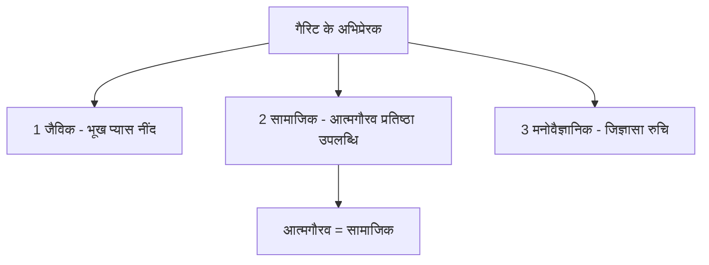

---

### प्रश्न 121: कर्पूरी ठाकुर की पुण्यतिथि

**प्रश्न:**
स्वतंत्रता सेनानी कर्पूरी ठाकुर (बिहार, समस्तीपुर से संबंधित, बिहार के दो बार मुख्यमंत्री) की पुण्यतिथि हाल ही में मनाई गई। वह कौन सी पुण्यतिथि थी?

**विकल्प:**
- A - 36वीं पुण्यतिथि
- B - 37वीं पुण्यतिथि
- C - 38वीं पुण्यतिथि
- D - 40वीं पुण्यतिथि

**सही उत्तर:** C - 38वीं पुण्यतिथि

**हल:**
- चरण 1 - कर्पूरी ठाकुर का परिचय - स्वतंत्रता सेनानी, बिहार के समस्तीपुर से, बिहार के दो बार मुख्यमंत्री रह चुके हैं
- चरण 2 - निधन की तिथि याद करें - फरवरी सन् 1988 ईस्वी में निधन हुआ था - यह तथ्य ट्रांसक्रिप्ट में शिक्षक ने बताया
- चरण 3 - गणना करें - पुण्यतिथि = वर्तमान वर्ष - निधन वर्ष
- चरण 4 - 2026 - 1988 = 38
- चरण 5 - घटाव विस्तार से - 2026 में से 2000 घटाएँ तो 26 बचे, 1988 में से 2000 घटाएँ तो -12, अंतर 38 - या सीधे 2026 - 1988 = 38
- चरण 6 - इसलिए फरवरी 2026 में 38वीं पुण्यतिथि मनाई गई - ऑप्शन C सही
- चरण 7 - अतिरिक्त जानकारी - कर्पूरी ठाकुर को हाल ही में भारत रत्न से भी सम्मानित किया जा चुका है - यह भी परीक्षा में पूछा जा सकता है
- चरण 8 - जिन लोगों ने 121 नंबर पर C लगाया है, उनका सही है - शिक्षक ने यही कहा

**ट्रिक / कॉन्सेप्ट:**
- पुण्यतिथि = वर्तमान वर्ष - निधन वर्ष - सीधा घटाव
- कर्पूरी ठाकुर = बिहार + समस्तीपुर + दो बार मुख्यमंत्री + भारत रत्न + निधन 1988 - पाँच बिंदु एक साथ याद
- भारत रत्न वाला बिंदु अलग से पूछा जा सकता है - हाल ही में मिला है

---

### प्रश्न 122: अमेरिका का स्वतंत्रता दिवस

**प्रश्न:**
अमेरिका का स्वतंत्रता दिवस किस तिथि को मनाया जाता है?

**विकल्प:**
- A - 26 मार्च
- B - 14 अगस्त
- C - 4 जुलाई
- D - 15 अगस्त

**सही उत्तर:** C - 4 जुलाई

**हल:**
- चरण 1 - विकल्प A देखें - 26 मार्च - यह बांग्लादेश का स्वतंत्रता दिवस है - बांग्लादेश 1971 में आजाद हुआ था - इसलिए A अमेरिका नहीं
- चरण 2 - विकल्प C देखें - 4 जुलाई - प्रत्येक वर्ष 4 जुलाई को अमेरिकी स्वतंत्रता दिवस मनाया जाता है - सन् 1776 में अमेरिका इसी दिन आजाद हुआ था - यही सही उत्तर है
- चरण 3 - विकल्प B देखें - 14 अगस्त 1947 - इस दिन पाकिस्तान स्वतंत्र हुआ था - इसलिए B पाकिस्तान है
- चरण 4 - विकल्प D देखें - 15 अगस्त 1947 - इस दिन भारत स्वतंत्र हुआ था - हम अपना स्वतंत्रता दिवस इसी दिन मनाते हैं - इसलिए D भारत है
- चरण 5 - चारों देशों को एक साथ याद करने से भ्रम नहीं होगा - बांग्लादेश 26 मार्च, अमेरिका 4 जुलाई, पाकिस्तान 14 अगस्त, भारत 15 अगस्त
- चरण 6 - शिक्षक ने कहा रोशन ने C बताया और बिल्कुल सही है

**ट्रिक / कॉन्सेप्ट:**
- 26 मार्च = बांग्लादेश 1971, 4 जुलाई = अमेरिका 1776, 14 अगस्त = पाकिस्तान 1947, 15 अगस्त = भारत 1947 - चार तिथि-देश का चार्ट बना लें
- 1776 वाला वर्ष अमेरिका की पहचान है

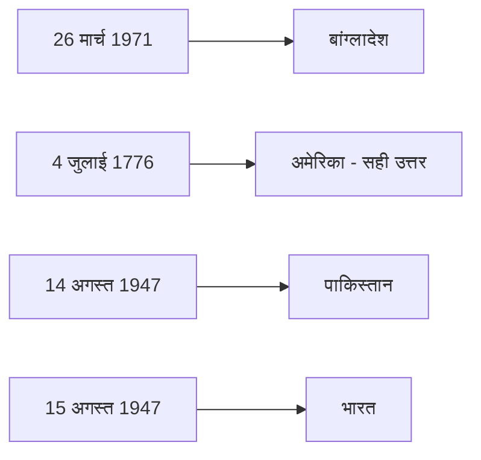

---

### प्रश्न 123: नवनिर्मित ध्यान मंदिर का उद्घाटन

**प्रश्न:**
हाल ही में प्रधानमंत्री नरेंद्र मोदी ने नवनिर्मित ध्यान मंदिर का उद्घाटन कहाँ किया है?

**विकल्प:**
- A - वाराणसी, उत्तर प्रदेश
- B - अयोध्या, उत्तर प्रदेश
- C - बेंगलुरु, कर्नाटक
- D - भोपाल, मध्य प्रदेश

**सही उत्तर:** C - बेंगलुरु, कर्नाटक - आर्ट ऑफ लिविंग इंटरनेशनल सेंटर

**हल:**
- चरण 1 - समय नोट करें - उद्घाटन मई 2026 में हुआ है - हाल ही की करंट अफेयर्स घटना
- चरण 2 - स्थान - बेंगलुरु, कर्नाटक - शिक्षक ने स्पष्ट कहा कर्नाटक के बेंगलुरु में किया है
- चरण 3 - विशिष्ट स्थल - आर्ट ऑफ लिविंग इंटरनेशनल सेंटर - इसी परिसर में ध्यान मंदिर बना है और वहीं उद्घाटन हुआ है
- चरण 4 - प्रधानमंत्री नरेंद्र मोदी ने स्वयं उद्घाटन किया है - यह तथ्य भी विकल्प की पहचान है
- चरण 5 - अन्य विकल्प वाराणसी, अयोध्या, भोपाल ध्यान मंदिर से संबंधित नहीं हैं - इसलिए बाहर
- चरण 6 - इसलिए उत्तर C होगा

**ट्रिक / कॉन्सेप्ट:**
- ध्यान मंदिर = बेंगलुरु + आर्ट ऑफ लिविंग + मई 2026 + मोदी - चारों को एक साथ जोड़ें
- कर्नाटक वाला बिंदु राज्य पूछे जाने पर भी काम आएगा

---

### प्रश्न 124: यूनेस्को से संबंधित दो कथन

**प्रश्न:**
यूनेस्को के संदर्भ में दो कथन दिए गए हैं, उनके आधार पर सही उत्तर चुनिए -
कथन 1 - यूनेस्को की स्थापना 16 नवंबर 1945 को हुई थी।
कथन 2 - भारत यूनेस्को का हस्ताक्षरकर्ता देश है।

**विकल्प:**
- A - केवल 1 सही है
- B - केवल 2 सही है
- C - 1 और 2 दोनों सही हैं
- D - न तो 1 सही है न ही 2 सही है

**सही उत्तर:** B - केवल 2 सही है

**हल:**
- चरण 1 - कथन 1 को परखें - यूनेस्को की स्थापना 16 नवंबर 1945 को हुई थी - तिथि सही है पर स्थान का पेंच है
- चरण 2 - स्थापना कहाँ हुई थी - लंदन में हुई थी - यह ट्रांसक्रिप्ट में शिक्षक ने स्पष्ट कहा - स्थापना लंदन में, मुख्यालय पेरिस में
- चरण 3 - यदि कथन में स्थापना को पेरिस बताया गया होता या केवल तिथि अधूरी होती तो गलत माना जाता - शिक्षक ने कहा पहला स्टेटमेंट गलत हो गया क्योंकि स्थापना लंदन में हुई थी, पेरिस उसका मुख्यालय है
- चरण 4 - कथन 2 को परखें - भारत यूनेस्को का हस्ताक्षरकर्ता देश है - बिल्कुल सही - भारत ने 4 नवंबर सन् 1946 को यूनेस्को पर हस्ताक्षर किया था
- चरण 5 - इसलिए कथन 1 गलत, कथन 2 सही - केवल 2 सही
- चरण 6 - शिक्षक ने कहा जिन लोगों ने केवल 2 लगाया है उनका सही है - मंजू वर्मा ने 123 का C सही कहा और 124 का यही लॉजिक है

**ट्रिक / कॉन्सेप्ट:**
- यूनेस्को - स्थापना 16 नवंबर 1945 लंदन में, मुख्यालय पेरिस में, भारत सदस्य 4 नवंबर 1946 - तीन तिथि-स्थान रट्टा
- स्थापना बनाम मुख्यालय का अंतर ही अक्सर कथन को गलत बनाता है - लंदन स्थापना, पेरिस मुख्यालय - उलटा न करें

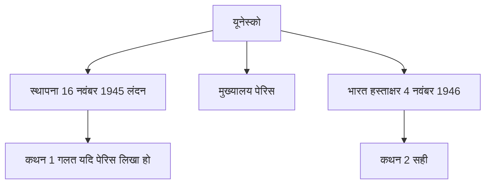

---

### प्रश्न 125: चितराई महोत्सव

**प्रश्न:**
चितराई महोत्सव (चितई महोत्सव) किस राज्य का प्रमुख उत्सव है? हाल ही में इसका आयोजन कहाँ और कब किया गया?

**विकल्प:**
- A - तमिलनाडु
- B - केरल
- C - कर्नाटक
- D - आंध्र प्रदेश

**सही उत्तर:** A - तमिलनाडु - मदुरई, मीनाक्षी अम्मन मंदिर परिसर - अप्रैल 2026 में आयोजन

**हल:**
- चरण 1 - नाम पहचानें - चितराई महोत्सव / चितई महोत्सव - दक्षिण भारत का प्रसिद्ध उत्सव
- चरण 2 - राज्य - तमिलनाडु - शिक्षक ने कहा चितरई महोत्सव का आयोजन तमिलनाडु में हुआ है
- चरण 3 - शहर - मदुरई - तमिलनाडु के मदुरई में इसका आयोजन हुआ है - यह बिंदु भी याद रखें
- चरण 4 - स्थल - मीनाक्षी अम्मन मंदिर परिसर - इसी मंदिर परिसर में आयोजन किया जाता है - नाम मीनाक्षी अम्मन याद रखें
- चरण 5 - समय - अप्रैल 2026 में इसका आयोजन किया गया - हाल ही की घटना
- चरण 6 - इस उत्सव में क्या होता है - मीनाक्षी और सुंदरेश्वर के विवाह का जश्न मनाया जाता है - मीनाक्षी और सुंदरेश्वर के विवाह का उत्सव - यह सांस्कृतिक तथ्य भी पूछा जा सकता है

**ट्रिक / कॉन्सेप्ट:**
- चितराई = तमिलनाडु = मदुरई = मीनाक्षी अम्मन मंदिर = मीनाक्षी-सुंदरेश्वर विवाह = अप्रैल 2026 - पूरी श्रृंखला एक साथ
- मदुरई वाला बिंदु जिला/शहर पूछने पर काम आएगा

---

### प्रश्न 126: बसीर बद्र - पद्मश्री और साहित्य अकादमी

**प्रश्न:**
मशहूर शायर और कवि बसीर बद्र, जिनका हाल ही में निधन हुआ है, को पद्मश्री पुरस्कार किस वर्ष दिया गया था? साथ ही साहित्य अकादमी पुरस्कार से भी संबंधित तथ्य बताइए।

**विकल्प:**
- A - 1998
- B - 1999
- C - 2000
- D - 2001

**सही उत्तर:** B - 1999 - पद्मश्री 1999 और साहित्य अकादमी पुरस्कार 1999 उर्दू भाषा में कविता संग्रह आस के लिए

**हल:**
- चरण 1 - व्यक्ति पहचानें - बसीर बद्र - मशहूर शायर और कवि - उर्दू के प्रसिद्ध रचनाकार
- चरण 2 - निधन - मई 2026 में निधन हुआ है - हाल ही की घटना इसलिए पुरस्कार वाला प्रश्न पूछा गया
- चरण 3 - पद्मश्री - किस वर्ष मिला - 1999 में मिला - शिक्षक ने कहा पद्मश्री भी 1999 का मिला है
- चरण 4 - साहित्य अकादमी पुरस्कार - यह भी 1999 में मिला - दोनों पुरस्कार एक ही वर्ष में मिले
- चरण 5 - भाषा - उर्दू भाषा के लिए मिला - यह भी याद रखें - उर्दू के लिए
- चरण 6 - कृति - कविता संग्रह आस के लिए मिला - कविता संग्रह का नाम आस है - इसी के लिए साहित्य अकादमी दी गई
- चरण 7 - करंट अफेयर्स का नियम - सामान्यतः साहित्य अकादमी में पहला किसे मिला, हाल ही में किसे मिला पूछा जाता है, पर यदि किसी चर्चित पुरस्कृत व्यक्ति का निधन हो जाए तो उसका पुरस्कार वर्ष भी पूछा जा सकता है - शिक्षक ने यही ट्रिक बताई
- चरण 8 - इसलिए दोनों पुरस्कार 1999 - उत्तर B

**ट्रिक / कॉन्सेप्ट:**
- बसीर बद्र = मई 2026 निधन + 1999 पद्मश्री + 1999 साहित्य अकादमी + उर्दू + आस - पाँच बिंदु एक साथ
- 1999 वर्ष ही दोनों पुरस्कारों की पहचान - एक ही वर्ष दो पुरस्कार
- निधन वाला व्यक्ति + पुरस्कार वर्ष का कॉम्बिनेशन अक्सर पूछा जाता है

---

### प्रश्न 127: भौगोलिक संकेतक (जीआई टैग) - सुमेलन

**प्रश्न:**
हाल ही में प्रदान किए गए भौगोलिक संकेतक (जीआई टैग) के संदर्भ में सूची-1 को सूची-2 से सुमेलित कीजिए -
सूची-1 - उत्पाद - जरी पोशाक, पुनरू खादी, पन्ना हीरा, नागौरी अश्वगंधा
सूची-2 - राज्य

**विकल्प:**
- A - 1-राजस्थान, 2-मध्य प्रदेश, 3-आंध्र प्रदेश, 4-उत्तर प्रदेश
- B - 1-आंध्र प्रदेश, 2-उत्तर प्रदेश, 3-राजस्थान, 4-मध्य प्रदेश
- C - 1-मध्य प्रदेश, 2-राजस्थान, 3-उत्तर प्रदेश, 4-आंध्र प्रदेश
- D - 1-उत्तर प्रदेश, 2-आंध्र प्रदेश, 3-मध्य प्रदेश, 4-राजस्थान

**सही उत्तर:** D - 1-उत्तर प्रदेश, 2-आंध्र प्रदेश, 3-मध्य प्रदेश, 4-राजस्थान

**हल:**
- चरण 1 - जरी पोशाक - किस राज्य का - उत्तर प्रदेश का है - भगवान श्री कृष्ण के बाल रूप का वस्त्र है - इसका उत्पादन मथुरा में होता है - यूपी स्पेशल पूछे तो मथुरा - इसलिए 1 का संबंध उत्तर प्रदेश से
- चरण 2 - पुनरू खादी - किस राज्य का - आंध्र प्रदेश का उत्पाद है - स्पेशली श्रीकाकुलम जिले का - आंध्र प्रदेश के श्रीकाकुलम जिले का प्रोडक्ट है - इसलिए 2 का संबंध आंध्र प्रदेश से
- चरण 3 - पन्ना हीरा - किस राज्य का - मध्य प्रदेश का उत्पाद है - हाल ही में जीआई टैग दिया गया है - इसलिए 3 का संबंध मध्य प्रदेश से
- चरण 4 - नागौरी अश्वगंधा - किस राज्य का - राजस्थान का है - इसे भी हाल ही में जीआई टैग दिया गया है - इसलिए 4 का संबंध राजस्थान से
- चरण 5 - क्रम बनाएँ - 1 उत्तर प्रदेश, 2 आंध्र प्रदेश, 3 मध्य प्रदेश, 4 राजस्थान - यह क्रम विकल्प D में है - शिक्षक ने कहा ऑप्शन डी बन रहा है 1 2 3 4
- चरण 6 - सिंगल भी पूछा जा सकता है - जैसे जरी पोशाक किस राज्य का है तो उत्तर प्रदेश, पुनरू खादी किस जिले का तो श्रीकाकुलम

**ट्रिक / कॉन्सेप्ट:**
- जरी = मथुरा = यूपी - कृष्ण के बाल रूप का वस्त्र - कहानी से याद
- पुनरू खादी = श्रीकाकुलम = आंध्र प्रदेश - जिला नाम से राज्य जोड़ें
- पन्ना = मध्य प्रदेश का पन्ना हीरा खदान वाला जिला - वही नाम
- नागौरी = नागौर राजस्थान का जिला - नाम से ही राजस्थान
- सुमेलन में पहले दो पक्का कर लें तो बाकी स्वतः बैठ जाते हैं

---

### प्रश्न 128: इटली की सीमा किन देशों से लगती है

**प्रश्न:**
इस समय चर्चा में रहा इटली (प्रधानमंत्री नरेंद्र मोदी का दौरा, प्रधानमंत्री मिलोनी को टॉफी गिफ्ट के कारण सोशल मीडिया पर चर्चा) की सीमा किन देशों से लगती है? साथ ही किस सागर से लगती है?

**विकल्प:**
- A - फ्रांस, स्विट्जरलैंड, ऑस्ट्रिया
- B - फ्रांस, स्विट्जरलैंड, ऑस्ट्रिया, स्लोवेनिया (और भूमध्य सागर से)
- C - फ्रांस, जर्मनी, ऑस्ट्रिया, स्लोवेनिया
- D - स्विट्जरलैंड, ऑस्ट्रिया, स्लोवेनिया, क्रोएशिया

**सही उत्तर:** B - फ्रांस, स्विट्जरलैंड, ऑस्ट्रिया, स्लोवेनिया - साथ ही भूमध्य सागर से भी सीमा टच करती है

**हल:**
- चरण 1 - संदर्भ समझें - इटली हाल ही में चर्चा में है - भारतीय प्रधानमंत्री नरेंद्र मोदी का दौरा और मिलोनी को टॉफी गिफ्ट - इस कारण सोशल मीडिया पर चर्चा
- चरण 2 - इटली की स्थलीय सीमा चार देशों से लगती है - शिक्षक ने चार नाम बताए
- चरण 3 - पहला - फ्रांस से लगती है
- चरण 4 - दूसरा - स्विट्जरलैंड से लगती है
- चरण 5 - तीसरा - ऑस्ट्रिया से लगती है
- चरण 6 - चौथा - स्लोवेनिया से लगती है
- चरण 7 - इसके अलावा एक सागर से भी टच करती है - भूमध्य सागर - यह भी याद रखें
- चरण 8 - विकल्प में 1, 2 और 4 का संयोजन यानी फ्रांस, स्विट्जरलैंड और स्लोवेनिया तथा ऑस्ट्रिया को मिलाकर चारों वाला विकल्प सही होगा - शिक्षक ने कहा एक दो चार होगा यानी ऑप्शन बी होगा - जिन लोगों ने बी लगाया है उनका सही है
- चरण 9 - जर्मनी या क्रोएशिया वाला विकल्प गलत है - इटली की सीमा जर्मनी से नहीं लगती

**ट्रिक / कॉन्सेप्ट:**
- इटली के चार पड़ोसी - फ्रांस, स्विट्जरलैंड, ऑस्ट्रिया, स्लोवेनिया - घड़ी की दिशा में याद करें - पश्चिम से फ्रांस, उत्तर में स्विट्जरलैंड और ऑस्ट्रिया, पूर्वोत्तर में स्लोवेनिया
- भूमध्य सागर वाला बिंदु अतिरिक्त - इटली बूट जैसा प्रायद्वीप है जो भूमध्य सागर में स्थित है
- मिलोनी वाला करंट अफेयर्स हुक याद रखें - टॉफी गिफ्ट वाली चर्चा

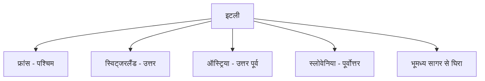

---

### प्रश्न 129: दक्षिणी ध्रुव तक स्कीइंग - सबसे कम उम्र की भारतीय पर्वतारोही

**प्रश्न:**
हाल ही में दक्षिणी ध्रुव तक स्कीइंग करने वाली सबसे कम उम्र की भारतीय पर्वतारोही कौन बनी है?

**विकल्प:**
- A - काम्या कार्तिकेयन
- B - अरुणिमा सिन्हा
- C - बछेंद्री पाल
- D - संतोष यादव

**सही उत्तर:** A - काम्या कार्तिकेयन - 18 वर्ष - जनवरी 2026 में रिकॉर्ड

**हल:**
- चरण 1 - प्रश्न को समझें - दक्षिणी ध्रुव तक स्कीइंग - बर्फ पर चश्मा लगा करके खेलना / चलना - पर्वतारोहण से जुड़ा स्कीइंग रिकॉर्ड
- चरण 2 - उत्तर - काम्या कार्तिकेयन - शिक्षक ने स्पष्ट कहा सही जवाब काम्या कार्तिकेयन है
- चरण 3 - उम्र - मात्र 18 वर्ष की उम्र में यह उपलब्धि हासिल की है - सबसे कम उम्र की भारतीय महिला / पर्वतारोही
- चरण 4 - समय - जनवरी 2026 में इन्होंने यह रिकॉर्ड बनाया है - हाल ही की घटना
- चरण 5 - अन्य विकल्प - अरुणिमा, बछेंद्री, संतोष सभी प्रसिद्ध पर्वतारोही हैं पर दक्षिणी ध्रुव स्कीइंग का यह विशिष्ट रिकॉर्ड काम्या का है
- चरण 6 - इसलिए A सही है

**ट्रिक / कॉन्सेप्ट:**
- दक्षिणी ध्रुव + स्कीइंग + सबसे कम उम्र + 18 वर्ष + काम्या कार्तिकेयन + जनवरी 2026 - छह बिंदु एक साथ
- 18 वर्ष वाली सबसे कम उम्र ही पहचान है - परीक्षा में उम्र पूछी जा सकती है

---

### प्रश्न 130: राज्य और राज्यपाल की नवीन नियुक्तियाँ - सुमेलन (प्रारंभ)

**प्रश्न:**
हाल ही में नवीन राज्यपालों की नियुक्ति की गई है। राज्य और राज्यपाल को सुमेलित कीजिए। यह आपको बताना है कि इस प्रश्न का उत्तर क्या होगा?

**विकल्प:**
- A - विकल्प सूची ट्रांसक्रिप्ट में अपूर्ण है
- B - विकल्प सूची ट्रांसक्रिप्ट में अपूर्ण है
- C - विकल्प सूची ट्रांसक्रिप्ट में अपूर्ण है
- D - विकल्प सूची ट्रांसक्रिप्ट में अपूर्ण है

**सही उत्तर:** ट्रांसक्रिप्ट में इस प्रश्न का केवल प्रारंभ उपलब्ध है - राज्य और राज्यपाल की नवीन नियुक्तियों वाला सुमेलन प्रश्न पूछा गया है, पर विकल्पों का विवरण और उत्तर की चर्चा इस भाग में कट गई है - शेष अगले भाग (Part 10) में कवर होगा

**हल:**
- चरण 1 - प्रश्न का प्रकार समझें - राज्य - राज्यपाल सुमेलन - नवीन नियुक्तियों पर आधारित करंट अफेयर्स प्रश्न - यह हर साल पूछा जाता है
- चरण 2 - ट्रांसक्रिप्ट में शिक्षक ने कहा - देखिए ये राज्य है और यह राज्यपाल है, अभी नए नए राज्यपालों की नियुक्ति की गई है और यह आपको बताना है कि इस प्रश्न का उत्तर क्या होगा, बताइएगा इस प्रश्न का उत्तर क्या लगाया है - इसके बाद ट्रांसक्रिप्ट समाप्त हो जाता है
- चरण 3 - चूँकि विकल्प और उत्तर की चर्चा उपलब्ध नहीं है, इस प्रश्न को इस भाग में अधूरा मानकर अगले भाग से जोड़ा जाएगा - शून्य हानि के सिद्धांत से यहाँ केवल उपलब्ध परिचय को दर्ज किया गया है

**ट्रिक / कॉन्सेप्ट:**
- राज्यपाल नियुक्ति वाले सुमेलन प्रश्नों में नवीन नियुक्तियों की सूची पहले से तैयार रखें - राष्ट्रपति द्वारा नियुक्ति होती है - पाँच वर्ष का कार्यकाल पर राष्ट्रपति की इच्छा तक - यह संवैधानिक तथ्य भी साथ में याद रखें

---

### अतिरिक्त करंट अफेयर्स नोट्स - इसी भाग में शिक्षक द्वारा बताए गए

- **ज्ञान गंगा नोट्स टेलीग्राम पर दो बुकलेट उपलब्ध** - करंट अफेयर्स में कुल 10 यूनिट होते हैं, हर यूनिट पर एक बुकलेट - बुकलेट 1 हिस्टोरिकल इशू और बुकलेट 2 कल्चरल इशू उपलब्ध करा दी गई है - ज्ञान गंगा नोट्स टेलीग्राम चैनल से डाउनलोड करें - रूम नंबर 6 में सुबह 6:30 बजे ऑफलाइन क्लास चल रही है, बंद रोड ब्रांच
- **कोर्स डिस्काउंट** - सुपर टेट और टीजीटी पीजीटी के जीएस स्पेशल बैच के ऑनलाइन कोर्स पर 90 प्रतिशत डिस्काउंट चल रहा है - डेमो देख सकते हैं या परचेस कर सकते हैं
- **अगला पेपर** - शिक्षक ने कहा अगला पेपर बहुत बेहतरीन और लाजवाब होने वाला है, सीडीपी का पेपर वे स्वयं बनाएंगे - व्यस्तता के बाद अब फ्री हैं
- **परीक्षा रणनीति** - करंट अफेयर्स में पहला किसे मिला, हाल ही में किसे मिला, और निधन वाले व्यक्ति का पुरस्कार वर्ष - ये तीन पैटर्न सबसे ज्यादा पूछे जाते हैं

---

### इस भाग से रिवीज़न के लिए मुख्य सूत्र और ट्रिक

- अभिसारी = बहुविकल्पी = इन द बॉक्स, अपसारी = रचनात्मकता = आउट ऑफ द बॉक्स
- संसाधन संपन्न शिक्षक = ज्ञान संपन्न - पैसा या संपर्क नहीं
- गैरिट के तीन अभिप्रेरक - जैविक, सामाजिक, मनोवैज्ञानिक - आत्मगौरव = सामाजिक
- कर्पूरी ठाकुर - निधन फरवरी 1988 - 2026 - 1988 = 38वीं पुण्यतिथि - भारत रत्न
- 26 मार्च बांग्लादेश, 4 जुलाई अमेरिका 1776, 14 अगस्त पाकिस्तान, 15 अगस्त भारत
- ध्यान मंदिर - मई 2026 - बेंगलुरु कर्नाटक - आर्ट ऑफ लिविंग इंटरनेशनल सेंटर - मोदी द्वारा उद्घाटन
- यूनेस्को - स्थापना 16 नवंबर 1945 लंदन, मुख्यालय पेरिस, भारत हस्ताक्षर 4 नवंबर 1946 - केवल कथन 2 सही
- चितराई महोत्सव - तमिलनाडु मदुरई मीनाक्षी अम्मन मंदिर - मीनाक्षी-सुंदरेश्वर विवाह - अप्रैल 2026
- बसीर बद्र - मई 2026 निधन - पद्मश्री 1999 + साहित्य अकादमी 1999 उर्दू आस
- जीआई टैग - जरी पोशाक उत्तर प्रदेश मथुरा, पुनरू खादी आंध्र प्रदेश श्रीकाकुलम, पन्ना हीरा मध्य प्रदेश, नागौरी अश्वगंधा राजस्थान - उत्तर D
- इटली - फ्रांस, स्विट्जरलैंड, ऑस्ट्रिया, स्लोवेनिया + भूमध्य सागर - उत्तर B
- काम्या कार्तिकेयन - 18 वर्ष - जनवरी 2026 - दक्षिणी ध्रुव स्कीइंग सबसे कम उम्र

---

### अगले भाग के लिए संकेत

- प्रश्न 130 का शेष - राज्य-राज्यपाल सुमेलन के विकल्प और उत्तर, तथा 131 से 150 तक के शेष जीके/जीएस और हिंदी साहित्य के प्रश्न Part 10 में जारी रहेंगे
- हिंदी साहित्य खंड Part 10 में विस्तार से कवर होगा

> यह सार Part 09 के ट्रांसक्रिप्ट (3680 शब्द) पर आधारित है - शून्य सूचना हानि के लक्ष्य से हर प्रश्न का कथन, विकल्प, हल और ट्रिक यथासंभव संरक्षित किया गया है। अधूरे प्रश्न 130 को अगले भाग से जोड़ा जाएगा।
## भाग 10: समापन - शेष प्रश्न एवं परीक्षा रणनीति

> **PART 10 of 10 | SUPER TET 2026 Mock Test-06 Paper Analysis + Complete Answer Key**
> इस भाग में ट्रांसक्रिप्ट part_10.md (4011 शब्द) के आधार पर सामान्य ज्ञान / करंट अफेयर्स एवं स्टैटिक जीके के अंतिम शेष प्रश्नों (प्रश्न 130 से 150) का शब्द-शः विश्लेषण किया गया है। स्रोत में अशोक सर द्वारा करंट अफेयर्स खंड का समापन किया गया है। साथ ही पेपर के कुल 30 जीके/जीएस प्रश्नों का सार, करंट अफेयर्स तैयार करने की रणनीति, ऑफलाइन बैच की सूचना और शिक्षक के अंतिम प्रेरणा संदेश को भी विस्तार से दर्ज किया गया है। हर प्रश्न, हर विकल्प, हर उत्तर और हर हल को चरण-दर-चरण हिंदी में प्रस्तुत किया गया है, बिना किसी जानकारी को हटाए।

### इस भाग में क्या कवर हुआ
- प्रश्न 130 - नए राज्यपालों की नियुक्ति मार्च 2026 - तेलंगाना, हिमाचल प्रदेश, नागालैंड, तमिलनाडु - राष्ट्रपति द्रौपदी मुर्मू द्वारा
- प्रश्न 131 - प्रेस क्लब ऑफ इंडिया की पहली महिला अध्यक्ष - संगीता बरवा
- प्रश्न 132 - हाई कोर्ट के नए मुख्य न्यायाधीश - कोलकाता, जम्मू-कश्मीर एवं लद्दाख, आंध्र प्रदेश, गुवाहाटी
- प्रश्न 133 - सतत विकास लक्ष्य रिपोर्ट 2026 - भारत का 94वाँ स्थान, फिनलैंड पहला
- प्रश्न 134 - मुख्यमंत्री निश्चय स्वयं सहायता भत्ता योजना - बिहार - बेरोजगार युवाओं को 1000 रुपये प्रति माह
- प्रश्न 135 - भारत का पहला निजी तेल भंडार - कर्नाटक
- प्रश्न 136 - डीआरडीओ स्थापना दिवस - 1 जनवरी 1958 - 2026 में 68वाँ दिवस
- प्रश्न 137 - भौतिकी का नोबेल पुरस्कार 2025 - जॉन क्लार्क, मिशेल एच डेवोरेट और जॉन एम मार्टिनिस
- प्रश्न 138 - भारत की पहली रॉकेट 3डी प्रिंटिंग फैसिलिटी - अग्निकुल कॉसमॉस
- प्रश्न 139 - गुरु घासीदास तिमोर पिंगला टाइगर रिजर्व - देश का 56वाँ, क्षेत्रफल 2829 वर्ग किमी, तीसरा सबसे बड़ा
- प्रश्न 140 - पेंगोलिन के व्यापार और शिकार पर प्रतिबंध - नागालैंड
- प्रश्न 141 - आईयूसीएन का नवीनतम 89वाँ सदस्य देश - आर्मेनिया
- प्रश्न 142 - केंद्रीय औद्योगिक सुरक्षा बल सीआईएसएफ - स्थापना 10 मार्च 1969, मुख्यालय नई दिल्ली
- प्रश्न 143 - भारत का पहला झुग्गी मुक्त शहर - चंडीगढ़
- प्रश्न 144 - भारत का पहला बाल विवाह मुक्त जिला - बालोद, छत्तीसगढ़
- प्रश्न 145 - यूनिसेफ स्थापना दिवस - 11 दिसंबर 1946, मुख्यालय न्यूयॉर्क
- प्रश्न 146 - भारत-किरगिस्तान संयुक्त सैन्य अभ्यास खंजर 2026 - मिसामारी, असम - 13वाँ संस्करण
- प्रश्न 147 - एशिया पावर इंडेक्स 2025 - भारत तीसरे स्थान पर - अमेरिका पहला, चीन दूसरा
- प्रश्न 148 - पुरुषों के टेस्ट मैच में अंपायरिंग करने वाली पहली महिला अंपायर - क्लेयर पोलोसक, ऑस्ट्रेलिया
- प्रश्न 149 - प्रो कबड्डी लीग 12वाँ संस्करण - विजेता दबंग दिल्ली
- प्रश्न 150 - चौथी दक्षिण एशियाई एथलेटिक्स चैंपियनशिप 2025 रांची, झारखंड - भारत प्रथम
- हर प्रश्न के लिए टॉपिक टैग, प्रश्न, विकल्प, सही उत्तर, हल और ट्रिक / कॉन्सेप्ट
- अंत में शिक्षक के समापन संदेश, परीक्षा रणनीति, अगले कदम और करंट अफेयर्स की तैयारी का तरीका

---

### प्रश्न 130: नए राज्यपालों की नियुक्ति मार्च 2026

**प्रश्न:**
मार्च 2026 में राष्ट्रपति द्रौपदी मुर्मू द्वारा नियुक्त नए राज्यपालों के संदर्भ में सुमेलित कीजिए - तेलंगाना, हिमाचल प्रदेश, नागालैंड, तमिलनाडु के नए राज्यपाल कौन हैं?

**विकल्प:**
- A - सभी चार सही हैं - 1, 2, 3 और 4
- B - केवल 1 और 2 सही हैं
- C - केवल 2 और 3 सही हैं
- D - केवल 3 और 4 सही हैं

**सही उत्तर:** A - 1, 2, 3 और 4 सभी सही हैं

**हल:**
- चरण 1 - घटना को समझें - मार्च 2026 में राष्ट्रपति द्वारा नए राज्यपालों की नियुक्ति की गई है - हाल ही की करंट अफेयर्स घटना
- चरण 2 - नियुक्ति किसने की - राष्ट्रपति द्रौपदी मुर्मू ने - यह बिंदु भी याद रखें
- चरण 3 - राज्यवार सूची -
  - तेलंगाना का राज्यपाल - शिव प्रसाद शुक्ला को बनाया गया है
  - हिमाचल प्रदेश का राज्यपाल - कविंदर गुप्ता को बनाया गया है
  - नागालैंड का राज्यपाल - नंद किशोर यादव को बनाया गया है
  - तमिलनाडु का राज्यपाल - राजेंद्र विश्वनाथ अरलेकर को बनाया गया है
- चरण 4 - प्रश्न में चारों नाम-राज्य युग्म पूछे गए थे - और चारों सही बैठते हैं - इसलिए उत्तर 1, 2, 3 और 4
- चरण 5 - विकल्प A में चारों का संयोजन है - इसलिए A सही
- चरण 6 - शिक्षक ने कहा इसका सही जवाब ऑप्शन ए होगा यानी एक दो तीन और चार - इसलिए भ्रम न रखें
- चरण 7 - मार्च 2026 और राष्ट्रपति द्रौपदी मुर्मू वाला समय-बिंदु परीक्षा में तिथि पूछने पर भी काम आएगा

**ट्रिक / कॉन्सेप्ट:**
- शिव प्रसाद शुक्ला = तेलंगाना, कविंदर गुप्ता = हिमाचल, नंद किशोर यादव = नागालैंड, अरलेकर = तमिलनाडु - चार नाम-राज्य का सीधा रट्टा
- मार्च 2026 + राष्ट्रपति द्रौपदी मुर्मू - महीने और नियुक्तिकर्ता को साथ याद करें
- सुमेलन में चारों सही हो तो उपर्युक्त सभी वाला विकल्प टिक करें

---

### प्रश्न 131: प्रेस क्लब ऑफ इंडिया की पहली महिला अध्यक्ष

**प्रश्न:**
हाल ही में प्रेस क्लब ऑफ इंडिया की पहली महिला अध्यक्ष किसे चुना गया है?

**विकल्प:**
- A - किसी अन्य महिला पत्रकार
- B - संगीता बरवा
- C - किसी अन्य पुरुष अध्यक्ष
- D - उपर्युक्त में से कोई नहीं

**सही उत्तर:** B - संगीता बरवा

**हल:**
- चरण 1 - संस्था पहचानें - प्रेस क्लब ऑफ इंडिया - पत्रकारों की राष्ट्रीय संस्था
- चरण 2 - प्रश्न की विशेषता - पहली महिला अध्यक्ष - इससे पहले कोई महिला इस पद पर नहीं थी - इसलिए ऐतिहासिक पहला
- चरण 3 - उत्तर - संगीता बरवा को हाल ही में चुना गया है - शिक्षक ने दो बार दोहराया किसको बनाया गया है - संगीता बरवा को
- चरण 4 - विकल्प में B में यही नाम है - इसलिए B सही
- चरण 5 - शिक्षक ने कहा जिन लोगों ने बी लगाया उनका सही था - इसलिए पुष्टि
- चरण 6 - पहली महिला वाला टैग परीक्षा में अक्सर पूछा जाता है - इसलिए याद रखें

**ट्रिक / कॉन्सेप्ट:**
- प्रेस क्लब ऑफ इंडिया = पहली महिला अध्यक्ष = संगीता बरवा - तीन शब्द एक साथ
- पहली महिला वाला तथ्य ही पहचान है - पुरुष विकल्प स्वतः बाहर

---

### प्रश्न 132: हाई कोर्ट के नए मुख्य न्यायाधीशों की नियुक्ति

**प्रश्न:**
हाल ही में राष्ट्रपति द्रौपदी मुर्मू द्वारा नियुक्त हाई कोर्ट के मुख्य न्यायाधीशों के संदर्भ में सुमेलित कीजिए -
- कोलकाता हाई कोर्ट
- जम्मू-कश्मीर एवं लद्दाख हाई कोर्ट
- आंध्र प्रदेश हाई कोर्ट
- गुवाहाटी हाई कोर्ट

**विकल्प:**
- A - 1 और 2 सही
- B - 1, 2, 4 और 3 - सभी चार सही (क्रम 1-2-4-3 वाला विकल्प)
- C - केवल 1 और 4 सही
- D - केवल 2 और 3 सही

**सही उत्तर:** B - 1, 2, 4 और 3 - सभी चार सही

**हल:**
- चरण 1 - नियुक्तिकर्ता - राष्ट्रपति द्रौपदी मुर्मू द्वारा नए मुख्य न्यायाधीशों की नियुक्ति - हाल ही की घटना
- चरण 2 - कोलकाता हाई कोर्ट - नए मुख्य न्यायाधीश जस्टिस तापव्रत चक्रवर्ती बने हैं - शिक्षक ने कहा तापव्रत चक्रवर्ती यह यहाँ पर हो गया
- चरण 3 - जम्मू-कश्मीर एवं लद्दाख हाई कोर्ट - नए मुख्य न्यायाधीश संजीव कुमार बने हैं - शिक्षक ने कहा एसआई है इनको नियुक्त किया गया है
- चरण 4 - आंध्र प्रदेश हाई कोर्ट - नए मुख्य न्यायाधीश जस्टिस आशुतोष कुमार को बनाया गया है - नियुक्त किया गया है
- चरण 5 - गुवाहाटी हाई कोर्ट - नई मुख्य न्यायाधीश लिसा गिल बनी हैं - शिक्षक ने कहा गुवाहाटी हाई कोर्ट के मुख्य न्यायाधीश लिसा गिल बनी हैं
- चरण 6 - क्रम बनाएँ - 1 कोलकाता तापव्रत, 2 जम्मू-कश्मीर संजीव कुमार, 3 आंध्र आशुतोष कुमार, 4 गुवाहाटी लिसा गिल - चारों बैठते हैं
- चरण 7 - विकल्प B में 1, 2, 4 और 3 का संयोजन है - शिक्षक ने कहा इसका उत्तर ऑप्शन बी होगा - 1 2 4 और तीन - जिन लोगों ने बी लगाया उनका सही है

**ट्रिक / कॉन्सेप्ट:**
- कोलकाता = तापव्रत चक्रवर्ती, जम्मू-कश्मीर लद्दाख = संजीव कुमार, आंध्र = आशुतोष कुमार, गुवाहाटी = लिसा गिल - चार हाई कोर्ट - चार नाम
- राष्ट्रपति द्रौपदी मुर्मू द्वारा नियुक्ति - यह वाक्य ही करंट अफेयर्स का हुक है
- सुमेलन में चारों को एक साथ टिक करें - कोई भी छूटा तो विकल्प गलत

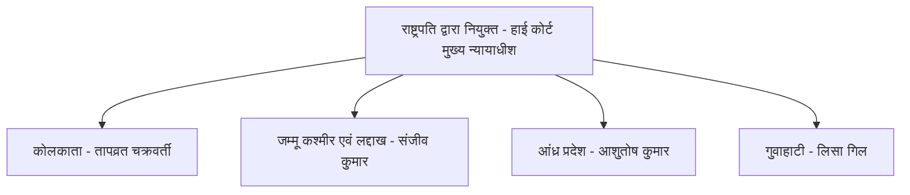

---

### प्रश्न 133: सतत विकास लक्ष्य रिपोर्ट 2026 में भारत का स्थान

**प्रश्न:**
हाल ही में जारी सतत विकास लक्ष्य रिपोर्ट 2026 में भारत का रैंक कौन सा है?

**विकल्प:**
- A - 99वाँ
- B - 92वाँ
- C - 94वाँ
- D - 101वाँ

**सही उत्तर:** C - 94वाँ स्थान - फिनलैंड पहले स्थान पर

**हल:**
- चरण 1 - रिपोर्ट पहचानें - सतत विकास लक्ष्य रिपोर्ट 2026 - एसडीजी रिपोर्ट - हाल ही में जारी
- चरण 2 - भारत का स्थान - 94वाँ - शिक्षक ने कहा भारत का स्थान इस बार 94वाँ है
- चरण 3 - पिछली बार से तुलना - पिछली बार 99वाँ था - इस बार सुधार करते हुए 94 पर आ गया है - 5 स्थान का सुधार
- चरण 4 - पहला स्थान किसका - फिनलैंड का पहला स्थान है - शिक्षक ने कहा अगर फर्स्ट स्थान पूछ लिया गया होता तो फिनलैंड का है
- चरण 5 - इसलिए भारत 94, फिनलैंड 1 - विकल्प C सही
- चरण 6 - रैंक वाला प्रश्न हर साल आता है - पिछला और वर्तमान दोनों याद रखें

**ट्रिक / कॉन्सेप्ट:**
- एसडीजी 2026 - भारत 94, पिछली बार 99, फिनलैंड 1 - तीन संख्या एक साथ
- सुधार वाला बिंदु - 99 से 94 - ऊपर आया है - यह वाक्य याद रखें

---

### प्रश्न 134: मुख्यमंत्री निश्चय स्वयं सहायता भत्ता योजना

**प्रश्न:**
हाल ही में किस राज्य सरकार ने मुख्यमंत्री निश्चय स्वयं सहायता भत्ता योजना के तहत उस राज्य के बेरोजगार युवाओं को प्रति माह 1000 रुपये देने की घोषणा की है?

**विकल्प:**
- A - उत्तर प्रदेश
- B - बिहार
- C - मध्य प्रदेश
- D - राजस्थान

**सही उत्तर:** B - बिहार

**हल:**
- चरण 1 - योजना का नाम - मुख्यमंत्री निश्चय स्वयं सहायता भत्ता योजना - पूरा नाम याद करें - निश्चय शब्द महत्वपूर्ण
- चरण 2 - लाभ - राज्य के सभी बेरोजगार युवाओं को 1000 रुपये प्रति माह - जब तक सिलेक्शन नहीं हो जाता तब तक सरकार 1000 मुहैया कराती है
- चरण 3 - राज्य कौन - बिहार - शिक्षक ने स्पष्ट कहा यह योजना बिहार की है - कहाँ की है - बिहार की है
- चरण 4 - उत्तर प्रदेश क्यों नहीं - शिक्षक ने कहा यूपी में इस प्रकार की कोई योजना ही नहीं आती है - हमने कभी नहीं देखा कि यूपी में बेरोजगारों को 1000 क्या 900 भी दिया जाए - इसलिए यूपी बाहर
- चरण 5 - अन्य राज्य मध्य प्रदेश, राजस्थान का इस योजना से कोई संबंध नहीं - इसलिए B सही
- चरण 6 - शिक्षक ने कहा यह बहुत अच्छी योजना है - छात्र के पढ़ाई-लिखाई का खर्चा इसमें से निकल सकता है - इससे ज्यादा भी देना चाहिए
- चरण 7 - परीक्षा में योजना का नाम पूरा और राशि 1000 वाला बिंदु पूछा जा सकता है

**ट्रिक / कॉन्सेप्ट:**
- निश्चय स्वयं सहायता भत्ता = बिहार = 1000 प्रति माह = बेरोजगार युवा - चार बिंदु एक साथ
- यूपी में ऐसी योजना नहीं - यह नकारात्मक बिंदु ही बिहार को पक्का करता है
- राशि 1000 ही पहचान है

---

### प्रश्न 135: भारत का पहला निजी तेल भंडार

**प्रश्न:**
भारत का पहला निजी तेल भंडार किस राज्य में बनाया जाएगा?

**विकल्प:**
- A - कर्नाटक
- B - गुजरात
- C - महाराष्ट्र
- D - असम

**सही उत्तर:** A - कर्नाटक

**हल:**
- चरण 1 - प्रश्न को समझें - तेल भंडार - अब तक सरकारी हाथ में था - पहला निजी भंडार - निजीकरण को सरकार महत्व दे रही है
- चरण 2 - निजी का अर्थ - किसी निजी व्यक्ति या उद्योगपति के हाथ में होगा - शिक्षक ने कहा जैसे किसी उद्योगपति के हाथ में होगा - आप समझ ही सकते हैं किसके हाथ में होगा
- चरण 3 - राज्य - कर्नाटक में यह तेल भंडार बनेगा - शिक्षक ने स्पष्ट कहा कर्नाटक में जो है एक ऐसा तेल का भंडार बनेगा जो किसी निजी व्यक्ति के हाथ में होगा
- चरण 4 - अन्य राज्य गुजरात, महाराष्ट्र, असम में पहला निजी वाला बिंदु नहीं है - इसलिए A सही
- चरण 5 - पहला निजी वाला टैग ही उत्तर है - सरकारी बनाम निजी का अंतर याद रखें

**ट्रिक / कॉन्सेप्ट:**
- पहला निजी तेल भंडार = कर्नाटक = निजीकरण - तीन शब्द एक साथ
- निजी = उद्योगपति के हाथ में - यह वाक्य ही कर्नाटक से जोड़ें

---

### प्रश्न 136: डीआरडीओ स्थापना दिवस

**प्रश्न:**
रक्षा अनुसंधान एवं विकास संगठन डीआरडीओ का स्थापना दिवस कौन सा मनाया गया? 2026 में कौन सा स्थापना दिवस है?

**विकल्प:**
- A - 67वाँ
- B - 69वाँ
- C - 68वाँ
- D - 70वाँ

**सही उत्तर:** C - 68वाँ

**हल:**
- चरण 1 - डीआरडीओ का पूरा नाम - रक्षा अनुसंधान एवं विकास संगठन - डिफेंस रिसर्च एंड डेवलपमेंट ऑर्गनाइजेशन
- चरण 2 - स्थापना तिथि - 1 जनवरी सन 1958 ईस्वी को स्थापना हुई थी - शिक्षक ने कहा 1 जनवरी 1958 को डीआरडीओ की स्थापना हुई थी
- चरण 3 - गणना करें - स्थापना दिवस = वर्तमान वर्ष - स्थापना वर्ष
- चरण 4 - 2026 - 1958 = 68 - घटाकर देख लीजिए - शिक्षक ने कहा 2026 में से 1958 को माइनस करेंगे तो 68 आएगा
- चरण 5 - विस्तार - 2026 - 2000 = 26, 1958 - 2000 = -42, अंतर 68 - या सीधे 2026 - 1958 = 68
- चरण 6 - इसलिए 2026 में 68वाँ स्थापना दिवस मनाया गया - ऑप्शन सी था - शिक्षक ने कहा जो लोग सी लगाए हैं उनका सही है

**ट्रिक / कॉन्सेप्ट:**
- डीआरडीओ = 1 जनवरी 1958 - इस तिथि को रट्टा
- स्थापना दिवस = 2026 - 1958 = 68 - सीधा घटाव ही ट्रिक
- 1 जनवरी वाला बिंदु नए साल से जोड़ें

---

### प्रश्न 137: भौतिकी का नोबेल पुरस्कार 2025

**प्रश्न:**
हाल ही में भौतिकी का नोबेल पुरस्कार 2025 किसे दिया गया है?

**विकल्प:**
- A - जॉन क्लार्क
- B - मिशेल एच डेवोरेट
- C - जॉन एम मार्टिनिस
- D - उपर्युक्त सभी - जॉन क्लार्क, मिशेल एच डेवोरेट और जॉन एम मार्टिनिस

**सही उत्तर:** D - उपर्युक्त सभी

**हल:**
- चरण 1 - वर्ष - 2025 का भौतिकी का नोबेल पुरस्कार - हाल ही में दिया गया - पेपर में प्रश्न 121 से 150 तक शिक्षक ने ही बनाए हैं
- चरण 2 - विजेता - जॉन क्लार्क, मिशेल एच डेवोरेट और जॉन एम मार्टिनिस - तीनों को संयुक्त रूप से दिया गया है - शिक्षक ने कहा जॉन क्लार्क और मिशेल एच डेवोरेट और जॉन एम मार्टिन इन तीनों लोगों को भौतिकी का नोबेल पुरस्कार दिया गया है
- चरण 3 - विकल्प A, B, C अकेले अधूरे हैं - पूरा उत्तर D है - उपर्युक्त सभी
- चरण 4 - शिक्षक ने कहा इसका उत्तर डी था - ठीक है - इसलिए D सही
- चरण 5 - भौतिकी वाला बिंदु याद रखें - अन्य श्रेणियों के नोबेल से भ्रम न करें

**ट्रिक / कॉन्सेप्ट:**
- भौतिकी नोबेल 2025 = तीन नाम - क्लार्क + डेवोरेट + मार्टिनिस - तीनों एक साथ
- तीन नाम दिखे तो उपर्युक्त सभी टिक करें

---

### प्रश्न 138: भारत की पहली रॉकेट 3डी प्रिंटिंग फैसिलिटी

**प्रश्न:**
हाल ही में भारत की पहली रॉकेट 3डी प्रिंटिंग फैसिलिटी किसके द्वारा लांच की गई है?

**विकल्प:**
- A - इसरो
- B - डीआरडीओ
- C - हिंदुस्तान एयरोनॉटिक्स लिमिटेड
- D - अग्निकुल कॉसमॉस

**सही उत्तर:** D - अग्निकुल कॉसमॉस

**हल:**
- चरण 1 - प्रश्न को समझें - पहली रॉकेट 3डी प्रिंटिंग फैसिलिटी - भारत में पहली बार - साइंस टेक जीके टाइप
- चरण 2 - उत्तर - अग्निकुल कॉसमॉस के द्वारा जारी किया गया है - शिक्षक ने कहा इस प्रश्न का सही जवाब अग्निकुल कॉसमॉस के द्वारा - यानी ऑप्शन डी
- चरण 3 - 139 नंबर के प्रश्न से पहले यह पूछा गया था - शिक्षक ने 139 से पहले इसे बताया - इसलिए क्रम न भूलें
- चरण 4 - अन्य विकल्प इसरो, डीआरडीओ, एचएएल इस विशिष्ट फैसिलिटी से संबंधित नहीं हैं - इसलिए D सही

**ट्रिक / कॉन्सेप्ट:**
- रॉकेट 3डी प्रिंटिंग = अग्निकुल कॉसमॉस - दो शब्द एक साथ
- पहली बार वाला टैग ही पहचान है - प्राइवेट स्पेस स्टार्टअप से जोड़ें

---

### प्रश्न 139: गुरु घासीदास तिमोर पिंगला टाइगर रिजर्व

**प्रश्न:**
गुरु घासीदास तिमोर पिंगला टाइगर रिजर्व के संदर्भ में सत्य कथन की पहचान कीजिए -
- कथन 1 - यह देश का 56वाँ टाइगर रिजर्व है और छत्तीसगढ़ में स्थित है
- कथन 2 - यह 2829 वर्ग किमी में फैला हुआ है और क्षेत्रफल के दृष्टिकोण से देश का तीसरा सबसे बड़ा टाइगर रिजर्व है
- कथन 3 - नागार्जुन सागर श्रीसैलम टाइगर रिजर्व आंध्र प्रदेश देश का सबसे बड़ा और मानस टाइगर रिजर्व असम दूसरा सबसे बड़ा है

**विकल्प:**
- A - केवल 1 सही है
- B - केवल 1 और 2 सही हैं
- C - केवल 2 और 3 सही हैं
- D - उपर्युक्त सभी सही हैं - 1, 2 और 3

**सही उत्तर:** D - उपर्युक्त सभी - 1, 2 और 3 सभी सही हैं

**हल:**
- चरण 1 - कथन 1 को परखें - देश का 56वें नंबर का टाइगर रिजर्व है और छत्तीसगढ़ में है - शिक्षक ने कहा बिल्कुल सही सही जवाब है - देश का 56वाँ टाइगर रिजर्व और अवस्थिति छत्तीसगढ़ में है - इसलिए कथन 1 सही
- चरण 2 - कथन 2 को परखें - 2829 वर्ग किमी में फैला हुआ है - शिक्षक ने कहा यह टाइगर रिजर्व 2829 वर्ग किमी में फैला हुआ है - यह भी सही है
- चरण 3 - कथन 2 का विस्तार - क्षेत्रफल के दृष्टिकोण से तीसरा सबसे बड़ा टाइगर रिजर्व है - शिक्षक ने कहा यह हमारे देश का क्षेत्रफल के दृष्टिकोण से तीसरा सबसे बड़ा टाइगर रिजर्व है - इसलिए यह भी सही
- चरण 4 - कथन 3 को परखें - नागार्जुन सागर श्रीसैलम टाइगर रिजर्व आंध्र प्रदेश देश का सबसे बड़ा - शिक्षक ने कहा 58 टाइगर रिजर्व में से नागार्जुन सागर श्रीसैलम आंध्र प्रदेश सबसे बड़ा है - नंबर एक पर - सही
- चरण 5 - कथन 3 का दूसरा भाग - मानस टाइगर रिजर्व असम दूसरा सबसे बड़ा - शिक्षक ने कहा नंबर दो पर मानस टाइगर रिजर्व है - सही
- चरण 6 - कथन 3 का तीसरा भाग - तीसरा सबसे बड़ा गुरु घासीदास है - शिक्षक ने कहा तीसरा गुरु घासीदास है - इसलिए क्रम 1 नागार्जुन, 2 मानस, 3 गुरु घासीदास - सही
- चरण 7 - तीनों कथन सही हैं - इसलिए उत्तर उपर्युक्त सभी - विकल्प डी - शिक्षक ने कहा इस प्रश्न का उत्तर ऑप्शन डी यानी उपर्युक्त सभी - याद रखिएगा जीके में पूछा जा सकता है

**ट्रिक / कॉन्सेप्ट:**
- गुरु घासीदास = 56वाँ + छत्तीसगढ़ + 2829 वर्ग किमी + तीसरा सबसे बड़ा - चार बिंदु एक साथ
- सबसे बड़ा क्रम - 1 नागार्जुन श्रीसैलम आंध्र, 2 मानस असम, 3 गुरु घासीदास छत्तीसगढ़ - 1-2-3 रट्टा
- ईवीएस में भी यह क्षेत्रफल वाला बिंदु पूछा जाता है

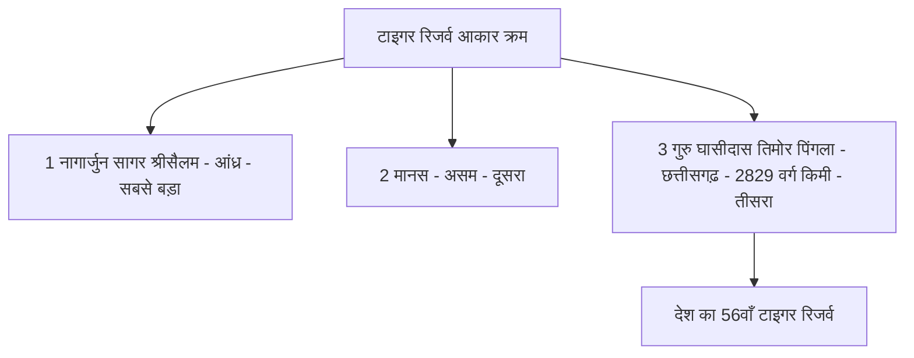

---

### प्रश्न 140: पेंगोलिन के व्यापार और शिकार पर प्रतिबंध

**प्रश्न:**
हाल ही में पेंगोलिन के व्यापार और शिकार पर किस राज्य द्वारा प्रतिबंध लगाया गया है?

**विकल्प:**
- A - छत्तीसगढ़
- B - असम
- C - नागालैंड
- D - मेघालय

**सही उत्तर:** C - नागालैंड

**हल:**
- चरण 1 - जीव पहचानें - पेंगोलिन - एक संरक्षित वन्य जीव - एनवायरनमेंट से संबंधित प्रश्न
- चरण 2 - घटना - व्यापार और शिकार पर प्रतिबंध - शिक्षक ने कहा जीवों पर शिकार पर प्रतिबंध बिल्कुल लगाना चाहिए
- चरण 3 - राज्य - नागालैंड ने ऐसा किया है - शिक्षक ने कहा ऐसा कारनामा हमारे देश में जो नागालैंड है उसने किया है - तो नागालैंड ने इसके शिकार और व्यापार पर प्रतिबंध किया है
- चरण 4 - विकल्प C में नागालैंड है - इसलिए C सही
- चरण 5 - अन्य राज्य इस विशिष्ट प्रतिबंध से संबंधित नहीं हैं - इसलिए बाहर
- चरण 6 - 140 नंबर का उत्तर ऑप्शन सी था - शिक्षक ने यही कहा

**ट्रिक / कॉन्सेप्ट:**
- पेंगोलिन = नागालैंड = व्यापार और शिकार पर प्रतिबंध - तीन शब्द एक साथ
- पूर्वोत्तर वाला राज्य - नागालैंड - एनवायरनमेंट में पूर्वोत्तर जीवों पर अक्सर प्रश्न

---

### प्रश्न 141: आईयूसीएन का नवीनतम सदस्य देश

**प्रश्न:**
आईयूसीएन का नवीनतम सदस्य देश कौन है? 89वाँ सदस्य कौन बना है?

**विकल्प:**
- A - भूटान
- B - नेपाल
- C - आर्मेनिया
- D - अजरबैजान

**सही उत्तर:** C - आर्मेनिया - 89वाँ सदस्य देश

**हल:**
- चरण 1 - संस्था पहचानें - आईयूसीएन - इंटरनेशनल यूनियन फॉर कंजर्वेशन ऑफ नेचर - प्रकृति संरक्षण संघ
- चरण 2 - प्रश्न - नवीनतम सदस्य - 89वाँ सदस्य देश - हाल ही में बना है
- चरण 3 - उत्तर - आर्मेनिया - शिक्षक ने कहा सबसे न्यूनतम सदस्य जो हाल ही में बना है वो बना है 89वाँ सदस्य देश और 89 नंबर पर हाल ही में आया है आर्मेनिया - इसलिए जवाब आर्मेनिया
- चरण 4 - विकल्प C में आर्मेनिया है - इसलिए C सही
- चरण 5 - शिक्षक ने कहा इसलिए इसका जवाब क्या हो जाएगा - ऑप्शन सी होगा
- चरण 6 - 89वाँ वाला आंकड़ा ही पहचान है

**ट्रिक / कॉन्सेप्ट:**
- आईयूसीएन = 89वाँ सदस्य = आर्मेनिया - संख्या और देश एक साथ
- 89 वाला आंकड़ा ही ट्रिक है - 89 दिखे तो आर्मेनिया

---

### प्रश्न 142: केंद्रीय औद्योगिक सुरक्षा बल सीआईएसएफ

**प्रश्न:**
केंद्रीय औद्योगिक सुरक्षा बल सीआईएसएफ के संदर्भ में सत्य कथन की पहचान कीजिए -
- कथन 1 - इसकी स्थापना 10 मार्च 1969 को हुई थी
- कथन 2 - इसका मुख्यालय हैदराबाद में है / इसका मुख्यालय नई दिल्ली में है (विकल्प में दिया गया)

**विकल्प:**
- A - केवल 1 सही है
- B - केवल 2 सही है
- C - 1 और 2 दोनों सही हैं
- D - न तो 1 सही है न ही 2 सही है

**सही उत्तर:** A - केवल 1 सही है

**हल:**
- चरण 1 - कथन 1 को परखें - स्थापना 1969 में 10 मार्च को - शिक्षक ने कहा इसकी स्थापना 1969 में 10 मार्च को हुआ था - यह पहला स्टेटमेंट सही है
- चरण 2 - कथन 2 को परखें - मुख्यालय की बात - यदि विकल्प में हैदराबाद लिखा हो तो गलत - शिक्षक ने कहा अगर हम मुख्यालय की बात करें तो इसका मुख्यालय नई दिल्ली में है - कहाँ पर है बाबू - न्यू दिल्ली में है
- चरण 3 - इसलिए मुख्यालय नई दिल्ली वाला कथन सही, हैदराबाद वाला गलत - प्रश्न में यदि दूसरा कथन हैदराबाद वाला था तो वह गलत हो गया
- चरण 4 - इसलिए केवल कथन 1 सही - उत्तर ऑप्शन ए - शिक्षक ने कहा इस प्रश्न का उत्तर हो जाता ऑप्शन ए - ठीक है - मुख्यालय नई दिल्ली में है
- चरण 5 - स्थापना तिथि और मुख्यालय दोनों अलग-अलग याद रखें

**ट्रिक / कॉन्सेप्ट:**
- सीआईएसएफ - स्थापना 10 मार्च 1969 - मुख्यालय नई दिल्ली - दो बिंदु रट्टा
- मुख्यालय वाला भ्रम ही परीक्षा में गलत कराता है - नई दिल्ली बनाम हैदराबाद - नई दिल्ली सही
- केवल 1 सही दिखे तो ए टिक करें

---

### प्रश्न 143: भारत का पहला झुग्गी मुक्त शहर

**प्रश्न:**
हाल ही में भारत का पहला झुग्गी मुक्त शहर कौन बना है?

**विकल्प:**
- A - चंडीगढ़
- B - इंदौर
- C - सूरत
- D - पुणे

**सही उत्तर:** A - चंडीगढ़

**हल:**
- चरण 1 - प्रश्न को समझें - झुग्गी मुक्त शहर - उस शहर में कोई भी झुग्गी नहीं है - हाल ही में घोषित
- चरण 2 - उत्तर - चंडीगढ़ बना है - शिक्षक ने कहा झुग्गी मुक्त जो शहर बना है वो चंडीगढ़ बना है - तो सभी लोग इसका उत्तर जरूर लगाए होंगे - चंडीगढ़
- चरण 3 - शिक्षक ने टिप्पणी की - पता नहीं वहाँ रहने वाले झुग्गी वालों को कहीं प्लेसमेंट किया गया है अच्छे से या केवल निकाल कर भगा दिया गया है - यह चर्चा का बिंदु है पर उत्तर चंडीगढ़ ही है
- चरण 4 - अन्य शहर इंदौर, सूरत, पुणे इस विशिष्ट टैग से नहीं हैं - इसलिए A सही
- चरण 5 - पहला झुग्गी मुक्त वाला टैग ही पहचान है

**ट्रिक / कॉन्सेप्ट:**
- पहला झुग्गी मुक्त शहर = चंडीगढ़ - दो शब्द एक साथ
- झुग्गी मुक्त = कोई झुग्गी नहीं - चंडीगढ़ से जोड़ें

---

### प्रश्न 144: भारत का पहला बाल विवाह मुक्त जिला

**प्रश्न:**
हाल ही में भारत का पहला बाल विवाह मुक्त जिला कौन सा बना है? वह पहला जिला जहाँ अब कोई भी बाल विवाह का केस सामने नहीं आता है और लड़कियों की शादी 18 वर्ष के बाद होती है।

**विकल्प:**
- A - बालोद, छत्तीसगढ़
- B - दुर्ग, छत्तीसगढ़
- C - रायपुर, छत्तीसगढ़
- D - बिलासपुर, छत्तीसगढ़

**सही उत्तर:** A - बालोद, छत्तीसगढ़

**हल:**
- चरण 1 - प्रश्न को समझें - बाल विवाह मुक्त जिला - कोई बाल विवाह नहीं - 18 वर्ष के बाद ही शादी - हाल ही में घोषित
- चरण 2 - राज्य - छत्तीसगढ़ - शिक्षक ने कहा छत्तीसगढ़ का एक डिस्ट्रिक्ट है - छत्तीसगढ़
- चरण 3 - जिला - बालोद - शिक्षक ने कहा सही डिस्ट्रिक्ट का नाम बालोद है - याद रखिएगा छत्तीसगढ़ का एक जिला है बालोद - देखिए कितना खतरनाक क्वेश्चन है - ये भी छत्तीसगढ़ ये भी छत्तीसगढ़ - लेकिन सही बालोद है
- चरण 4 - शिक्षक ने कहा यह भी छत्तीसगढ़, यह भी छत्तीसगढ़ लेकिन सही बालोद है - इसलिए आपको डिटेल तैयार करना है
- चरण 5 - अन्य विकल्प दुर्ग, रायपुर, बिलासपुर भी छत्तीसगढ़ के जिले हैं पर पहला बाल विवाह मुक्त बालोद ही है - इसलिए A सही

**ट्रिक / कॉन्सेप्ट:**
- पहला बाल विवाह मुक्त जिला = बालोद = छत्तीसगढ़ = 18 वर्ष के बाद शादी - चार बिंदु एक साथ
- छत्तीसगढ़ के तीन-चार जिलों में भ्रम कराया जाता है - बालोद ही पक्का उत्तर - नाम से बाल विवाह का बाल याद करें

---

### प्रश्न 145: यूनिसेफ स्थापना दिवस

**प्रश्न:**
हाल ही में यूनिसेफ का स्थापना दिवस कब मनाया गया? यूनिसेफ की स्थापना कब हुई थी और इसका मुख्यालय कहाँ है?

**विकल्प:**
- A - 11 दिसंबर 1946 - न्यूयॉर्क
- B - 11 दिसंबर 2025 को स्थापना दिवस - स्थापना 11 दिसंबर 1946 - मुख्यालय न्यूयॉर्क
- C - 20 नवंबर 1946
- D - 10 दिसंबर 1946

**सही उत्तर:** B - 11 दिसंबर 2025 को स्थापना दिवस मनाया गया - मूल स्थापना 11 दिसंबर 1946 - मुख्यालय न्यूयॉर्क, अमेरिका

**हल:**
- चरण 1 - यूनिसेफ क्या है - बच्चों वाला संगठन - यूनाइटेड नेशंस इंटरनेशनल चिल्ड्रेन्स इमरजेंसी फंड - बच्चों के लिए
- चरण 2 - स्थापना तिथि - 11 दिसंबर 1946 को स्थापना हुई थी - शिक्षक ने कहा यूनिसेफ की स्थापना 11 दिसंबर 1946 को हुई थी
- चरण 3 - मुख्यालय - न्यूयॉर्क में है - शिक्षक ने कहा इसका मुख्यालय न्यूयॉर्क में है - कहाँ पर - न्यूयॉर्क - अमेरिका के न्यूयॉर्क में
- चरण 4 - हाल का दिवस - इसका 11 को हुआ था - तो आप काउंट करके निकाल सकते हैं - इस प्रश्न का सही जवाब बी लगाना था - यानी 11 दिसंबर 2025 को इसने अपनी स्थापना दिवस मनाया है - शिक्षक ने यही कहा
- चरण 5 - स्थापना 1946 से 2025 तक 79 वर्ष हुए - पर विकल्प में तिथि ही मुख्य है - इसलिए B सही
- चरण 6 - मुख्यालय न्यूयॉर्क वाला बिंदु भी पूछा जा सकता है

**ट्रिक / कॉन्सेप्ट:**
- यूनिसेफ = 11 दिसंबर 1946 स्थापना + न्यूयॉर्क मुख्यालय + 11 दिसंबर 2025 दिवस - तीन तिथि-स्थान एक साथ
- 11 दिसंबर ही दोनों की पहचान - स्थापना और दिवस एक ही तिथि

---

### प्रश्न 146: भारत-किरगिस्तान संयुक्त सैन्य अभ्यास खंजर 2026

**प्रश्न:**
हाल ही में भारत और किरगिस्तान के बीच संयुक्त सैन्य अभ्यास खंजर 2026 कहाँ संपन्न हुआ है? यह कौन सा संस्करण है?

**विकल्प:**
- A - जोधपुर, राजस्थान
- B - मिसामारी, असम
- C - पिथौरागढ़, उत्तराखंड
- D - जयपुर, राजस्थान

**सही उत्तर:** B - मिसामारी, असम - 13वाँ संस्करण - फरवरी 2026 में संपन्न

**हल:**
- चरण 1 - अभ्यास का नाम - खंजर - भारत और किरगिस्तान के बीच होता है - शिक्षक ने कहा खंजर भारत और किरगिस्तान के बीच में होता है
- चरण 2 - प्रश्न - कहाँ हुआ - हाल ही में संपन्न हुआ - शिक्षक ने कहा यह कहाँ संपन्न हुआ है यह बताना है
- चरण 3 - स्थान - मिसामारी जगह है और यह जगह असम में है - शिक्षक ने कहा एक मिसामारी जगह है और यह जगह असम में है - वहीं असम में अभी संपन्न हुआ - हाल ही में संपन्न हुआ था - यानी फरवरी 2026 में संपन्न हुआ है खंजर का
- चरण 4 - संस्करण - यह 13वाँ संस्करण है - शिक्षक ने कहा यह जो अभी संस्करण हुआ है यह 13वाँ संस्करण है - यह भी पूछा जाता है
- चरण 5 - विकल्प B में मिसामारी, असम है - इसलिए B सही - शिक्षक ने कहा ऑप्शन क्या हो जाएगा इसका - बी होगा - हाँ
- चरण 6 - परीक्षा में तीन बिंदु पूछे जाते हैं - किन देशों के बीच, कौन सा संस्करण, कहाँ हुआ - तीनों तैयार रखें
- चरण 7 - शिक्षक ने कहा संयुक्त सैन्य अभ्यास से प्रश्न हमेशा एक पूछा जाता है - इसलिए महत्वपूर्ण

**ट्रिक / कॉन्सेप्ट:**
- खंजर = भारत + किरगिस्तान + मिसामारी असम + फरवरी 2026 + 13वाँ संस्करण - पाँच बिंदु एक साथ
- खंजर नाम से किरगिस्तान जोड़ें - ख से खंजर ख से किरगिस्तान
- मिसामारी = असम - स्थान का रट्टा

---

### प्रश्न 147: एशिया पावर इंडेक्स 2025 में भारत का स्थान

**प्रश्न:**
एशिया पावर इंडेक्स 2025 में भारत ने कौन सा स्थान प्राप्त किया है?

**विकल्प:**
- A - पहला स्थान
- B - दूसरा स्थान
- C - तीसरा स्थान
- D - चौथा स्थान

**सही उत्तर:** C - तीसरा स्थान

**हल:**
- चरण 1 - रिपोर्ट - एशिया पावर इंडेक्स 2025 - वर्ष 2025 का - हाल ही का इंडेक्स
- चरण 2 - पहला स्थान - अमेरिका का है - शिक्षक ने कहा पहला स्थान यूएसए का है - याद रखिएगा
- चरण 3 - दूसरा स्थान - चीन ने प्राप्त किया है - शिक्षक ने कहा दूसरा स्थान चीन ने प्राप्त किया है
- चरण 4 - तीसरा स्थान - हम लोगों का स्थान यानी इंडिया का स्थान तीसरा है - शिक्षक ने कहा इंडिया का स्थान बाबू तीसरा है
- चरण 5 - इसलिए भारत तीसरे पर - विकल्प C सही - शिक्षक ने कहा इस कारण इस प्रश्न का सही जवाब ऑप्शन सी था - यानी तीसरा स्थान - यह बात क्लियर है
- चरण 6 - क्रम - 1 यूएसए, 2 चीन, 3 भारत - यह क्रम ही परीक्षा में पूछा जाता है

**ट्रिक / कॉन्सेप्ट:**
- एशिया पावर इंडेक्स 2025 = 1 यूएसए, 2 चीन, 3 भारत - तीन देश क्रम से
- भारत तीसरा - यह संख्या ही पहचान है

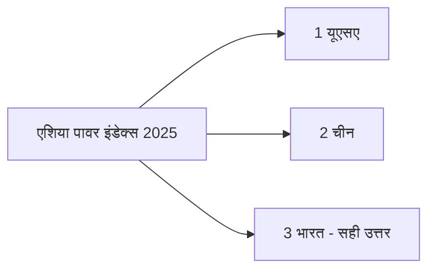

---

### प्रश्न 148: पुरुषों के टेस्ट मैच में अंपायरिंग करने वाली पहली महिला अंपायर

**प्रश्न:**
पुरुषों के टेस्ट मैच में अंपायरिंग करने वाली पहली महिला अंपायर कौन हैं?

**विकल्प:**
- A - क्लेयर पोलोसक
- B - वृंदा राठी
- C - किम कॉटन
- D - सु रेडफर्न

**सही उत्तर:** A - क्लेयर पोलोसक - ऑस्ट्रेलिया

**हल:**
- चरण 1 - शर्त समझें - पुरुषों का टेस्ट मैच हो रहा हो और उसमें कोई महिला अंपायर हो - यह कंडीशन है - शिक्षक ने कहा कंडीशन है पुरुषों का टेस्ट मैच में अंपायरिंग करने वाली पहली महिला अंपायर कौन सा है - ध्यान रखिएगा इस बात को
- चरण 2 - उत्तर - क्लेयर पोलोसक - शिक्षक ने कहा इस प्रश्न का सही जवाब क्लेयर पोलोसक होगा
- चरण 3 - देश - ऑस्ट्रेलिया की हैं - शिक्षक ने कहा ये ऑस्ट्रेलिया की हैं - पहली बात याद रखना है कि ये किस देश की हैं - तो ये ऑस्ट्रेलिया की हैं
- चरण 4 - किस टेस्ट मैच में - सिडनी टेस्ट मैच में - शिक्षक ने तीन बार दोहराया सिडनी टेस्ट मैच में
- चरण 5 - कब हुआ था - 2021 में हुआ था - शिक्षक ने कहा यह मैच हुआ था 2021 में
- चरण 6 - किनके बीच हुआ था - भारत बनाम ऑस्ट्रेलिया के बीच हुआ था - शिक्षक ने कहा भारत बनाम ऑस्ट्रेलिया में हुआ था
- चरण 7 - किस भूमिका में - फोर्थ अंपायर के रूप में सौभाग्य प्राप्त हुआ और रिकॉर्ड हासिल किया - शिक्षक ने कहा इसी में इनको फोर्थ अंपायर करने का सौभाग्य प्राप्त हुआ और रिकॉर्ड इन्होंने हासिल किया
- चरण 8 - इसलिए A क्लेयर पोलोसक सही

**ट्रिक / कॉन्सेप्ट:**
- पुरुष टेस्ट में पहली महिला अंपायर = क्लेयर पोलोसक = ऑस्ट्रेलिया = सिडनी टेस्ट = 2021 = भारत बनाम ऑस्ट्रेलिया = फोर्थ अंपायर - सात बिंदु एक साथ
- ऑस्ट्रेलिया और सिडनी से जोड़ें - देश और शहर एक साथ
- फोर्थ अंपायर वाला पद भी पूछा जा सकता है

---

### प्रश्न 149: प्रो कबड्डी लीग 12वाँ संस्करण

**प्रश्न:**
हाल ही में प्रो कबड्डी लीग के 12वें संस्करण का खिताब किसने जीता है?

**विकल्प:**
- A - पटना पाइरेट्स
- B - दबंग दिल्ली
- C - जयपुर पिंक पैंथर्स
- D - बंगाल वॉरियर्स

**सही उत्तर:** B - दबंग दिल्ली

**हल:**
- चरण 1 - लीग - प्रो कबड्डी लीग - हाल ही में आयोजन हुआ - 12वाँ संस्करण था - स्पोर्ट से जीके का प्रश्न
- चरण 2 - विजेता - दबंग दिल्ली ने अपने नाम किया था - शिक्षक ने कहा दबंग दिल्ली ने इसको अपने नाम किया था - किसी ने इसे अपने नाम किया था
- चरण 3 - विकल्प B में दबंग दिल्ली है - इसलिए B सही - शिक्षक ने कहा ऑप्शन क्या होगा - बी होगा
- चरण 4 - 12वाँ वाला संस्करण संख्या भी याद रखें

**ट्रिक / कॉन्सेप्ट:**
- प्रो कबड्डी 12वाँ = दबंग दिल्ली - दो शब्द एक साथ
- 12वाँ संस्करण ही पहचान है - दबंग शब्द से दिल्ली जोड़ें

---

### प्रश्न 150: चौथी दक्षिण एशियाई एथलेटिक्स चैंपियनशिप 2025 रांची

**प्रश्न:**
हाल ही में झारखंड के रांची में आयोजित चौथी दक्षिण एशियाई एथलेटिक्स चैंपियनशिप 2025 में पहला स्थान किस देश ने हासिल किया है?

**विकल्प:**
- A - भारत
- B - श्रीलंका
- C - नेपाल
- D - बांग्लादेश

**सही उत्तर:** A - भारत

**हल:**
- चरण 1 - आयोजन - चौथे नंबर की दक्षिण एशियाई एथलीट चैंपियनशिप 2025 - हाल ही में झारखंड के रांची में आयोजित - शिक्षक ने कहा हाल ही में झारखंड के रांची में आयोजित जो चौथे नंबर की दक्षिण एशियाई एथलेटिक्स चैंपियनशिप 2025 है
- चरण 2 - प्रश्न - किस देश ने पहला स्थान हासिल किया - अंतिम क्वेश्चन है - अपने देश के साथ समापन - शिक्षक ने कहा अंतिम क्वेश्चन है अपने देश के साथ समापन करते हैं
- चरण 3 - उत्तर - भारत ने फर्स्ट रैंक हासिल किया है - शिक्षक ने कहा इस प्रश्न का सही जवाब भारत है - फर्स्ट रैंक हासिल किया है कौन है - भारत है
- चरण 4 - विकल्प A में भारत है - इसलिए A सही
- चरण 5 - शिक्षक ने कहा यहाँ पर आपने इस प्रश्न को सॉल्व कर लिया - जो 30 क्वेश्चन करंट अफेयर्स और स्टैटिक जीके जीएस से थे उसका सभी का सलूशन हमने दे दिया
- चरण 6 - रांची झारखंड वाला स्थान भी परीक्षा में पूछा जा सकता है - चौथी चैंपियनशिप + रांची

**ट्रिक / कॉन्सेप्ट:**
- चौथी दक्षिण एशियाई एथलेटिक्स 2025 = रांची झारखंड + भारत प्रथम - तीन बिंदु एक साथ
- अंतिम प्रश्न भारत के साथ समापन - भारत प्रथम ही सकारात्मक अंत है

---

### समापन - शिक्षक के अंतिम संदेश, रणनीति और अगले कदम

- 30 प्रश्नों का समापन - शिक्षक ने कहा जो आपके 30 क्वेश्चन करंट अफेयर्स और स्टैटिक जीके जीएस से थे उसका सभी का सलूशन हमने दे दिया - 121 से 150 तक के सभी प्रश्न इसी भाग में पूरे हुए - टेस्ट पेपर का सबसे अंतिम प्रश्न यही था
- जीके/जीएस बैच की सूचना - शिक्षक ने कहा यह जीके जीएस संबंधित जो बैच है जिसके बारे में हमने चर्चा किया है - फिर से दोबारा यह चीज यहाँ पर है - आप लोग इसे देख लीजिएगा - टेस्ट पेपर संस्थान की दोनों ब्रांचों के ऑफिस में उपलब्ध है
- ऑफलाइन क्लास की सूचना - शिक्षक ने सभी ऑफलाइन ज्ञान गंगा के बच्चों को आश्वस्त किया - सभी को समय के साथ करंट अफेयर्स की क्लास सब में चलेगी - अभी इस समय बंद रोड ब्रांच पर सुबह 6:30 बजे की क्लास ले रहे हैं - जैसे ही यह खत्म हो जाएगा तो इसके बाद गोविंदपुर आएंगे - तो गोविंदपुर ब्रांच में आएंगे - यहाँ पर बैच कंप्लीट कर लें फिर उसके बाद वहाँ पर आते हैं
- कल की क्लास - कल सुबह 6:30 बजे नियमित टाइम पर क्लास रहेगी - सभी लोगों की उपस्थिति अनिवार्य है - शिक्षक ने कहा मैं चाहूंगा कि सभी लोग आएं - ठीक है स्टूडेंट्स
- करंट अफेयर्स तैयार करने का तरीका - शिक्षक ने एक बढ़िया तरीका बताया -
  - जब भी किसी बैच में करंट अफेयर्स पढ़ाते हैं और हर एक टॉपिक पर जो नोट्स या बुकलेट उपलब्ध कराते हैं वो टेलीग्राम से डाउनलोड कर लिया करें
  - उस बैच में पढ़ने वाले किसी भी स्टूडेंट से वह बुकलेट थोड़ी देर के लिए ले लें जिस पर सर ने बुकलेट को सॉल्व कराया है
  - उस पर अपना आंसर लगा लें - तो अपडेटिंग होती रहेगी - शिक्षक ने कहा अपडेटिंग आपकी होती रहेगी
- प्रेरणा और भोजपुरी - एक छात्र सुभान/सुभांकर ने कहा बहुत निक सेशन है - शिक्षक ने कहा आपने निक शब्द का इस्तेमाल किया - निक शब्द एक भोजपुरी शब्द है - ठीक है अच्छी बात है - चलिए
- अंतिम धन्यवाद - शिक्षक ने कहा ठीक है स्टूडेंट्स हम लोग फिर मिलेंगे अपने नेक्स्ट सेशन में - ओके स्टूडेंट्स धन्यवाद - इसी के साथ मॉक टेस्ट-06 का पेपर एनालिसिस पूरा हुआ
- परीक्षा रणनीति के लिए सार -
  - जीके/जीएस के 30 प्रश्नों में हर प्रश्न का करंट अफेयर्स हुक - महीना, स्थान, व्यक्ति, राशि, संस्करण - को अलग से रट्टा करें
  - सुमेलन वाले प्रश्नों में पहले एक-दो युग्म पक्का करें तो बाकी स्वतः बैठ जाते हैं
  - रैंक, स्थापना दिवस, पहला वाला टैग - पहला निजी तेल भंडार, पहली महिला अध्यक्ष, पहली झुग्गी मुक्त, पहला बाल विवाह मुक्त - पहला शब्द ही उत्तर की पहचान है
  - अभ्यास के लिए ज्ञान गंगा की बुकलेट को टेलीग्राम से डाउनलोड करके उसी पर आंसर लगाकर दोहराव करें - यही अपडेट रहने का सबसे तेज तरीका है

---

> यह सार part_10.md (4011 शब्द) पर आधारित है - शून्य सूचना हानि के लक्ष्य से हर प्रश्न का कथन, विकल्प, उत्तर, हल और ट्रिक यथासंभव संरक्षित किया गया है। यह SUPER TET 2026 Mock Test-06 के 10 भागों की श्रृंखला का अंतिम भाग है - इसके साथ पूरा पेपर एनालिसिस समाप्त होता है।

